# AutoNavAlerts — Design

> Status: **Draft for review**. No code is written until this document is approved. Any later design change is made here first.

---

## 1. Goals, non-goals, decisions, prerequisites

### 1.1 Goals
- An Android Auto navigation app that can **stand in for Google Maps on the head unit**:
  - Google map tiles, traffic, place search, route preview with alternatives, and turn-by-turn guidance with lane info, voice and the cluster/HUD.
- A **generic POI alert system**:
  - Any POI file can be imported.
  - Each import set has its own icon and spoken alert text.
  - Alerts check direction, so only POIs facing your direction of travel fire.
  - PocketGPSWorld (PGW) speed cameras are the first source, synced automatically.
- POI alerts go out **the same way as nav instructions**:
  - navigation-guidance audio that lowers the media volume
  - a navigation heads-up card
  - the cluster
- **Lives alongside media**: Android Auto's split-screen layout shows the media card next to our map, and our alerts and turn info still appear when media is full screen.
- **Uses as little power as it can** while taking the GPS at the rate the phone offers, never forcing a faster one (owner, 2026-10-24, §10.2).
- **Navigate to contacts**: drive to any postal address saved in the phone's contacts (§8.3).
- **Speed and speed limit on screen at all times**: your current speed next to the road's speed limit as Google Maps reports it. The display turns amber or red when you're over the limit (§8.4).
- **People finder (Home Assistant)**: navigate to the live location of people tracked in your Home Assistant, such as a child or a relative living with dementia. The route updates as they move (§17).

### 1.2 Non-goals (v1)
- Full navigation UI on the phone. The phone is for settings and import only.
- Android Automotive OS (built-in car systems, as opposed to phone projection). The design doesn't rule it out but isn't aimed at it.
- Offline maps or routing. Map tiles and routing come from the Navigation SDK and need a connection, though POIs work offline.
- Public Google Play publication (store listing, review, open or production tracks). Distribution is Play's **internal testing track** since 2026-10-24 (§1.3 Distribution, §13.3 "Google Play"); the ADB sideload is the developer path.
- Sharing POI data between users. Each user brings their own data, as PGW licensing requires.

### 1.3 Decisions made
| Topic | Decision | Reason |
|---|---|---|
| Build stamp | `BuildConfig.GIT_COMMIT` = `git rev-parse --short=9 HEAD`, plus `-dirty` when the working tree has changes, set at configure time with `providers.exec` (configuration-cache safe); shown as "Build <commit> (debug)" in Settings → About (owner, 2026-10-12) | So a phone can be matched to a commit |
| Diagnostics | **Two always-on debug logs** on the phone (`debug-nav.log`: route, map, navigation; `alert-debug.log`: alerts and what was done at each camera), written in **15-second batches**, plus an opt-in drive recorder (§15.5) (owner, 2026-10-12) | The owner's phone drops app logcat, and the first real drive left no evidence of what went wrong. Tiny by rate rules and a size cap, not by a toggle |
| Licence | **Apache License 2.0** (`LICENSE`, `NOTICE`, SPDX header in each source file) | Open-source licence chosen by the owner. PGW data is never part of the project (§6.4). |
| Language | Kotlin only | Car App Library and Navigation SDK are JVM-only. A cross-platform engine adds power drain. |
| Map/routing/search | Google Navigation SDK + Places API (New) | Closest to the real Google Maps; supports Android Auto directly |
| POI data | Generic framework. **PGW is the only automatic source** (RSS-triggered sync). **Free and other POI files are loaded by hand only**, with no automatic fetching or URL subscriptions. | Not limited to speed cameras; you decide when third-party data changes |
| PGW format | iGO TXT as the main format | Carries direction type and bearing |
| Distribution | **Google Play internal testing track** (owner, 2026-10-24; live since 22:10 that day; current release 2 = `0.0.2-2026-10-24`, version code 2, published 22:28 with native debug symbols and no Console warning). Play App Signing with the **shared key** as the app signing key, so the SHA-1 is unchanged and the users' Maps keys, the OAuth client and existing installs stay valid. Testers join by the opt-in link in docs/INSTALLATION.md once their Google account is on the tester list; no Play review. The ADB sideload (`adb install -r -i com.android.vending`, Android Auto developer mode) stays as the **developer and bench path**. Rules in §13.3 "Google Play". | Google's testing guide: Android Auto's "Unknown sources" setting "doesn't apply to apps built using the Android for Cars App Library"; such apps "must install from a trusted source such as Google Play", and the internal test track or internal app sharing do that "without going through the Google Play review process" (developer.android.com/training/cars/testing). On the owner's phone the sideloaded app runs on a head unit but is never kept in Android Auto's Customise Launcher list across a reboot (§16 row 10). |
| Phone UI | Settings, import and editing only | All driving use happens on the car screen |
| People finder | Home Assistant REST + WebSocket API, `person.*` / `device_tracker.*` entities, long-lived access token (v1) | HA already brings together the family's phone, tracker-tag and companion-app locations; no new tracking setup needed |
| GPS rate | Phone: **the rate the phone offers, never forced** (asked at 1 Hz, any faster fix it delivers accepted; owner, 2026-10-24, §10.2; was always 10 Hz from 2026-10-12). Car speed and car GPS: **the fastest rate the car can provide** (`UPDATE_RATE_FASTEST`, §10.6–10.7; owner, 2026-10-12) | Alerts fire at accurate distances and the map is always fresh; costs more battery when slow |
| **Camera direction (hard rule)** | A camera alerts only when it faces your direction of travel (§11 step 3). Never dropped, loosened or defaulted to "any direction" when the data gives one | Alerts for the other carriageway are wrong and noisy; set by the owner, 2026-10-12 |
| **Car-map buttons (hard rule)** | All our on-screen buttons on the car map are on the **right-hand side only** (§8) | One control column on the right; set by the owner, 2026-10-12 |
| **Nothing dead, nothing twice on the car screen (hard rule)** | **Every element visible on the car screen must work, and no function is shown twice.** Anything that can't take a tap or has no job on Android Auto (the SDK's own ETA card, header, recenter, speedometer, trip bar, limit icon) is turned off or hidden (§8 step 6); one element per job so the screen estate is kept (the X on the host's travel-estimate card is the one cancel; we add no stop action, owner 2026-10-13); every UI change is checked on a DHU screenshot during guidance before it's called done | Two "stop" affordances with one dead was seen on 2026-10-13; set by the owner the same day ("nothing should be showing on the UI that doesn't function"; "not placing duplicate functionality on the display as the screen estate [is] to be maintained") |
| **No shake on the car screen (hard rule)** | **A screen that is holding still must look still.** A template is re-sent (`invalidate()`) only when something the driver can see has changed; never on a timer for its own sake. The host animates every refresh, so an identical template re-sent once a second made the More screen's rows judder while the car was parked. Any live row (GPS, Alerts, a countdown) compares its lines first and invalidates only on a change; the same goes for any view of ours on the map (no redraw loops at a fixed rate with unchanged content). Checked with a burst of DHU screenshots: consecutive frames of a still screen must be identical | Seen on the bench by the owner on 2026-10-13 ("why is there a shake on the head unit"); owner: "make sure it's a hard requirement not to cause the shake" |
| Tolls | **Avoided by default** (setting, §8.3a) | The owner's choice |
| EV routing | Optional **energy-efficient routes** from Google's Routes API (eco-friendly route for an electric vehicle), followed by the Navigation SDK through a route token (§8.3a); falls back to the fastest route | The Navigation SDK has no energy option of its own |
| Speed limits | Google's when it gives one, else a camera's, else OpenStreetMap's from **one bulk download** (Geofabrik, the whole UK) kept on the phone (§8.4–8.4a). Never live OSM lookups | Google only gives apps the limit while you're speeding |
| Spoken directions | **We speak the turn-by-turn directions** (the Navigation SDK's voice off) in **the phone's default TTS voice**, the same voice as the alerts; no voice setting (owner, 2026-10-23) | The SDK's recorded voice can't be chosen and didn't match the alerts (§12.3) |
| Memory | Big data is streamed from disk, never held whole in RAM: zip entries are read when used (§5.2), a picked single file is copied to a temp file and OV2, iGO and CSV are parsed from it record by record; KML and GPX (read as a whole document) are refused above 50 MB (2026-10-13), the speed-limit download spills to disk and lookups load only the tiles around the car (§8.4a) | The phone also runs the map, Android Auto and media |

### 1.4 Prerequisites
1. Google Cloud project with billing; **Navigation SDK** (access approval required) and **Places API (New)** enabled. API key restricted to the app package and signing SHA-1. **Each user gets their own key in the phone app (Settings tab, setup sections) after installing: either the app creates it with the Google account on the phone (§13.1), or they paste one.** It's stored encrypted with the Keystore and applied at run time with `NavigationApi.setApiKey()` and `Places.initializeWithNewPlacesApiEnabled()`. **There is never a built-in or build-time key, and no fallback of any kind** (owner's rule): every user's Maps, Navigation and Places use is billed to their own Google account, never the maintainer's. The app works only once the user has their own key.
   - **Where it lives:** `SettingsStore` keeps it as a Keystore-encrypted secret; `mapsApiKey()` returns it, or `null` when it's missing or blank. Nothing else is consulted: there's no `com.google.android.geo.API_KEY` in the manifest, no `local.properties` entry, and the Secrets Gradle plugin (which copied every `local.properties` entry into `BuildConfig`) has been removed.
   - **No SDK call before the key:** without a manifest key, *any* Navigation SDK call made before `NavigationApi.setApiKey()` crashes the app on a background thread ("API key not found. Check that <meta-data android:name="com.google.android.geo.API_KEY" …/> is in the <application> element"). So every SDK entry point goes through `NavigatorHolder.applyApiKey()` first, and does nothing when it returns false:
     | Call | Where | Guard |
     |---|---|---|
     | `NavigationApi.areTermsAccepted` | phone Settings, `termsAccepted()` | `NavigatorHolder.sdkTermsAccepted()` = `applyApiKey() && areTermsAccepted()`; the app's own record of acceptance is checked first |
     | `NavigationApi.showTermsAndConditionsDialog` | phone Settings | button disabled until a key is saved ("Add your Google Maps API key above first") |
     | `NavigationApi.getNavigator` / `getNavigatorNoToS` | `ensureNavigator()` | `applyApiKey()` first; no key → `NavUnavailable.NO_API_KEY` |
     | `NavigationViewForAuto` (car map) | `MapSurface` | created only after `applyApiKey()` succeeds (§8) |
     | Places client | `placesClient()` | `applyApiKey()` first |
   - **Changing the key:** saving or removing it calls `NavigatorHolder.keyChanged()`, which forgets the applied key and cleans up the Navigator, so the next use re-applies the new one.
   - **Who pays:** Maps use is billed to the Cloud project that owns the key. Each user's key is in their own project (§13.1), so the maintainer is never billed for anyone else. The app's own registration project (§13.3) has no billing at all.
2. An active PocketGPSWorld subscription.
3. A phone on the Play internal-testing list (§13.3 "Google Play"). For developer builds: a phone with Android Auto developer mode and "Unknown sources" enabled, and/or the Desktop Head Unit (DHU) on the dev machine.
4. *(People finder, optional)* A Home Assistant instance the phone can reach away from home (Nabu Casa Cloud, or your own HTTPS domain or VPN), with the people to find set up as `person` entities fed by the HA Companion app or another tracker. You create a long-lived access token for a HA user who can read those entities.
5. Dev machine (set up in phase 1):
   - Android SDK at `~/Android/Sdk`: platform **37.0** (compileSdk), build-tools 37, platform-tools, and the DHU (`extras/google/auto`).
   - No system JDK is needed. Gradle downloads JDK 21 itself through `gradle/gradle-daemon-jvm.properties` and the foojay toolchain resolver. Bytecode targets Java 17.
   - Versions: AGP 9.4.1 (built-in Kotlin), Kotlin 2.4.21, Gradle 9.8.1, Car App 1.7.0, Navigation SDK 8.0.0. minSdk 26, targetSdk 36.

---

## 2. System architecture

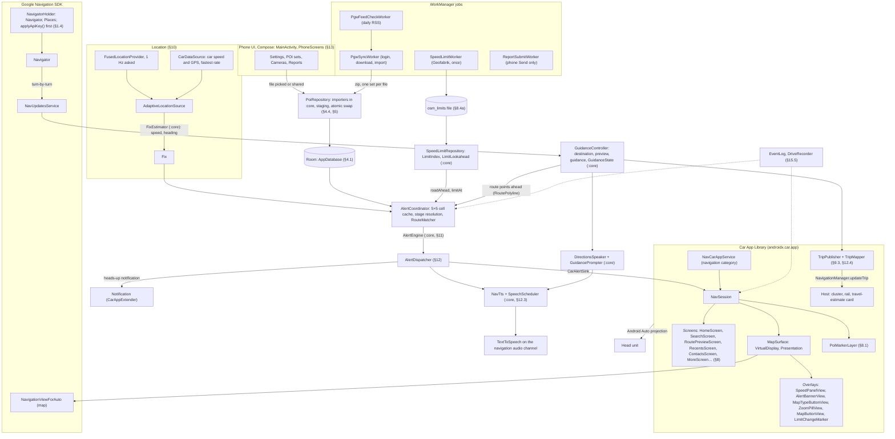

*Class names are the real ones in the source tree (§3). Dotted lines are diagnostics.*

**One fix, one alert, one sentence spoken** (the path every camera alert takes; threads in §2 "Threads"):

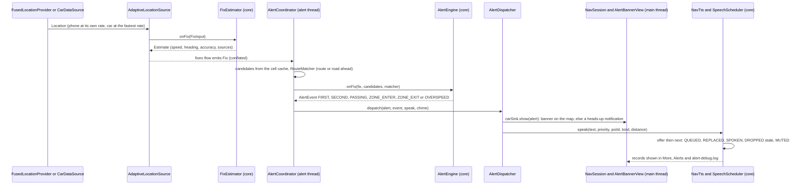


**Process model:** one APK and one process. The car service and phone UI share the same Hilt singletons (`NavigatorHolder`, `PoiRepository`, `AdaptiveLocationSource`, `CarDataSource`, `AlertCoordinator`, `AlertDispatcher`, `NavTts`, `GuidanceController`, `SettingsStore`, `EventLog`, `DriveRecorder`, …; the car side reaches them through `CarDeps`, since the host constructs sessions and screens). **As built (2026-10-24): there is no foreground service of our own.** `NavCarAppService` is declared with `foregroundServiceType="location"` (the navigation category needs it) and the Android Auto host keeps it bound for as long as the car is connected, which is what keeps location and alerts alive while the car screen is hidden behind media: `NavSession.onCreate` starts `CarDataSource`, `AlertCoordinator` (and with it `AdaptiveLocationSource`) and the drive recorder, and `onDestroy` stops them. `NavUpdatesService` is a plain bound service the Navigation SDK sends the turn-by-turn feed to. Alerts with no car connected (phone only) are not built (README "Planned").

**Threads:** all work uses coroutines.
- `Dispatchers.IO` for Room and network.
- The engine runs on the app scope (`App.appScope`, `Dispatchers.Default`), not a dedicated thread (as built): `AlertCoordinator` collects the location source's `fixes` flow **conflated**, so fixes are handled one at a time in order and a slow fix drops the ones behind it, and the engine is guarded by one lock. The design's "one alert thread" is met by serialisation, not by a thread of its own.
- The main thread only for the Car App Library and map calls.

---

## 3. Package layout and each class's job

**Two Gradle modules**:
- **`:core`**: plain Kotlin/JVM with no Android dependencies. It holds the logic that has to be right and is easy to unit-test on the JVM: geo maths, the grid, importers, the location estimator, the PGW feed and page parsers, the alert maths, the speech policy, the guidance prompts and the OpenStreetMap limit file.
- **`:app`**: the Android parts (Car App Library, Navigation SDK, Room, WorkManager, Compose), which call into `:core`.

The tree below is the source tree as it is (regenerated from the code on 2026-10-24; the namespace stays `io.autonav.alerts`, the application ID is `uk.damiendye.autonav`, §13.3). Each line is the class's job and the section that specifies it. Every class carries the same in its KDoc.

```
app/src/main/kotlin/io/autonav/alerts/
  App.kt                      Hilt application; the app-wide coroutine scope
  alerts/
    AlertCoordinator.kt       Runs AlertEngine on every fix; 5×5 cell cache; resolves each set's stages (lead-time slider); ActiveAlert for the UI; AlertTraceLog → alert-debug.log (§10–12, §11.1, §15.5)
    AlertDispatcher.kt        Routes an AlertEvent: the car banner via CarAlertSink, else a navigation heads-up notification; speech via NavTts (§12, §12.1, §12.2)
    NavTts.kt                 TextToSpeech on the navigation audio channel, audio focus (duck, never pause), drives the core SpeechScheduler; alerts and directions in one voice (§12.3)
  car/
    NavCarAppService.kt       The CarAppService Android Auto binds to; navigation category; host validator; geo:/NAVIGATE intents (§9.1)
    NavSession.kt             One car session: creates MapSurface, PoiMarkerLayer, TripPublisher; starts/stops CarDataSource, AlertCoordinator and the recorder; CarAlertSink → banner (§8, §9)
    CarDeps.kt                The car side's handle on the Hilt singletons (sessions and screens are built by the host) (§2)
    TripMapper.kt             NavInfo → RoutingInfo, TravelEstimate, Trip; displayKey so a template is re-sent only on change (§8, §12.4)
    TripPublisher.kt          NavigationManager.navigationStarted / updateTrip / navigationEnded from the session, whichever screen is on top (§9.3, §12.4)
    screens/HomeScreen.kt     The map: free drive or guidance; action strip Search · Report · Recents · More; one-tap Report (§8, §8.5)
    screens/SearchScreen.kt   SearchTemplate: Places autocomplete, recents in the empty state, contacts above the results (§8, §8.2, §8.3)
    screens/RoutePreviewScreen.kt  Route alternatives, Go; Back abandons the preview (§8, §8.3a)
    screens/ContactsScreen.kt Contacts with a postal address, recent first (§8.3)
    screens/VoiceCommentScreen.kt  Step 2 of a report: the spoken comment from the car mic; no review or Send in the car (§8.5)
    screens/ListScreens.kt    MoreScreen (live GPS/Alerts rows, re-sent only on change), RouteOptionsScreen, PoiLayersScreen, AlertsRecordsScreen, RecentsScreen, PlaceDetailScreen, ConfirmScreen (§8, §8.2, §8.3a, §12.3)
    screens/CarUi.kt          Small helpers shared by the car screens
  contacts/ContactsSource.kt  Contacts' postal addresses, geocoded on pick and cached (§8.3)
  data/
    AppDatabase.kt            Room database, migrations, DatabaseModule (§4.1, §11.1 MIGRATION_6_7)
    Entities.kt               PoiSetEntity, PoiCategoryEntity, PoiEntity, PlaceEntity, CameraReportEntity, ContactGeocodeEntity and their enums (§4.1)
    Daos.kt                   The DAOs for the above
    PoiRepository.kt          Import pipeline (file, zip, PGW zip), staging and atomic swap, cell queries, `changes` flow (§4.4, §5)
    IconRepository.kt         Built-in and user icons as cached bitmaps (§7.1)
    StageRules.kt             The §11.1 stage checks shared by the set editor and the backup restore
  diag/
    EventLog.kt               The two always-on 15 s-batched logs, debug-nav.log and alert-debug.log (§15.5)
    DriveRecorder.kt          Opt-in CSV of every fix and car report, for replay (§15.5)
    DiagFiles.kt              Save/Share of the logs through the FileProvider; DiagnosticsSnapshot (§15.5)
  map/
    MapSurface.kt             SurfaceCallback → VirtualDisplay → Presentation → NavigationViewForAuto; overlays; visible/stable areas; gestures; traffic always on; zoom cap 17; FollowWatchdog (§8)
    AlertBannerView.kt        The alert banner at the bottom of the map (§12.1)
    SpeedPanelView.kt         Speed and limit in one white pill, bottom right (§8.4)
    MapTypeButtonView.kt      The satellite toggle, top right (§8)
    ZoomPillView.kt           + over − in one pill, right column (§8)
    MapButtonView.kt          The round recenter button, right column; MapButtonColors (§8)
    LimitChangeMarker.kt      The next limit change on the map (§8.4a)
    PoiMarkerLayer.kt         Markers redrawn per fix as a diff; dimmed facing-away cameras; verdicts from the engine (§8.1)
    IncidentReporting.kt      Google's incident reporting: detected when a future SDK offers it on Android Auto (§16 #21)
  nav/
    NavigatorHolder.kt        The Navigator and Places client, created only after applyApiKey() (§1.4, §9)
    GuidanceController.kt     Destination, preview, routes, start/stop guidance (StopReason), route points ahead; GuidanceState in core (§8, §8.3a, §9.3)
    NavUpdatesService.kt      The service the Navigation SDK sends the turn-by-turn feed to (§9.3)
    DirectionsSpeaker.kt      Speaks the directions via NavTts while the SDK's voice is off; falls back to the SDK's voice (§12.3)
    EcoRoutes.kt              Energy-efficient route token from the Routes API, on the user's own key (§8.3a)
    LimitAnnouncer.kt         When to announce a limit change ahead (§8.4a)
    AdaptiveLocationSource.kt The phone's fused location at its own rate, the car's GPS while fresh, the simulator on the bench → Fix via FixEstimator; EstimateMapper; LocationStats for More → GPS (§10)
    CarDataSource.kt          Car speed and car GPS from CarHardwareManager at UPDATE_RATE_FASTEST (§10.6, §10.7)
  osm/
    SpeedLimitRepository.kt   The on-phone limit file: limitAt, roadAhead; LimitIndex and LimitLookahead from core (§8.4a)
    SpeedLimitWorker.kt       The one-off Geofabrik download, streamed, as a foreground WorkManager job (§8.4a)
    RemoteZip.kt              Reads one entry of a remote zip with HTTP range requests (§8.4a)
  pgw/
    PgwClient.kt              PocketGPSWorld login, feed check, download, report submission over HTTPS (§6, §8.5)
    PgwWorkers.kt             PgwScheduler (daily), PgwFeedCheckWorker, PgwSyncWorker (never while guiding), ReportSubmitWorker (phone Send only) (§6.2, §6.2a, §8.5)
  phone/
    MainActivity.kt           The phone UI host; PhoneDeps (§13)
    PhoneScreens.kt           The Compose screens: Settings (setup, key creation, backup, diagnostics), POIs, Cameras, Reports (§13, docs/SETTINGS.md)
  places/PlacesSearch.kt      Places autocomplete with session tokens and location bias; recents (§8, §8.2)
  reports/
    CameraReportRepository.kt Reports captured in one tap, drafts, review and Send on the phone, "My reports" set (§8.5)
    DrivingState.kt           "Never while driving" guard for sending (§8.5)
    VoiceComment.kt           CarVoiceRecorder (car mic, 15 s) and Transcriber (on the phone) (§8.5)
  settings/
    SettingsStore.kt          DataStore of every setting; AppSettings, PgwState, SpeedSource (docs/SETTINGS.md)
    SecretBox.kt              AES-GCM with an Android Keystore key, for the Maps key, PGW login and cookies (§6.1, §13)
    MapsKeyCreator.kt         Creates the user's own Maps key in their Google Cloud account (§13.1)
    SettingsBackup.kt         The settings backup file (§13.4)
app/src/debug/kotlin/io/autonav/alerts/bench/BenchReceiver.kt   Debug-only adb broadcast hooks for the bench (TESTING.md §3)

core/src/main/kotlin/io/autonav/alerts/core/
  alerts/
    AlertEngine.kt            The alert maths: Fix, AlertPoi, AlertStage, AlertEvent, RouteMatcher; the direction hard rule, stages, ratchet, zones (§11, §11.1)
    AlertTrace.kt             Verdict and ClearReason enums; the engine's optional diagnostic hook (§11 step 10, §8.1)
    AlertTemplateRenderer.kt  {category} {speed} {units} {distance} {direction} templates (§7.2)
    SpeechScheduler.kt        The speech queue policy: replace, stale, never drop PASSING, record ring (§12.3)
  contacts/ContactMatch.kt    Name matching, postcodes, geocode cache key (§8.3)
  diag/
    BatchLog.kt               One log channel's 15 s batches with a fix summary per block (§15.5)
    DriveLog.kt               The drive recorder's CSV format, read for replay (§15.5)
  geo/
    Geo.kt                    Haversine, bearings, angle differences
    LatLngLike.kt             A position type the app's map types can satisfy
  location/FixEstimator.kt    Speed (median of 3; displacement only without hasSpeed) and heading (adaptive chord, circular EMA, GPS-bearing blend, stale guard, none when still) (§10.2, §10.6a)
  nav/
    GuidanceState.kt          Everything a route must not pass to the next; reset by stopGuidance (§9.3)
    GuidancePrompter.kt       When and what to say for a direction: prepare, now, continue (§12.3)
    RoutePolyline.kt          Route segments ahead of the car; cross-track distance (§11 step 4)
    FollowWatchdog.kt         None / Refollow / Rebuild decision for the map camera (§8)
    EcoReaskPolicy.kt         When to ask for an energy-efficient route again (§8.3a)
  osm/
    OsmSpeedLimits.kt         LimitSegment; maxspeed parsing, tiles, road matching (§8.4a)
    OsmLimitFile.kt           The compact on-phone limit file: writer and reader (§8.4a)
    LimitIndex.kt             A few tiles around the car in plain arrays; the nearest road's limit (§8.4a)
    LimitLookahead.kt         The next limit change along the road or route; roadAhead (§8.4a)
    LimitSnap.kt              Google's derived limit snapped to a real one (§8.4)
    RoadAheadMatcher.kt       Free drive's RouteMatcher over the road ahead (§11 step 4)
    ShapefileRoads.kt         Streaming readers for Geofabrik's roads shapefile (§8.4a)
    NorthernIreland.kt        The border polygon used to keep Northern Ireland's roads (§8.4a)
  pgw/
    PgwPages.kt               PgwConfig (every URL, field and selector), page parsing, PgwDownload, PgwSubmission (§6.1, §8.5)
    PgwUpdateFeed.kt          speed-camera-rss.php → PgwRelease; version comparison (§6.2)
  poi/
    PoiModel.kt               DirectionType, SpeedUnit, ZoneRole, ImportRow, RowError, ImportResult (§4.1, §5.1)
    Grid.kt                   0.01° grid cells and neighbourhoods (§4.3)
    importers/IgoTxtImporter.kt   iGO TXT, checked against PGW v24.101 (§5.2)
    importers/PgwOv2.kt           PGW's OV2 download: direction and limit from each entry's name (§5.2a)
    importers/OtherImporters.kt   FormatSniffer, KmlImporter, GpxImporter, Ov2Importer, CsvImporter, CsvProfile (§5.3–5.7)
    importers/ZipEntries.kt       Zip reading via the central directory; LazyBytes (§5.8)
```

Not in the code (designed only, §17–18 and README "Planned"): the Home Assistant people finder, EV chargers, Google Maps history imports, a phone "Send to car" target, phone-only background alerts.

---

## 4. Data model

### 4.1 Room entities

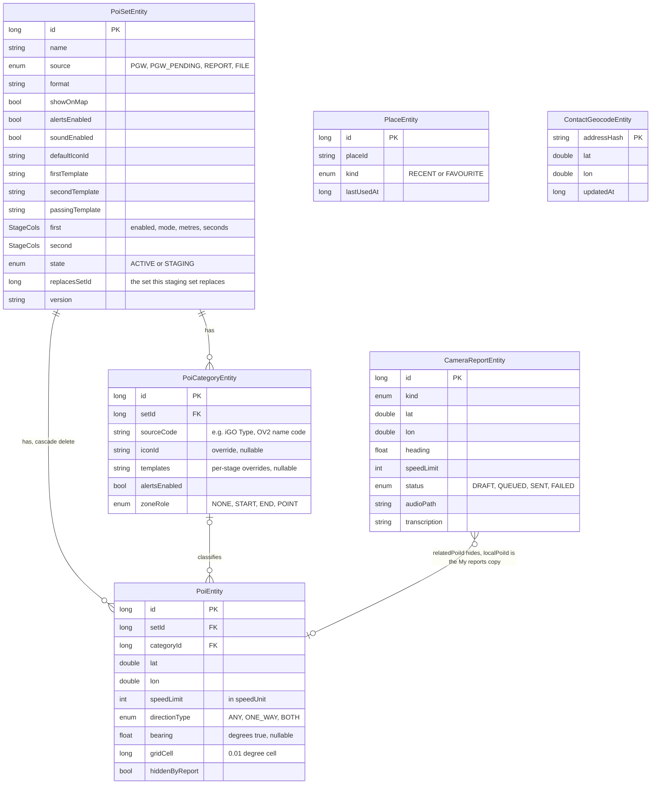

*Columns from `data/Entities.kt`; the per-stage settings (`StageCols`) and the meaning of `bearing` are in the tables below.*

```kotlin
// The Room entities exactly as declared in app/src/main/kotlin/io/autonav/alerts/data/Entities.kt (comments stripped; regenerated 2026-10-24).
// Column meanings, units and which importer fills each one are in that file's KDoc.
enum class PoiSourceType { PGW, PGW_PENDING, FILE, REPORT }
enum class SetState { ACTIVE, STAGING }
data class StageCols(
    val enabled: Boolean,
    val mode: DistanceMode,
    val metres: Int,
    val seconds: Int?,
)
@Entity(tableName = "poi_set")
data class PoiSetEntity(
    @PrimaryKey(autoGenerate = true) val id: Long = 0,
    val name: String,
    val source: PoiSourceType,
    val format: String,
    val enabled: Boolean = true,
    val showOnMap: Boolean = true,
    val alertsEnabled: Boolean = true,
    val soundEnabled: Boolean = true,
    val defaultIconId: String,
    val firstTemplate: String,
    val secondTemplate: String,
    val passingTemplate: String,
    @Embedded(prefix = "a1_") val firstAlert: StageCols,
    @Embedded(prefix = "a2_") val secondAlert: StageCols,
    val minZoom: Float = 11f,
    val state: SetState = SetState.ACTIVE,
    val replacesSetId: Long? = null,
    val poiCount: Int = 0,
    val version: String? = null,
    val lastUpdated: Long,
)
@Entity(
    tableName = "poi_category",
    foreignKeys = [ForeignKey(entity = PoiSetEntity::class, parentColumns = ["id"], childColumns = ["setId"], onDelete = ForeignKey.CASCADE)],
    indices = [Index("setId"), Index(value = ["setId", "sourceCode"], unique = true)],
)
data class PoiCategoryEntity(
    @PrimaryKey(autoGenerate = true) val id: Long = 0,
    val setId: Long,
    val sourceCode: String,
    val name: String,
    val iconId: String? = null,
    val firstTemplate: String? = null,
    val secondTemplate: String? = null,
    val passingTemplate: String? = null,
    val alertsEnabled: Boolean = true,
    val soundEnabled: Boolean? = null,
    val zoneRole: ZoneRole = ZoneRole.NONE,
)
@Entity(
    tableName = "poi",
    foreignKeys = [ForeignKey(entity = PoiSetEntity::class, parentColumns = ["id"], childColumns = ["setId"], onDelete = ForeignKey.CASCADE)],
    indices = [Index(value = ["setId", "gridCell"]), Index("gridCell"), Index("categoryId")],
)
data class PoiEntity(
    @PrimaryKey(autoGenerate = true) val id: Long = 0,
    val setId: Long,
    val categoryId: Long?,
    val lat: Double,
    val lon: Double,
    val name: String?,
    val speedLimit: Int?,
    val speedUnit: SpeedUnit?,
    val directionType: DirectionType,
    val bearing: Float?,
    val gridCell: Long,
    val hiddenByReport: Boolean = false,
    @ColumnInfo(defaultValue = "NULL") val expiresAt: Long? = null,
    @ColumnInfo(defaultValue = "NULL") val sourceId: String? = null,
)
enum class PlaceKind { RECENT, FAVOURITE }
@Entity(tableName = "place", indices = [Index("lastUsedAt")])
data class PlaceEntity(
    @PrimaryKey(autoGenerate = true) val id: Long = 0,
    val placeId: String?,
    val name: String,
    val address: String?,
    val lat: Double,
    val lon: Double,
    val kind: PlaceKind = PlaceKind.RECENT,
    val lastUsedAt: Long,
    val useCount: Int = 1,
)
enum class ReportKind { UNSPECIFIED, MOBILE_SEEN, NEW_FIXED, NEW_AVERAGE, NEW_RED_LIGHT, NEW_RED_LIGHT_SPEED, CAMERA_GONE, WRONG_LIMIT, WRONG_DIRECTION, WRONG_TYPE }
enum class LimitSource { GOOGLE, CAMERA, NONE, USER }
enum class ReportStatus { DRAFT, QUEUED, SENDING, SENT, FAILED, DISCARDED }
@Entity(tableName = "camera_report", indices = [Index("status")])
data class CameraReportEntity(
    @PrimaryKey(autoGenerate = true) val id: Long = 0,
    val kind: ReportKind,
    val lat: Double,
    val lon: Double,
    val heading: Float?,
    val speedMps: Float?,
    val accuracyM: Float?,
    val road: String?,
    val speedLimit: Int?,
    val directionType: DirectionType,
    val relatedPoiId: Long?,
    val comment: String?,
    val createdAt: Long,
    val status: ReportStatus,
    val lastError: String? = null,
    val audioPath: String? = null,
    val limitSource: LimitSource = LimitSource.NONE,
    val localPoiId: Long? = null,
    val transcription: String? = null,
)
@Entity(tableName = "contact_geocode")
data class ContactGeocodeEntity(
    @PrimaryKey val key: String,
    val placeId: String?,
    val lat: Double,
    val lon: Double,
    val formattedAddress: String?,
    val updatedAt: Long,
)
```

**Meaning of `bearing`:** the direction of travel the POI applies to, in degrees clockwise from true north. A camera facing north-bound traffic has bearing ≈ 0, whichever way the camera itself points. Each importer converts to this meaning (§5).

### 4.2 Icon and template resolution
For an alert or marker about POI *p* in set *s* with category *c*:

```
icon     = p.iconOverride     ?: c?.iconId        ?: s.defaultIconId
template = p.alertOverride    ?: c?.alertTemplate ?: s.defaultAlertTemplate   // 2nd/passing templates use the same order
alertsOn = s.enabled && s.alertsEnabled && (c?.alertsEnabled ?: true)
soundOn  = alertsOn && (c?.soundEnabled ?: s.soundEnabled) && !globalMute && !setMute
stage1   = c?.firstAlert  ?: s.firstAlert
stage2   = c?.secondAlert ?: s.secondAlert
passing  = soundOn          // passing alert 1 s ahead (≥ 20 yd): compulsory whenever sound is on, and has no settings (§11.1)
```

### 4.3 Grid-cell scheme
- Cell size is **0.01°** of latitude by 0.01° of longitude. That's about 1.11 km north–south everywhere, and about 0.69 km east–west at 52°N (UK).
- `row = floor((lat + 90) / 0.01)`, `col = floor((lon + 180) / 0.01)`, `gridCell = row * 36_000 + col`. This fits in a Long and has no collisions.
- **Viewport query**: list the cells covering the visible bounds. If there are more than 400 cells (zoomed out), skip the query; `minZoom` usually prevents this anyway. Then `SELECT … WHERE gridCell IN (:cells) AND setId IN (:enabledSets)`.
- **Alert cache**: `PoiGridCache` holds the block of cells around the vehicle that covers the engine's reach, the larger of the 3 km lookahead and the 5 km zone gap: `Grid.reachCells(lat, 5 km)` gives about ±5 cells N–S and ±8 E–W in the UK (11×17). It was a 5×5 block (±2.2 km N–S, ±1.3 km E–W) until 2026-10-13, which ended zones early when the next SPECS camera was over ~1.3 km away and fired the 1st alert late at long lead times (code review). An invalidation (data changed, lead time changed) that lands during a reload is never undone by it (a generation counter). It reloads only when the vehicle moves into a new cell, and the reload runs on IO in the background. The engine's per-fix work never touches Room.
  - Fixes are handled one at a time with `conflate()` (a fix arriving meanwhile replaces any waiting one), never `collectLatest`: at 10 Hz the next fix would cancel a reload half-way. The cell is marked loaded only after the new POIs are in, so an interrupted reload is retried on the next fix.
  - Per fix there's no DataStore read (the latest settings are kept by their collector) and no list copy: the engine's candidate list is built once per reload and only rebuilt per fix while a set is muted or a report is being kept quiet.

### 4.4 Staging and atomic swap
1. Import creates a `PoiSet(state = STAGING, replacesSetId = old?)` and streams rows into it in batches of 2,000 in a single transaction per batch.
2. On success, one transaction does the swap:
   - Copy the user's icon and template customisations from the old set's categories to the new ones, matched on `sourceCode`. Copy set-level settings too.
   - Delete the old set, which cascades to its POIs.
   - Mark the new set ACTIVE.
3. On failure the staging set is deleted, and the old set is never touched.
4. At startup, any leftover STAGING sets are deleted.
5. After the swap, `PoiRepository.changes` emits; `AlertCoordinator` drops its cell cache and `PoiMarkerLayer` reloads.

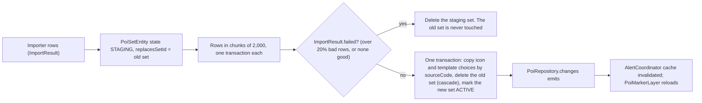


---

## 5. POI importer spec

**No set name is asked for on import.** Names come from what's loaded: a single file is named after the file, and a **zip becomes one set per POI file inside it (never merged)**, each named after its file and using the zip's matching `.bmp`/`.png` as its icon. Re-importing a zip updates its sets, matched by **zip name and file name** (2026-10-13; by file name alone, a second zip with a file of the same name replaced the first zip's set). Two files with the same name in different folders of one zip both become sets (the later keeps its folder path), and a PGW download with two regions keeps each region's file of a type apart. Sets can be renamed in the set editor.

**Free and third-party POI files are loaded by hand only.** You pick a file on the phone, through the Storage Access Framework or by sharing a file to the app. There's **no automatic download, scheduled refresh or URL subscription** for any source other than PGW (§6). Updating a free set means re-importing it by hand (§13 → set detail → **Re-import**), which keeps your icon, template and alert settings (§4.4).

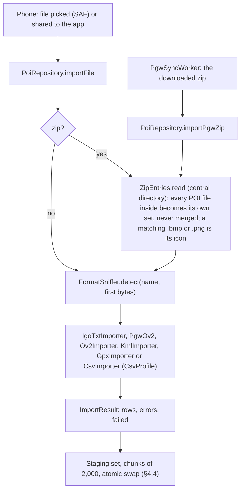

### 5.1 Common interface
```kotlin
interface PoiImporter {
  val format: PoiFormat
  fun sniff(head: ByteArray, fileName: String): Boolean   // auto-detect
  suspend fun import(input: InputStream, ctx: ImportContext): Flow<ImportRow>
}
data class ImportRow(val lat: Double, val lon: Double, val name: String?, val categoryCode: String?,
                     val speed: Int?, val speedUnit: SpeedUnit?, val dirType: DirectionType,
                     val bearing: Float?, val extra: Map<String, String>)
```
- `ImportRunner` handles the shared steps:
  - unzipping and choosing the files inside
  - character set detection (UTF-8 first, then Windows-1252)
  - validation: lat −90..90, lon −180..180, and not (0,0)
  - batching, progress reporting and staging
  - an error report: counts of good rows, skipped rows and why, and the first 20 bad lines
- An import **fails as a whole** if more than 20% of rows are bad or there are no good rows. Otherwise it succeeds with warnings.

### 5.2 iGO TXT (main format, PGW)

> **iGO option: package 288 "UK – Consolidated by type"** (with pending mobiles). Each file becomes **its own set**, and sets are matched by file on every sync, so per-set icon and alert choices are kept:
>
> | File | Set | Rows (v24.101) | Type codes |
> |---|---|---|---|
> | `pocketgps_uk_gatso.txt` | PGW fixed cameras | 4,248 | 1 (3,932), **11 (316)** |
> | `pocketgps_uk_mobile.txt` | PGW mobile camera sites | 8,888 | 5 |
> | `pocketgps_uk_redlight.txt` | PGW red light cameras | 778 | 3 |
> | `pocketgps_uk_specs.txt` | PGW average speed cameras (SPECS) | 3,396 | 4 (zone points) |
> | `pocketgps_uk_pmobile.txt` | PGW pending mobile sites (unverified), alerts on (owner, 2026-10-23; off before) | 2,516 | 5 |
>
> - The total, 19,826, matches the single-file package 61.
> - **Type 11 is only in the fixed-camera file**, so it's a fixed-camera subtype, shown as "Fixed camera (type 11)". It isn't red light + speed as first guessed.
> - PGW sets from an older layout are removed on import.
> - `PgwSyncWorker.IMPORT_LAYOUT` forces a re-download when the import logic changes.
>
> The single-file notes below still describe the file format, which is identical in every file.
 — **checked against real download v24.101 (07 Oct 26)**
**What's in the package** (`idPackage=61`, "UK - Single file with all cameras", with "Include pMobile files" ticked: the iGO package the format notes below were checked against. **As built the downloads offered are `PgwDownload.OV2` = `idPackage=1`, the default, §5.2a, and `PgwDownload.IGO` = `idPackage=288`, "consolidated by type"; `PgwConfig.PACKAGE_UK_IGO` is an alias of the OV2 package.) The zip contains:

| File | Contents |
|---|---|
| `pocketgps_uk_sc.txt` | Main database, 17,310 cameras |
| `pocketgps_uk_pmobile.txt` | *Pending* mobile sites submitted but **not yet verified** by PGW, 2,516 |
| `Release.txt` | `Version 24.101 (07 Oct 26)`, the installed-version source of truth (cross-checked against the RSS feed, §6.2) |
| `Licence.txt`, `_Need_Help.htm` | Licence terms (§6.4) and help; not imported |

- **Format as found**:
  - Comma-separated, ASCII, LF line endings (Release.txt uses CRLF; handle both).
  - Header `X,Y,Type,Speed,DirType,Direction`; matching ignores case.
  - Coordinates have 5 decimal places.
- **Reading the zip**: PGW's zips must be read through the zip's **central directory** (`java.util.zip.ZipFile`, `ZipEntries.kt`). Java's streaming `ZipInputStream` stops after the first entry (`_Need_Help.htm`) and never sees the camera files. Found on the first real sync, 2026-10-11.
- **Never all in memory**: `ZipEntries.read(file)` returns a closeable map whose values are read from the zip on disk **when used** and not kept, so icons, readmes and other camera files never sit in RAM together. A nested zip is streamed to a temp file. A file picked on the phone is streamed to a temp file first (not read into memory), and the import dialog's list of files in a zip comes from the zip's directory alone (`ZipEntries.names`), without inflating anything. Each entry is capped at 200 MB inflated.
- **Watermark row**: the **last line** of each file is `0.72185,51.51508,Copyright PocketGPSWorld.com,,`. It's a copyright and watermark row with a non-numeric Type, and the importer **must skip it**. Generally, any row whose Type isn't an integer is skipped quietly; it isn't counted as an error.
- **Empty fields are normal**. In `sc`, 163 rows (mostly mobile sites) have empty DirType/Direction, and some rows have an empty Speed. They're valid rows, not errors.

| Column | Field | Values found | Mapping |
|---|---|---|---|
| X | lon | −8…+2 | `lon` |
| Y | lat | 49…61 | `lat` |
| Type | category | `1, 3, 4, 5, 11` (see below) | `categoryCode` |
| Speed | limit, **mph** | `20,30,40,50,60,70`, `0`, empty | 0 or empty → `null`; unit MPH for UK packages |
| DirType | direction type | `1`, `2`, empty (**no 0** in the data) | 1 → ONE_WAY; 2 → BOTH; empty or 0 → ANY |
| Direction | **direction of travel**, degrees | 1–360, empty | **360 → 0**; empty → `null` (forces ANY) |

- **The meaning of Direction is settled**: PGW's own submission form labels this field **"Heading / 'Direction of Travel'"**. So `bearing` is the heading of the traffic the camera enforces, which matches our meaning (§4.1). There's no invert switch by default; it stays as a hidden debug option only.
- **Type codes**: PGW's iGO export uses its own codes, which are **different from the submission form's codes** (§8.5).

| Code | Count (sc) | Category | Notes |
|---|---|---|---|
| 1 | 3,932 | Fixed camera (Gatso, Truvelo, Monitron, Vector…) | |
| 3 | 778 | Red light camera | |
| 4 | 3,396 | Average speed camera (SPECS) | **Start, middle and end aren't marked.** All SPECS points are type 4. Zones are worked out from chains of points (§11 step 8). |
| 5 | 8,888 | Mobile camera site | Every row in `pmobile` is type 5 |
| 11 | 316 | Fixed camera (type 11) | **Confirmed fixed**: package 288 puts all of them in `pocketgps_uk_gatso.txt` (fixed cameras). Exact subtype not stated by PGW. |

- Codes not in the table become a category named "Type N".
- **pMobile set**: imported as a **separate PoiSet** "PGW pending mobile sites", alerts **on by default** (owner, 2026-10-23: "turn pending mobile alerts on by default", after a pending site passed silently on the bench) and a lighter "P" icon. PGW says these sites "have not been checked for accuracy", so they may give the odd false alert; being a separate set, they can be turned off in Camera sets. The direction rule (§11 step 3) and the mobile 100 m side allowance apply as to every camera. Until then they were off by default, so DB v9 (`MIGRATION_8_9`) turns alerts on for every existing `PGW_PENDING` set once; a sync keeps each set's switches after that.
- **Fixtures**: PGW's licence forbids copying the data. Each download is also **watermarked to the member**. So **no real PGW data goes into the repo or tests**. The fixtures are made-up files that copy the structure exactly: the header, empty fields, Direction=360, the copyright last row, and pMobile.

### 5.2a TomTom OV2 from PGW (default download)
The user chooses **TomTom OV2** (default) or **iGO** on the Cameras tab (`PgwDownload`). OV2 is TomTom OV2 → "UK – Speed Zoned Complete", **package 1**, `System=TomTom OV2`. The other OV2 package, "consolidated by type", is package 2.

- **Files**: one per type and speed, e.g. `pocketgps_uk_gatso_30.ov2`, `…_gatso_var.ov2`, `…_gatso_tba.ov2`, `…_redlight.ov2`, `…_specs_50.ov2`, `…_pmobile_70.ov2`. There's also a `.bmp` icon per file, which is ignored.
- **Every file becomes its own set. Files are never merged** (owner's rule). For example `gatso_30` → "PGW fixed cameras · 30 mph", `specs_var` → "PGW average speed cameras (SPECS) · variable limit", `redlight` → "PGW red light cameras".
  - v24.101 has **33 files / 33 sets**.
  - Each set keeps its own icon, alerts and sound across syncs, matched by file stem.
- **Icons supplied in the download are used.** Each file's `pocketgps_uk_<stem>_X2.bmp` (44 px, otherwise the 22 px `.bmp`) becomes that set's icon (`user:pgw_<stem>`), and category icons don't override it.
  - A sync refreshes a set's icon unless the user chose their own.
  - The `_X2` icons are **© GerryC, 2007**: free for non-commercial use, with credit and the licence included. The licence text is saved next to the icons, and the credit appears in the set editor and Settings → About ("Show icon licence").
- **Plain OV2 has no direction field, but PGW encodes it in each entry's name**: `<compass>-[R-][t]<TYPE>:<pgwId>[@<mph>]`, e.g. `E-R-MONITRON:3209@30`.
  - **compass** (N, NE, … NW) is the direction of travel. It's within 22.5° of iGO's exact degrees for 98% of cameras. It's missing for 49 entries, mostly pending mobiles, which are treated as ANY.
  - **`R-`** means reversible (BOTH). It matches iGO DirType 2 for 3,955 of 3,958 cameras.
  - **`t`** means a temporary (roadworks) camera.
  - **TYPE** is one of GATSO, MONITRON, TRUVELO, **REDSPEED** (316 entries: this is iGO type 11, so red light + speed; as built both the OV2 REDSPEED entries and iGO type 11 get the red-light+speed icon, while the iGO category keeps the name "Fixed camera (type 11)": ISSUES N4), REDLIGHT, SPECS, MOBILE, pMOBILE.
  - **pgwId** is stored as `poi.sourceId` and sent as `idCam` when reporting a known camera (Action 2/3/4, §8.5).
  - **@mph**: `@0` means variable; a missing speed means it's still to be confirmed.
  - The copyright watermark entry in each file is skipped.
- Verified on v24.101: **19,826 cameras**, identical to iGO.
- The parser is `PgwOv2.kt` in `:core`, with tests and an optional `PGW_OV2_ZIP` real-file check.

### 5.3 RadarDroid TXT / Nokia SpeedCam TXT (designed, not built: no importer and no `PoiFormat` value exist as of 2026-10-24; Appendix B)
- Similar layouts, with the exact columns confirmed from a sample file. Both get their own importer with a column table, sharing code with iGO through `DelimitedCameraImporter(columns: ColumnSpec)`.

### 5.4 KML (NDrive or generic)
- Stream-parse with XmlPullParser.
- Each `Placemark/Point/coordinates` gives lon,lat. The name comes from `<name>`. The category is the enclosing `<Folder><name>`, or the `styleUrl` if there's no folder.
- Bearing, if present, comes from `<ExtendedData><Data name="heading|bearing|direction">` or `<Style><IconStyle><heading>`. With a bearing, the direction type is ONE_WAY unless an extended `dirtype` or "both" in the description says otherwise. With no bearing it's ANY.
- Speed comes from extended data `speed`, or a regex on the name or description: `(\d{2,3})\s*(mph|km/?h)?`.

### 5.5 GPX
- Each `<wpt lat lon>` gives one POI. The name comes from `<name>` and the category from `<type>`, or else `<sym>`.
- Bearing from `<course>` (GPX 1.0) or `<extensions>` keys `course|heading|bearing`. Speed is regex-matched as in KML.

### 5.6 TomTom OV2 (binary, no direction)
- Records are read until the end of the file:
  - **type 2** (POI): `int32 len, int32 lon×100000, int32 lat×100000, zero-terminated name`
  - **type 1** (skipper block): skipped using its length
  - **type 0** (deleted): skipped
- All values are little-endian.
- The direction type is always ANY. Speed is regex-matched from the name, for example `[SPECS] 50`: a standalone 2–3 digit number, **never part of a road or junction number** ("M25", "J10", "A303" aren't limits; 2026-10-13), and one with a unit wins over a bare one. The same rule applies to KML and GPX names; a KML `speed` of 0 or less is no limit.
- **Type 3** records (`name\0id\0extra\0`) use the first field as the name. A POI record shorter than 13 bytes is a row error, not a crash. The file is read as a stream, record by record.

### 5.7 Generic CSV (wizard)
- The phone wizard:
  1. Pick the file.
  2. Auto-detect the delimiter (`,` `;` tab `|`) and whether there's a header.
  3. Show the first 10 rows in a table.
  4. Choose a column from a dropdown for each field (lat, lon required; name, speed, bearing, direction type, category optional).
  5. Map direction-type values, with presets: `0/1/2`, `any/one/both`, `A/O/B`.
  6. Choose the speed unit.
  7. Live preview of 5 parsed POIs with their direction arrows.
  8. Save as a `CsvMappingProfile`, which can be reused on re-imports.
- With a bearing column and no direction-type column, the direction type defaults to ONE_WAY. With neither, it's ANY.

### 5.8 Zip handling
- As built, `ZipEntries` (core) reads the zip through its central directory and **every POI file inside becomes its own set, never merged** (hard rule 9; §5 above). There is no picker and no merge option.
- For PGW, the expected file name pattern lives in `PgwConfig`.
- Zip-slip protection: entries are never written outside a temp directory. Total unpacked size is capped at 200 MB.

---

## 6. PGW sync

### 6.1 Flow
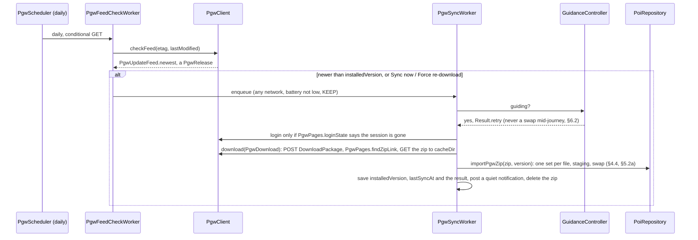

0. **Update check (RSS)**: `PgwUpdateFeed` reads `https://www.pocketgpsworld.com/speed-camera-rss.php` (§6.2). The download in steps 1–4 only runs when the feed shows a **newer database version** than the one installed, or when you press **Sync now** or **Force re-download**.
1. `CredentialStore`: the username and password are encrypted with AES-GCM, using a key in the Android Keystore with no user authentication required, so it works in the background. The encrypted data is kept in DataStore.
2. `PgwClient`, using OkHttp with an in-memory cookie jar, a 30 s timeout and a User-Agent naming the app:
   1. **Login**: checked on 2026-10-11. The site is PHP-Nuke. A plain form POST to `https://www.pocketgpsworld.com/modules.php?name=Your_Account` (`application/x-www-form-urlencoded`) with:
      `username=<u>&user_password=<p>&op=login&redirect=&mode=&f=&t=`
      - There's **no CSRF token and no captcha** on the login form. Its hidden fields are empty constants.
      - A login counts as successful if a session cookie is set and the response contains "logout" / "My Account" and **not** the `user_password` field.
      - The session cookie's name and how long it lasts are recorded in phase 1. The cookie jar is persisted in encrypted storage so a weekly sync can usually skip logging in. If any request gets the login form back, the app logs in again once and retries.
   2. **Generate the download**: POST to `modules.php?name=Cameras` with
      `op=DownloadPackage&idPackage=<package>&getPmob=yes&getFrance=no&getSwiss=no` (as built `idPackage` is 1 for the default OV2 download or 288 for iGO by type, §5.2; 61 was the original iGO single file)
      - These are the same fields the site's own **"Download Same Format (Current Version)"** button sends.
      - `System=iGO` and `voicePack=noVoice` are only used on the page to fill the package list. They're sent anyway to match the browser.
      - Other regions use the `idPackage` values found: EUR 155, AUS/NZ 156, AFRICA 157, USA 158, ASIA 159, CANADA 193, plus the "consolidated by type" variants 288–294. A region picker in the phone app is left to v2.
   3. **Find the link**: the response contains a link matching `/temp/users/pgpsw-speed-cams-[A-Za-z0-9]+-\((\d+)-(\d+)\)\.zip`, which includes the version, for example `pgpsw-speed-cams-tETDF-(24-101).zip`. The version in the file name is checked against the RSS release.
   4. **Download**: GET the temp URL. **No cookie is needed**: it was fetched without authentication and returned `200 application/zip`, 216 KB. It's streamed to `cacheDir/pgw-<millis>.zip` (as built) with checks on Content-Type `application/zip`, a size over 50 KB, and that the expected entries are inside. The zip is **deleted after import**.
3. `ImportRunner` runs the iGO importer into staging and swaps it in (§4.4). On a re-sync, existing categories keep the user's icon and template choices.
4. Save `lastSyncAt`, `lastSyncResult`, `poiCount` and **`installedVersion`** (from the feed item that triggered the sync). Post a quiet notification with the result, including the feed's own summary, for example "PGW database updated to 24.101: 20 static and mobile cameras added/removed/modified across the databases (12,345 cameras)".

- **Speed and load**: one login (if needed), one POST and one GET of about 220 KB, about once a week.

All URLs, form field names and selectors live in **`PgwConfig`** (a single Kotlin object). The first real login session is used to fill it in.

### 6.2 Update detection and scheduling (RSS feed)
- **The feed** (`speed-camera-rss.php`, RSS 2.0, public, no login needed):
  - Channel: "PocketGPSWorld.com Speed Camera database updates".
  - One `<item>` per database release:
    - `<title>`: version and date, for example `version 24.101:07 Oct 26`
    - `<description>`: a summary of changes, for example "This release sees 20 static and mobile speed cameras added/removed/modified…"
    - `<link>`: the cameras page
  - **The feed has no camera data at all**: no coordinates, types, limits, directions, or per-camera added/removed lists. It's only used to detect a release, and the cameras still come from the logged-in download (§6.1).
  - New releases come out roughly weekly.
- **`PgwUpdateFeed`**: a small XmlPullParser reader.
  - Parses each item into `PgwRelease(version: String, major: Int, minor: Int, date: LocalDate?, summary: String, guid/link)`.
  - The version comes from the regex `version\s+(\d+)\.(\d+)`. The date comes from the part after the colon (`dd MMM yy`, English locale).
  - The newest release is the one with the highest (major, minor). The feed's order isn't relied on.
  - If parsing fails, the whole item's hash is used as the version key, so any change counts as a new release.
- **`PgwFeedCheckWorker`**: a `PeriodicWorkRequest` running **every 24 h** (flex 4 h) that needs any network connection. The feed is tiny, so mobile data is fine.
  - It does a conditional GET: `If-None-Match` with the stored `ETag` and `If-Modified-Since` with the stored `Last-Modified`. Most checks get a **304** reply and cost almost nothing.
  - When the newest version is greater than `installedVersion`: save `pendingRelease`, then queue a one-time **`PgwSyncWorker`** straight away (constraints: **any network connection**, battery not low, unique-work policy KEEP).
  - The whole update is about 220 KB, so it runs on mobile data too, and the new database arrives within minutes of the release. An optional **Wi-Fi only** setting (off by default) can hold it back.
  - First run, with no installed version: queue a sync right away.
- **Safety net**: `PgwSyncWorker` also runs if no sync has succeeded in **14 days**, even if the feed hasn't changed. This covers a feed that has stopped updating or a missed item.
- **Backoff**: the feed check retries with backoff on network errors, capped at the next periodic run. The download uses exponential backoff from 1 h, up to 3 attempts. After that `pendingRelease` is kept and retried on the next feed check.
- **Sync now** checks the feed and, if a newer version exists, downloads it. **Force re-download** downloads without checking the version. Both only need a network connection.
- The phone's PGW screen shows: the installed version and date, the latest version in the feed with its summary, the last feed check, and the last download result.
- **While driving** (as built): `PgwSyncWorker` returns `Result.retry()` at the start while guidance is running, so the whole job, download included, waits for guidance to end; the design's finer split (download and staging in the background, only the **swap** held back until guidance ends or the car disconnects, so the cameras don't change mid-journey. If nothing is being guided, the swap happens straight away.

### 6.2a Fully automatic update (no user action)
When the feed shows a new release, the app does the whole update **by itself**, with no prompt, no tap and no browser:

```
PgwFeedCheckWorker (daily, conditional GET)
  └─ new version > installedVersion?
       └─ PgwSyncWorker (queued at once, any network)
            1. Load the saved cookie jar → GET Cameras page; still logged in?
               └─ no → log in with the saved credentials (Keystore, §6.1 step 1), once
            2. POST op=DownloadPackage (idPackage=1 OV2 or 288 iGO, getPmob=yes) → find the temp zip link
            3. GET the zip (no cookie needed) → check it → Release.txt version == feed version?
            4. Import into staging (sc + pMobile sets) → swap now, or after the drive
            5. installedVersion = new version; quiet notification with the release summary
```

- Credentials are entered **once**, in the phone app's PGW account screen, and then used without asking for every update. They're only sent to `www.pocketgpsworld.com` over HTTPS.
- **You're only asked to do something** when it can't be done automatically: wrong password or an expired subscription (`AUTH_FAILED` or no download link on the page), or a site change (`PARSE_FAILED`). Each gets one notification with a "Fix" action that opens the PGW account screen. Until then the old data stays in use.
- **Expired subscription**: if you're logged in but the download page has no package form or link, the status is `SUBSCRIPTION_REQUIRED` and you're notified once.

### 6.3 Failure handling
| Failure | Behaviour |
|---|---|
| Wrong credentials | Mark `AUTH_FAILED` and stop scheduling until the credentials are re-entered; notify once |
| Site layout changed (selectors miss) | `PARSE_FAILED`; keep the old data; as built the status line on the Cameras tab says so (no notification yet, and the AUTH_FAILED / subscription notifications have no "Fix" action) |
| Captcha / 2FA detected | Same as above, plus a "Log in via browser" hint |
| Network/timeout | Retry with backoff |
| RSS feed unreachable / changed format | The feed check fails quietly. The 14-day safety net still syncs. Diagnostics show "Update feed: last OK N days ago" |
| Feed shows a new version but the download has the same content | Accepted as done: `installedVersion` is updated, and the swap is skipped if the content hash matches |
| Import fails validation | Staging set discarded; old data kept |

### 6.4 Terms-of-use risk
PGW's terms may forbid automated downloads. To limit the risk:
- The app logs in only as the user, and **only when the public RSS feed shows a new release** (about weekly), or at most every 14 days. It never redistributes the data.
- The daily feed check is an anonymous conditional GET of a public feed that PGW provides for update notifications.
- Auto-sync can be switched off, and manual import is always available.

- **What the licence says** (`Licence.txt` in each download):
  - The data is licensed for **individual use**.
  - It may not be "copied, redistributed… incorporated… in any application… without prior written authorisation".
  - It may not be stored "on any platform accessible to anyone apart from the purchaser".
  - Each download is **watermarked** so it can be traced to the member.
- **How we comply: each user uses their own account.** The app **never ships, hosts or shares PGW data**. Every user must enter **their own PGW subscriber login**, and the app downloads **that user's own watermarked copy** for their device only. That meets the licence's main terms:
  - "individual use": one subscriber, one copy, on their own phone
  - no copying or redistribution: no data leaves the device, and no shared server or cache exists
  - "only the purchaser": private app storage, no backup, no export
  - the per-member watermark stays traceable to the account that downloaded it
- **The app enforces this**: there's no built-in or default PGW account, credentials can't be shared, and PGW data is never exported or synced between devices. If a subscription lapses, auto-sync stops (`SUBSCRIPTION_REQUIRED`) and nothing more is downloaded.
- **What that means for the design**:
  - The PGW data lives only in the app's **private storage** on your phone.
  - It's **excluded from Android backup** (`dataExtractionRules` / `fullBackupContent` exclude `poi.db` rows for PGW sets; in practice the whole POI DB is excluded and re-synced after a restore).
  - There's **no export** of PGW sets, they're never sent to any server, never bundled in the APK, and never put in the repo or test fixtures.
  - **Personal, non-commercial use only.** The one clause the own-account model doesn't settle directly is "incorporated… in any application… without prior written authorisation", because the app converts the file into its own database. **Low priority** for personal use. A short email to PGW confirming that a subscriber may use their own download in a self-built app removes the doubt, and is **needed before the app is shared with anyone else** (§16).

The user accepts this risk for personal use.

---

## 7. Icons and alert templates

### 7.1 Icons
- **Built-in pack** (vector drawables, as built in `IconRepository.BUILTIN`): `camera_fixed`, `camera_mobile`, `camera_average`, `camera_redlight`, `camera_redlight_speed`, `camera_pending`, `pin`, `hazard`, `school`, `fuel`, `ev`, `star`. (The designed `camera_variable`, `ev_charge`, `parking`, `toilet` and coloured pins were not built.)
- **User icons**: a bitmap image (PNG, BMP, JPEG, anything `BitmapFactory` decodes; SVG is not supported as built) picked through the Storage Access Framework or found in a POI zip. It's scaled to 256 px wide, saved under `filesDir/icons/` and its id is `user:<uuid>`.
- **Rendering**: `IconRepository` makes and caches two bitmaps per icon:
  - **map marker**: 48 dp. **A camera is drawn with its icon alone, never with a speed-limit badge**, at the usual icon size (80% of the marker: drawn larger, at 95%, it covered the head of the flat direction arrow under it on the tilted map, which hard rule 1 needs; bench, 2026-10-23, owner: "speed camera have lost the directional maker"): the PocketGPSWorld download icon (`user:pgw_…`, which shows the limit itself) or, where there's none, the built-in camera icon (`builtin:camera_…`, e.g. My reports) (owner, 2026-10-23: "only use the large icon if 2 icons are presented for a POI", "am getting the icon and a little speed limit in the bottom corner on the map icon", "would prefer you to use the supplied icon only for the camera POIs"). Other POIs with a speed limit get the badge (red circle with the number), cached per (icon, speed). `IconRepository.isCameraIcon` decides.
  - **CarIcon**: 64 dp, for alerts, list rows and the notification.
- Cache: an LRU of 96 bitmaps (as built).

### 7.2 Template placeholders
| Placeholder | Value |
|---|---|
| `{category}` | Category name, or the set name if the POI has no category |
| `{speed}` | Speed limit converted to the user's units (number only) |
| `{units}` | On screen "mph" / "km/h"; spoken "miles per hour" / "kilometres per hour" (as built, `AlertTemplateRenderer`) |
| `{distance}` | Distance spoken in the user's units, rounded: "400 yards", "a quarter of a mile", "300 metres" |
| `{direction}` | "ahead" / "on your left" / "on your right", from the bearing to the POI relative to your heading |

- **Rendering rules**:
  - When a placeholder's value is missing, any sentence piece that depends on it is dropped. For example `"{category} ahead, {speed} limit"` with no speed becomes "Fixed camera ahead".
  - Blank spaces and commas left behind are tidied up.
- Each POI has three alert templates, one per stage (§11.1):
  - **1st**: `{category} ahead, {speed} limit`
  - **2nd**: `{category}, {distance}`
  - **Passing** (1 s ahead, ≥ 20 yd): `{category} now`
- Zone enter/leave/over have their own templates: "Entering average speed zone, {speed} limit", "Leaving average speed zone" and "Average speed zone, {speed} limit, you are over the limit". {speed} is the zone's limit (§11 step 8).
- The display text and the spoken text come from the same template. Display uses short units ("30 mph") and speech uses full words.

---

## 8. Car UI

All screens use **NavigationTemplate-family** templates, so the map always stays on screen and split-screen with media keeps working.

| Screen | Template | Content |
|---|---|---|
| Home / free-drive | `NavigationTemplate` (no RoutingInfo) | Map, speed panel (§8.4), the map buttons. No message card for the next camera: the alert banner (§12.1) is the only alert surface on the map (one element per job, the hard rule below; 2026-10-13) |
| Search | `SearchTemplate` | Places autocomplete (debounced 300 ms, biased to your location); favourites and recents (including Google Maps imports) when the box is empty (§8.2). **Voice** (2026-10-12): the host delivers spoken input through `onSearchSubmitted` (Assistant's "navigate to …" arrives as the navigate intent, §9.1); both paths are handled and logged to `debug-nav` (`Search textChanged/submitted/voice len=`, `Places textSearch n= ms= status=`, `NavigateIntent`). `submit()` shows "Searching…", then the results or "No results for …", never a silent empty list; a contacts-only submit searches contacts and Places |
| Recents | `ListTemplate` (as built; designed as `PlaceListNavigationTemplate` with markers) | Recents and favourites as name and address rows; delete action on each row, plus Clear all (§8.2) |
| Place detail | `MessageTemplate` (as built, older hosts only; designed as `MapWithContentTemplate` / `PaneTemplate`) | Navigate · Remove from recents (Favourite: designed, not built) |
| Contacts | `ListTemplate` (`ContactsScreen`) | Contacts with a postal address to pick from, recently used first; one row per contact ("Home · 12 High St", with the known distance); a last "Search contacts…" row opens the typed search (§8.3) |
| Results | rows of the `SearchTemplate` (as built; a separate `PlaceListNavigationTemplate` with map markers was designed, not built) | Up to 6 places with their address |
| Route preview | `RoutePreviewNavigationTemplate` | Up to 3 alternative routes (ETA, distance, traffic delay); "Go". **Back** clears the destination (`abandonPreview()`) (2026-10-12; before, the route stayed drawn with no Stop action), also while the route is still loading: a route the SDK finishes after Back is cleared, never left drawn (code review, 2026-10-23). **A preview while guiding** (owner, 2026-10-13): the new destination's route is drawn in place of the guided one; **Go** switches guidance to it; **Back** re-routes to the destination being guided (its route token when it had one, else the SDK's route with the tolls option), restores its route choices and note, and logs `preview abandoned (restored guided route)`. Before, Back left the preview's route as the live one. **Go** first remembers the destination in Recents from the app scope (`NonCancellable`, awaited before the screen pops: a `lifecycleScope` insert was cancelled by `popToRoot()`, so Recents stayed empty after a real drive, 2026-10-12; logged `Places remember "<title>"`); Search and Recents reload their lists on resume |
| Navigating | `NavigationTemplate` + `RoutingInfo` + `TravelEstimate` | Maneuver icon, distance, road, lanes, next step; ETA, remaining time and distance |
| Arrival | `CarToast` | **Arrival ends guidance at once** (owner, 2026-10-13): on the final destination's arrival event, while guiding, `stopGuidance(ARRIVED)` runs and a toast says "You have arrived at <title>"; the host's card goes, the strip goes back to Search · Report · Recents · More, and the camera-reports reminder fires (§8.5). Before, an arrived card stayed up and the host's card (with the only X) had gone, so nothing could clear it. An arrival event while not guiding is ignored and logged |
| POI layers | `ListTemplate` (pushed; map stays behind) | Per set: one on/off toggle (`enabled`), with its alerts state shown as text (as built; a separate alerts toggle was designed). Mute is on More |
| **People** | `PlaceListNavigationTemplate` | Tracked HA people with live markers, distance, "updated 2 min ago", and accuracy; tap → Find (§17.3) |
| **Report** (one tap) | `MessageTemplate` "Listening…" with Done / Skip | One tap saves the report, then an optional spoken comment from the car mic; Undo alert (§8.5). No review or Send on the car. |
| More | `ListTemplate` | Recents · POI layers · Mute alerts 30 min · Satellite map · Route options (avoid tolls, energy-efficient EV routes) · **Alerts** (the speech records) · **GPS** (feeds and rates), both live rows in every build (as built; a debug-only Diagnostics row was the original design) |

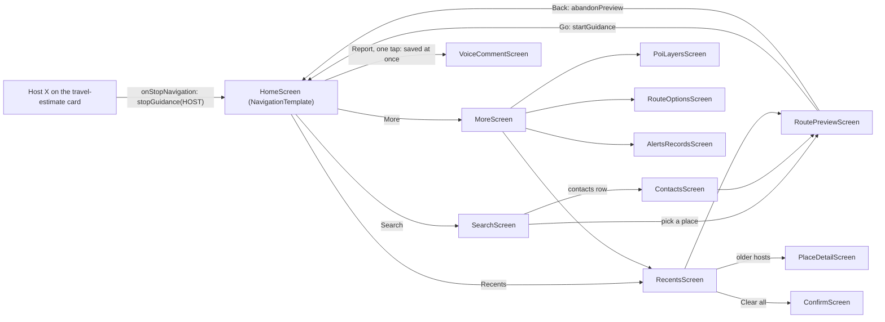

*The screen graph as pushed by `ScreenManager` in `car/screens/*.kt`. There is no separate "navigating" screen: `HomeScreen` shows the turn card while guiding.*

**Action strip** (up to 4): Search · **Report** · Recents · More (owner, 2026-10-12). **There is no stop action of ours** (owner, 2026-10-13: "we just need one, the Google provided one"): the host draws its own **travel-estimate card** at the bottom-left from the `Trip` we publish (§9.3), with Google's **X** on it, and that X is the one cancel on the car screen. It reaches us as `NavigationManagerCallback.onStopNavigation` → `stopGuidance(HOST)`; arrival ends guidance by itself (Arrival row above). The card stays through a reroute: the last travel estimate is sent again while the SDK reroutes or before its next update, so the X never blinks out mid-route (code review, 2026-10-23). While a route is set, Recents leaves the strip to keep the screen estate (it stays in More and in Search's empty state), so the strip reads Search · Report · More. A "Stop navigation" / "Done" text action was tried (2026-10-12/13) and dropped: it was the second cancel next to Google's. Mute is in More ("Mute alerts for 30 min"); the alert banner on the map has no buttons (§12.1). People (§17, not built) will live in More. **All its actions are persistent** (`Action.FLAG_IS_PERSISTENT`), so the host never fades them out: the user wants the four top-right buttons always on screen.
**Hard rule: nothing is shown on the car screen that doesn't work, and nothing is shown twice** (owner, 2026-10-13): no touch reaches the SDK view, so every SDK-drawn control is dead on Android Auto and is turned off and hidden (step 6 above); our own views only exist where they take a tap or show live data (speed panel, banner, buttons). **One element per job, to keep the screen estate**: the host's turn card is the only turn card (no SDK header), Google's X on the host's travel-estimate card is the only stop (no stop action of ours; the SDK's own ETA card stays off), our column's recenter is the only recenter, our speed panel the only speed and limit, the banner the only alert surface on the map (no message card for it). A UI change isn't done until a DHU screenshot during guidance shows nothing dead and nothing duplicated (TESTING.md §6.2, U1).
**Hard rule: all our on-screen buttons are on the right-hand side only** (owner, 2026-10-12): the satellite toggle and the zoom/recenter column are anchored to the right edge (`Gravity.END`) from the moment they're added, under the action strip, and `applyPadding` only adjusts their right and top margins from the visible area. (Anchored from the left, they sat at the top-left until the host reported the visible area.) The speed panel is bottom-right; nothing of ours goes on the left. **Driver side** (owner, 2026-10-23, after comparing Google Maps on the DHU with the seat set to Left and to Right): Google Maps mirrors its buttons, search and zoom to the driver's side and moves its speed pill to the far corner; the host's own cards (turn card, travel-estimate card) stay on the left for every app either way. Ours **stay on the right whatever the seat**: in a UK right-hand-drive car that is already the driver's side. No seat detection, no mirroring.

**Map buttons**: down the right edge of the map, under the satellite toggle (top right): **one zoom pill (+ over −, with a hairline between; `ZoomPillView`, 56 × 112 dp) and a round recenter** (`MapButtonView`, 56 dp), 10 dp apart, drawn on our surface and tapped through `onClick` (car API 5+); the pill's top half zooms in, its bottom half out. The host's map action strip keeps only `Action.PAN`, which hosts show for rotary/touchpad cars. Below car API 5 (no `onClick`) our buttons aren't drawn and the host strip has Pan · zoom in · zoom out · recenter as before.

**Looking like Google Maps** (owner, 2026-10-23: "look at the google maps screen shots and look at ours and fix up our UI to look similar to theirs"; compared on the DHU, `/tmp/autonav-bench/g6.png` vs `d1.png`). Only what is ours to draw changes; the hard rules above stand (our buttons stay right, one element per job, no shake):
- **Turn card**: the host draws it, but we set its colour with `NavigationTemplate.setBackgroundColor`: Google's teal, **#07786D** (sampled from Google Maps on the DHU), the same by day and night. Its text is the **road only**, as Google's is ("0.4 mi / Main Rd / A61"): the cue is the step's road name with "/" spaced to " / ", and the full instruction only when the step has no road (a destination, "Continue"). The spoken directions keep the full instruction (§12.3); the cluster `Trip` uses the same steps.
- **Speed and limit**: **one white pill** bottom-right, the limit ring on the left and the speed with its unit on the right (§8.4), as Google's.
- **Day and night follow the car**, as Google Maps does: the map is set with the inner `NavigationView.setForceNightMode(FORCE_DAY / FORCE_NIGHT)` from `CarContext.isDarkMode` (before, the SDK chose night from its own clock, so our map was dark while the car, and Google's map, were in day), and our buttons are white with dark icons by day and dark grey with white icons by night. Re-applied on `onCarConfigurationChanged`; redrawn only when it changes. Same for the satellite toggle and the zoom pill.
- Not ours, so left as the host or the SDK draws them: the travel-estimate card, the route line colour, the current-road chip.

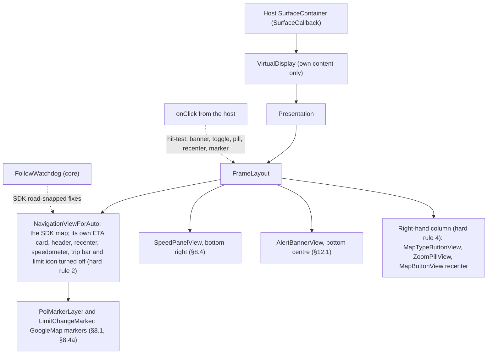

**Visible and stable areas**: `MapSurface` hears `onVisibleAreaChanged` and `onStableAreaChanged`. The **visible** area places our overlays (speed pill, banner, buttons) clear of the host's cards. **The host only reports a change** (bench, 2026-10-23, twice: after our app was restarted under a connected head unit, no visible area arrived until the media panel was toggled, so the car sat at the centre of the whole surface and the buttons and speed panel were laid out under the host's panel; owner: "you should be dynamically doing the controls"). The host keeps its own idea of what it last told us and that outlives our process, so **the last visible and stable areas, and the map panel, are kept per surface size** (`map_surface` preferences, key `w×h`) and **restored when the surface comes back** before any callback (logged `visible restored …`); a later callback replaces them. A report narrower or shorter than 200 px (a screen without the map, or nothing) changes nothing and is not kept (review, 2026-10-24); the areas belong to the surface they were reported for, so a surface of another size starts from its own saved areas, and a report that came before the surface existed is saved once it does. They're only ever read for the same surface size, so a different head unit starts from the whole surface as before. The map's **camera padding no longer follows either area** (owner, 2026-10-23, below): it is fixed, so the car never moves when the host's cards come and go.

**Where the car sits** (owner, 2026-10-23: "have our nav car in the middle about 2 cm up", "the camera alert should be able to display without overlaying the car", then "Bottom centre, car higher" when asked where the banner goes, and "the nav view and free drive should have the car arrow in the same place consistently"): **the same spot in free drive and in guidance**, **centred across the map the host shows**, **just above the camera alert banner**, which stays bottom centre (§12.1). The centre is worked out from the host's visible area each time it changes (owner, 2026-10-23: "you should be working out the centre position dynamically", after the host split the screen for a media panel and the car, centred on the whole 1816 px surface, sat off to the right of the 1283 px map): left and right padding are the visible area's left inset and right inset (12 px each on the full-screen DHU; 424 and 636 px with the host's media panel up; 1216 and 12 px when our map is the host's narrow right-hand panel, so neither inset is capped at half the width: a first version capped them and put the car left of that panel's middle, bench 2026-10-23), keeping a padded map at least 200 px wide, top the action strip's clearance (`ACTION_STRIP_CLEAR_DP`). **The host's cards never push the car** (owner, 2026-10-23, with a route preview up beside the media panel: "still not in the center", "under navigation it doesn't work so you're not using a common code base for it": the host's visible area counts its own route-preview card as a 440 px left inset, as it does the turn card in guidance, so the car sat at the visible area's middle, 894 px on the screen, not the 1192 px map panel's, 688): the car is centred across the **map panel**, the part of the surface the host shows our map in (full width, or the left or right panel beside the host's media panel), and the host's cards over the map (route-preview card, turn card, travel-estimate card, message card, all on the left, §8 driver side) float over it. The panel is worked out from the host's own reports: a visible area reported **while our template carries no left card** is the panel; a report while a card is up keeps the panel and measures the card's inset (its left minus the panel's left); if such a report moves the right edge by more than 32 px the host has re-laid out with the card up, so the panel's right edge is the new one and its left is the report's left less the last card inset measured. Whether a left card is up is ours to know (`MapSurface.homeCard` as built, set by `HomeScreen` when its template carries navigation info; the derived `hostCard` is preview-or-home, a travel estimate or the set-up message, and by `RoutePreviewScreen` while it shows), never guessed from pixel sizes. Until a panel is known the visible area is used. The overlays (speed panel, buttons, banner) keep placing themselves from the visible and stable areas, clear of the cards; only the car's horizontal centre uses the panel. Logged `panel Rect(…) card= inset=` when the panel changes, bottom the banner's height plus its 16 px margin and an 8 dp gap. The top and bottom are fixed, not from the visible area, because its top changes between free drive and guidance. Before this, it followed the stable area, whose top and left change between free drive and guidance (28 vs 92 px on the DHU), so the car jumped when a route started; and the turn card's inset pushed the car right of centre. A first try that also lifted it 2 cm was too high (owner). **The SDK's navigation camera from the start** (owner, 2026-10-23: "why is the car where it is on the screen, that's not to the design spec"): after a fresh start, before any route, the SDK's `followMyLocation(TILTED)` gave a flat map with the car centred and ignored our padding; once a route had run, free drive was tilted with the car in its place. The inner `NavigationView`'s navigation UI is switched on with the SDK controls (`setNavigationUiEnabled(true)` when `isNavigationUiEnabled` is false, logged as `navUi=`), **and the padding is set and the car followed again right after** (bench, 2026-10-23: after a reinstall in free drive the follow had been sent while it was still off, so the car stayed centred, flat, as a dot; and switching it on drops the padding, so the car then sat mid-screen), and its own controls stay off (§8 step 6). **Free drive matches guidance** (owner, 2026-10-23: "free drive and route should have the car in the same place"): with the same padding the SDK centres the car in free drive but puts it near the bottom when guiding (91.7% of the padded height from its top, measured on the DHU, `GUIDED_CAR_FRACTION`). So in free drive the top padding is raised until the padded area's centre is that same point; `MapSurface` re-applies the padding when guidance starts or stops. Bench check: a free-drive and a guidance screenshot have the car arrow at the same pixel (±10 px).

**Map surface set-up** (`MapSurface`, created by `NavSession.onCreateScreen` with `applyKey = { deps.navigator().applyApiKey() }`):
- **Order of events:**
  1. The host calls `onSurfaceAvailable(container)`. `MapSurface` cancels any set-up still running and starts a new one on its own main-thread scope (`Dispatchers.Main.immediate`).
  2. The set-up waits for `applyKey()`. If there's no key it stops there: the surface stays empty and the home screen shows "Add your Google Maps API key in the phone app's Settings."
  3. `attach(container)`: releases any old map, creates a `VirtualDisplay` (`VIRTUAL_DISPLAY_FLAG_OWN_CONTENT_ONLY`, the container's size and dpi) on the host's `Surface`, and a `Presentation` on that display.
  4. The `Presentation`'s content is a plain `FrameLayout` with three children, in drawing order: `NavigationViewForAuto` (match parent), the speed panel (§8.4, bottom end) and the alert banner (§12.1, bottom, centred by `applyPadding`). `NavigationViewForAuto` doesn't accept child views ("Adding child views is not supported"), so nothing is ever added to it directly.
  5. The view's `onCreate/onStart/onResume` run, the `Presentation` is shown, and `getMapAsync` turns on my-location, traffic and tilted follow, then calls `onMapReady` (markers and the camera-idle listener attach there).
  6. After `onResume()` the SDK's own on-map controls are turned **off**. `NavigationViewForAuto` itself has no such setters in SDK 8.0.0 (checked with `javap`), **but it is a `FrameLayout` whose child is the phone `NavigationView`** (seen in the bench view dump, 2026-10-13), and that public class has them all. `MapSurface.disableSdkControls` finds that child (`is NavigationView`, no obfuscated names involved) and calls `setHeaderEnabled(false)`, `setEtaCardEnabled(false)`, `setRecenterButtonEnabled(false)`, `setSpeedometerEnabled(false)`, `setTripProgressBarEnabled(false)` and `setSpeedLimitIconEnabled(false)` (our panel shows the limit, §8.4), logging `Map sdkControls off=[…]`; if the child isn't there yet it tries again when the map is ready, and logs `missing` if it never appears, so a later SDK that changes the structure is noticed on the bench (the bottom-left ETA card with its dead X was seen on 2026-10-13 after a build that only probed `NavigationViewForAuto`). **Not to be confused with the host's own travel-estimate card**, also bottom-left, which the host draws from our `Trip` and which stays: on the bench (2026-10-13) it showed our own estimate ("1 min · 0.7 mi" matching `Trip update … toDest=1091`) with all SDK children hidden, and its X is the one cancel (strip paragraph above). No touch ever reaches the SDK view (taps arrive through `SurfaceCallback.onClick` and are hit-tested against our views only), so every SDK-drawn control was dead: the ETA card's X did nothing in the car (found 2026-10-12, §16 row 23). The template already draws `RoutingInfo` and `TravelEstimate`; our speed panel and recenter button are the live ones.
- **Why wait for the key:** there is no manifest key (§1.4), and Android Auto can start the car session in a **fresh process** (after an update, a crash, or the phone killing the app) before the phone UI has ever set the key. Creating `NavigationViewForAuto` first crashes with "API key not found".
- **Tear-down:** `onSurfaceDestroyed` cancels the set-up and releases (view `onPause/onStop/onDestroy`, `Presentation.dismiss`, `VirtualDisplay.release`). `close()`, called from the session's `onDestroy`, also cancels the scope for good.
- **Follow watchdog** (`FollowWatchdog` in `:core`, pure: `check(now, following, guiding, previewShowing, sdkFixAgeMs, distanceM, onScreen)` → `None(reason)` / `Refollow` / `Rebuild`; driven by `MapSurface` from the SDK's road-snapped fixes, rewritten 2026-10-12, guidance added 2026-10-24):
  - **Why:** after a big jump in position (leaving a tunnel, a GPS glitch, or bench playback starting somewhere new) the SDK's map can stop following the car and stay where it was, while our speed panel and alerts carry on. Seen on the bench 2026-10-12 after a 3 km jump; the map stayed frozen until the car session restarted.
  - **In guidance too, judged by where the car is drawn** (owner, 2026-10-24: "we have stopped following the car why?", on the Banbury bench drive: between 00:32:30 and 00:34:58 the SDK dropped its own guidance camera with nothing of ours touching it, the map froze and the car drove off the top; a forced re-follow put it right and it held): while guiding, the SDK's position is projected onto the screen (`Projection.toScreenLocation`) and the car counts as followed ("in place") when that point lies inside the padded map area and the zoom is the locked one (§8 "Where the car sits", with a margin of a tenth of the surface); off it on two checks 5 s apart, follow again at the chosen zoom (`applyView("watchdog")`), a rebuild only after the third. The 500 m distance test is wrong in guidance (the tilted camera's target sits 200–500 m ahead of the car), so it is for free drive only. Never while the route preview is on screen (`previewShowing`, set by `RoutePreviewScreen`'s lifecycle): the SDK's route overview legitimately moves the camera kilometres away, and a rebuild then is one candidate for the route clearing on drive-off (§16 row 22). Same code for the road map and satellite.
  - **Check:** only while follow mode is on (the user hasn't panned). **In place** (both free drive and guidance, bench 2026-10-24): the SDK's own road-snapped position (`onSdkLocation()`, registered and unregistered by `NavSession`; never our fix, which may be the car's GPS while the SDK map follows the phone's) is projected onto the screen and must lie inside the padded map (+10 % margin) with the camera at the locked zoom (`MapSurface.carInPlace`). The older test, the map camera's **target** within **500 m** of the SDK position, is only the fallback before the map has a frame: with the chosen zoom kept for the session (above) the tilted camera's target sits 2 km ahead of the car at zoom 15, so after Google's X that test missed on every fix, re-followed, rebuilt the map and left it flat (bench, 00:55–00:57). No SDK fix yet → no action; **an SDK fix older than 10 s → no action** (it says nothing about where the car is now; as built, 2026-10-13).
  - **Act:** on the first miss, `followMyLocation(TILTED)` again at the chosen zoom; a **rebuild** of the map on the same surface (`attach(container, reason)`) only after **three consecutive misses at least 5 s apart**. The counter resets as soon as the map is within 500 m.
  - **Every decision is logged** to `debug-nav` (§15.5) with the distance, the feed source and the guidance state, including the skips (`watchdog skip (preview)`, `skip (guiding)`, `skip (no SDK fix)`).
  - Tested on the bench: a 4 km jump logged "Map is 3771 m from the car: following again" and the map caught up within about 5 s; `FollowWatchdogTest` covers the rules (§15.1).
- **Hard rule: no shake** (owner, 2026-10-13; §1.3): nothing on the car screen is re-sent or redrawn unless what the driver sees has changed. **Live rows on More (GPS, Alerts):** a once-a-second ticker while the screen is showing, which re-sends the template **only when one of the live lines changed** (titles never change, so the host takes it as a refresh). Re-sending an identical template every second made the host animate every row below the first change point: a visible shake on the More screen while parked. The same rule covers every template with a ticker or a collector (`invalidate()` only on a change of visible content) and our map views (the speed panel, banner and buttons redraw on new values, never on a clock). **The map screen during guidance** (2026-10-23, found while the owner reported "you need to be able to exit a route using the default google provided X"): `HomeScreen` re-sent its `NavigationTemplate` on every `NavInfo` (up to 1 Hz) even when the cards showed the same thing, so the host rebuilt its travel-estimate card, and the X on it, every second; a press landing during a rebuild was lost and the rotary focus on the X kept dropping. It now re-sends only when the **displayed** content changes: the turn card (cue, manoeuvre, distance as shown), the next step, the travel estimate (minutes left, distance as shown, arrival minute), the nav state, guiding and the unavailable message. Bench check: a burst of DHU screenshots of a still screen, every pair identical (TESTING.md U2).
- **Event log:** what the map and session do that matters afterwards (surface size, visible area, taps and what they hit, follow off, refollow, rebuild, session create/destroy, host stop) goes to `debug-nav.log` (§15.5). More → GPS is refreshed by a 1 s ticker from the same `LocationStats` (engine and display speed, sources, heading and its accuracy, chord, GPS bearing), and an **Alerts** row shows ahead / facing away / last stage / last suppress and the speech record ring (§12.3).

**Gestures**:
- `onScroll` pans and enters pan mode, which turns camera-follow off.
- `onScale` zooms.
- `onFling` gives a short animated pan.
- `onClick` on the satellite toggle switches the map type; on the alert banner it dismisses the alert; on a marker it shows the POI's details in a short-lived `Message`.
- **One view with and without a route, hard set and enforced** (owner, 2026-10-24: "we need to fix the view so its the same with and without a route set and it need to be hard set and enforced", after the SDK's guidance camera zoomed the Banbury drive out to about 15 on the motorway while free drive sat at 17): the car view is **the same camera in free drive and in guidance**: tilted, heading up, at `followZoom` (17 unless the user chose another with + / −), the car at its one spot ("Where the car sits"), on both map types. **Hard set**: while the map follows the car (and the route preview isn't up) the map's minimum and maximum zoom preferences are both `followZoom` (`MapSurface.applyZoomLock`, part of `applyView`), so nothing the SDK's camera does on its own (its guidance auto-zoom for speed or an approaching turn) can change the zoom; the SDK's `setZoomLevel` alone did not hold it. The lock is lifted (3–17) while the user has panned, so pinch and + / − zoom freely there, and while the route preview shows its overview; it comes back on recenter and when the preview closes (`previewShowing`'s setter goes through `applyView`). **Enforced**: on every SDK fix the follow watchdog counts the car as in place only when its position projects inside the padded map **and** the camera's zoom is within 0.25 of `followZoom` (`carInPlace`); otherwise it follows again, in guidance and free drive alike. Logged in the `view` line as `zoom=17.0!` while locked.
- **Zooming keeps your zoom**: while the map follows the car, + / − (and a pinch) keep following but at the zoom you chose (`followMyLocation(TILTED, FollowMyLocationOptions.setZoomLevel(z))`, `z` between 3 and 17), so the SDK's own follow zoom can't pull it back in while you look along the route. Zoom from a panned map just zooms. The follow watchdog re-follows at your zoom too. **The zoom you chose lasts the whole car session, route or no route** (owner, 2026-10-24: "when I set + or - that zoom should be persistent for the whole session regardless of route or not"): `followZoom` is kept by `MapSurface` for the session; a route starting or ending, the preview closing, a surface rebuild, the watchdog and **recenter** all follow at that zoom (recenter used to reset it to 17; now it only puts the car back). It starts at 17 when the car session opens.
- Recenter turns camera-follow back on **at the zoom you chose** (`followZoom`; owner, 2026-10-24 "Zooming keeps your zoom"), never the SDK's automatic follow zoom.

**Traffic**: Google's live traffic layer is **always on** (the user's rule). It's turned on when the map is created and when the map type changes, and checked on every SDK fix (alongside the follow watchdog), so if guidance, a rebuild or the SDK ever turns it off it's back within one fix. There's no setting to turn it off.
- **Zoom cap 17** (`MapSurface.MAX_ZOOM`, `setMaxZoomPreference`): the road map (`MAP_TYPE_NORMAL`) **stops drawing traffic when zoomed in closer than 17**, while satellite/hybrid keeps it, and the follow camera's default zoom is 18, so the road map showed no traffic at all while following. Found on the bench, 2026-10-12, by stepping the zoom: 18 → none anywhere; 17.5 → none in towns (Banbury: no colour at 17.5, a red queue on Hennef Way at 17), only thin green on some motorways; 17, 16.5, 16 → traffic everywhere. It isn't the 3D buildings (turning them off changed nothing) or the SDK's map style (an empty style changed nothing). With the cap, the follow camera and the + button stop at 17, and traffic looks the same on both map types. The map **always follows at an explicit zoom** (17 until the user picks another; recenter keeps the chosen zoom): left to itself, the SDK's follow camera drew closer than the cap (it reported 17 but showed no traffic in Banbury), and with `setZoomLevel(17)` the same spot showed amber and red on Hennef Way.

**Satellite view** (`satelliteMap` setting, default off):
- A toggle sits in the **top-right corner of the map**, 16 px inside the visible area's top-right corner. The action strip is **persistent** (`Action.FLAG_IS_PERSISTENT` on all its actions), so it's always on screen and the column always sits **below** it: its top is the largest of the visible area's top, the stable area's top and 88 dp, plus 16 px. (The host sometimes reports a visible area that ignores the strip, right after the map starts; going by that alone put the toggle under the strip.) Each change is logged ("Visible area Rect(…)"). On the 1080p bench with the strips hidden the visible area is `Rect(12, 12 - 1180, 1044)`. It's a dark pill (150 × 52 dp) with the layers icon and the type a tap switches to: "Satellite" on the road map, "Map" on satellite.
- Satellite uses `GoogleMap.MAP_TYPE_HYBRID` (imagery with road names and the route); off is `MAP_TYPE_NORMAL`. Traffic, markers, the speed panel and the alert banner draw the same on both.
- The host decides where its map action strip goes (bottom right), so the toggle and the zoom/recenter column are our own views on the surface and their taps come through `onClick` (each tap is logged: "Tap at x,y"). For rotary-only cars, and in case a host doesn't pass taps through, the same switch is a **Satellite map** toggle row in More, and "Satellite map in the car" on the phone's Settings → Car screen. All three write the one setting, and the map follows the setting, so they always agree. **Ending (or starting) a route keeps the view** (owner, 2026-10-23: "on exiting the route we change view", "and we shouldn't"): on Google's X the SDK moved its camera away (909 m from the car 0.8 s later, until the watchdog re-followed), so when guidance starts or stops the padding is set and the car followed again, at the chosen zoom and map type, while following: at once and again at 0.3, 0.7, 1.2 and 2 s, because the SDK moves its camera a moment after `stopGuidance` returns (a follow that is already in place changes nothing on screen). **One view for both map types** (owner, 2026-10-23: "going forward all view information should apply to map and sat views there should be no separate pathways"): the road map and satellite are the same map with a different `mapType`; padding, follow, zoom, tilt, the car's place, markers, buttons, banner and every rule in this section apply to both through the same code, and nothing may branch on the map type except the `mapType` value itself (and traffic, which is on for both). **One frame function** (owner, 2026-10-23: "review the code and look for cleaner ways to implement the same logic so that sat and map views share a common code path"): `MapSurface.applyView(reason, settle)` is the only place the camera frame is set (our overlays, the map padding, then the follow while following; `settle` adds the re-follows over 2 s), and every event that can move the camera or change the frame goes through it: map ready, map type change, navigation UI switched on, guidance start/stop (settled), visible or stable area change, zoom, recenter, the watchdog's re-follow. `setMapType` is the only place the map type is set. One `view <reason>` line in `debug-nav` per event. The follow itself is sent only when the frame (padding or follow zoom) changed or the SDK's camera was moved or dropped (map ready, map type, navigation UI on, recenter, the watchdog, guidance start/stop and its settle re-follows), never for a host area report that left the padding as it was (review, 2026-10-24: a `stable` report a few ms after `visible` sent a second camera request for nothing); the overlays are laid out again only when the areas or the surface changed, and the saved areas are written only when they differ from what was saved. **Switching the map type keeps the car followed** (owner, 2026-10-23: "changing to sat view stops the car being followed"): setting `mapType` drops the SDK's follow camera, and the car drove off the top of the screen (the watchdog only acts past 500 m), so after a change the padding is set and the car followed again at the chosen zoom when it was following.

### 8.1 POI marker redraw (on every GPS update)
`PoiMarkerLayer` redraws on **every fix** (cheaply: the on-screen POIs are picked without allocating, a distance sort runs only when more than 100 are on screen (`MAX_MARKERS / 2`, as built), and each marker image is handed to the map once and reused) from `AdaptiveLocationSource`, so it runs at up to the 10 Hz GPS rate. It also redraws on camera idle (the user panned or zoomed) and on `setsChanged`.

Each redraw:
1. **Pick the POIs to show**: POIs from `PoiGridCache` (in-memory, with no Room access per fix) in sets with `showOnMap`, inside the current visible bounds **plus a 10% margin** (implemented 2026-10-12; before, markers at the edge dropped out), where the visible bounds are **the whole car screen**: its four corners projected onto the map (`Projection.fromScreenLocation`), never `visibleRegion`, which is only the padded area, **clipped to 3 km around the car** (review, 2026-10-24: on the tilted follow camera the top corners sit near the horizon and the bounds would span tens of km², so every redraw would rank far more POIs than can be drawn; nothing beyond 3 km is legible at those zooms) (owner, 2026-10-23: "they should be on the map as soon as the placement is on screen"; in free drive the top padding that keeps the car low covered most of the screen, so a camera was drawn only once it reached the lower part, about 20 s after it came into view at motorway speed), and at or above each set's `minZoom`. **Cameras on our road that point the other way are drawn dimmed, never hidden** (owner, 2026-10-12): the engine's `classify(fix, pois, route)` gives each nearby POI a `Verdict` (`AHEAD_OK`, `WRONG_DIRECTION` (shown dimmed, "facing away"), `OFF_ROAD`, `BEHIND`, `OUT_OF_RANGE`, `NOT_MOVING`, `NO_HEADING`; the same enum the trace writes, §11 step 10) and the layer uses it: one source of truth, so the layer no longer has its own 30° "ahead" test. `WRONG_DIRECTION` (shown dimmed, "facing away") needs a **confident mismatch**: the camera's bearing against our heading exceeds 45° + `headingAccuracyDeg` (§10.6a, clamped 5–20°, 10° when unknown), the car is moving, and the POI is on our road (on the route, or within the side allowance of our line: 40 m, 100 m for mobile sites) and ahead or behind within 45°, within 3 km; with **hysteresis**, a dimmed camera goes back to full colour only once the mismatch drops below 40°. These cameras never alert (§11 step 3), so they're dimmed with their arrow visible, which shows at a glance that a silent camera faces the other way; nothing is dimmed before the heading is known; cameras on other roads are drawn as before. (Found on the bench: a pending mobile site for westbound traffic on our eastbound road, silent as it should be. The first fix hid such cameras altogether, which in the real car looked like cameras vanishing on approach whenever the heading or the 8-point compass bearing in the data was a little off.) While the user is panning, the bounds come from the camera; on camera idle the markers are redrawn from the cache only (as built: no Room viewport query; cells the car hasn't been near stay empty until it gets there).
2. **Rank and cap**: sort by distance to the vehicle and keep the closest **200**.
3. **Work out each marker's state**:
   - **icon**: §4.2 resolution
   - **badge**: the speed limit, never on a camera (§7)
   - **emphasis**:
     - **ACTIVE**: the POI the alert engine is currently alerting on. Shown 1.3× larger, with a pulse ring and drawn on top.
     - **AHEAD**: the engine's verdict is `AHEAD_OK` (§11 steps 2–4; one source of truth). Full colour.
     - **FACING_AWAY**: 35% alpha, with its arrow (owner, 2026-10-12).
     - **OTHER**: shown at 60% opacity.
   - **direction arrow** (owner, 2026-10-12): every camera with a bearing gets an arrow pointing at the bearing in its data file: single-headed for ONE_WAY, two-headed for BOTH, none when the bearing is null. The follow camera is bearing-up, so the arrow is a **second, flat marker** per directional POI (`MarkerOptions.flat(true).rotation(bearing)`, rotated to true bearing) beneath the unrotated icon: a chevron on a transparent square 2.2× the icon, so the head sits outside the icon. At most 8 bitmaps (by direction type and emphasis), pre-rendered and cached in `IconRepository`; no allocation per redraw. Two markers per directional POI, counted inside the 200-POI cap. The phone's POI previews (§13) show the same arrow.
4. **Diff against what's drawn**, using a map of `poiId → (Marker, arrowMarker?, lastState)`:
   - newly visible → `addMarker` (a marker pool is **not implemented**; markers are added and removed)
   - no longer visible → `remove()`
   - still visible → change only what differs, using `setIcon`, `setAlpha`, `setRotation` or `setZIndex`. If nothing changed, no map call is made.
5. All map calls are batched into **one main-thread post per fix**. If the previous redraw hasn't finished when the next fix arrives, the older one is dropped (conflated `StateFlow`) and only the newest is drawn.

**Cost**: per fix, the work is a distance sort over at most a few hundred in-memory POIs plus a handful of changed markers. In steady driving, usually only emphasis changes, affecting 0–3 markers. Icon bitmaps come from the `IconRepository` LRU, with variants per (icon, badge, emphasis) pre-made, so a redraw never creates a bitmap.

### 8.2 Recent and favourite places (including Google Maps history)

**Where entries come from** (all merged into one `place` table):

| Source | How | Gets | Automatic? |
|---|---|---|---|
| Our own app | Every destination you navigate to, and every search result you pick | Recents | Yes |
| **Google Maps share** | Share a place from Google Maps → "AutoNavAlerts". The share target reads the `maps.app.goo.gl` / `google.com/maps` link, follows the short-link redirect, and gets the place ID, or coordinates from the `!3d…!4d…` / `@lat,lon` parts, then fills in details through Places | Recents (with "Navigate now" if the car is connected) | Each time you share |
| **Google Takeout** | Import the zip on the phone: `My Activity/Maps/MyActivity.json` (the "Searched for" / "Directions to" / "Viewed" entries, coordinates taken from their URLs) and `Maps (your places)/Saved Places.json` (GeoJSON) | Recents (by time), Favourites, Home/Work | No, you import it by hand |
| **On-device Timeline export** | Android Settings → Location → Timeline → Export → `Timeline.json`. We read the `visit` segments (top candidate place ID + location) | Recents: places you actually visited, most recent first, for the last N months (default 3) | No, you import it by hand |
| **Google Data Portability API** (optional) | OAuth with your Google account, using the `myactivity.maps` and `maps` saved-place scopes (Home and Work: `maps.aliased_places`, built, §8.2a). A background job (weekly, Wi-Fi) runs an archive job, downloads the result, and runs the same parser as Takeout | Same as Takeout | **Yes**, but it needs a Google Cloud OAuth client set up with you as a test user. Only available in the EEA/UK/Switzerland. |

- There is **no API for reading Google Maps' recents live**. Takeout, Timeline and the Data Portability API are the only official exports. That means imported history is only as fresh as the last import or sync. Recents from our own app and shared places are always current.
- **Merging and duplicates**: the match is on `placeId`. Without one, two entries count as the same if they're within 30 m of each other and have similar names (case-folded, with Levenshtein ≤ 3). On a match, `lastUsedAt` takes the newest value, `useCount` is added together, and HOME/WORK/FAVOURITE win over RECENT.
- Anything with a key in `place_hidden` is skipped (see deleting, below).
- **Limits**: up to 200 recents are kept, oldest removed first. Favourites have no limit.

**Car screen use**:
- With the search box empty, the `SearchTemplate` shows **Home**, **Work**, then favourites and recents ordered by `lastUsedAt`. The car's list limit applies, usually 6 rows while driving, with more when parked (`ConstraintManager.CONTENT_LIMIT_TYPE_LIST`).
- Each row shows the name and address (as built; the distance and a "G" origin badge for Google Maps imports were designed, not built).
- Recents are also on the HomeScreen action strip as **"Recents"**, which opens `RecentsScreen`: a `PlaceListNavigationTemplate` showing markers on the map.

**Deleting from the car screen**:
- Each row in `RecentsScreen` has a **secondary action** (`Row.addAction`, car API ≥ 6) with a delete icon. Tapping it removes the row straight away and shows a "Removed …" toast (as built; the 5 s `Alert` with **Undo** was designed, not built).
- On car API < 6, tapping a row opens `PlaceDetailScreen` (`MapWithContentTemplate`/`PaneTemplate` with the map still showing). It has three actions: **Navigate**, **Favourite / Unfavourite**, **Remove from recents**.
- There's also a **"Clear all recents"** action at the bottom of the list, with a confirmation step.
- These are all a couple of taps, and the Car App Library already blocks text entry while driving.
- **Deleting a Google-sourced entry** writes a `HiddenPlace` tombstone, so the next Takeout, Timeline or Data Portability import doesn't bring it back.
- **We can't delete it inside Google Maps**, because there's no write API. The phone app's Places screen has a "Manage in Google My Activity" link for that.
- Favourites can't be removed from the recents action. Removing them needs Unfavourite or the phone app.

### 8.2a Home and Work from your Google account — removed
**Decision (owner, 2026-10-12): removed completely.** The feature fetched the Home and Work set in Google Maps through Google's Data Portability API (`maps.aliased_places`, in-app Google sign-in, one-time or time-based access) and offered them as the first rows of the car's search. It was built and tested end to end, but **Google's export carries no Home or Work for the owner's account** under any plausible scope: `maps.aliased_places` gives an empty "My labeled places" file, `maps.commute_settings` only the commute mode, `maps.commute_routes` nothing — checked with direct API calls outside the app, fresh jobs, archive index complete and not truncated, while Google Maps shows both. Google's export catalogue lists a separate "Home and Work" object with no documented scope. The owner's rule stands: **Google Maps is the only acceptable source** (one Home and Work, the same in both apps), and a manual set-by-address fallback was declined, so with no working source the feature is out rather than half-working.

What was learned, kept for any future attempt: Data Portability scopes can't be added to an app's other grants (request them alone, `setOptOutIncludingGrantedScopes(true)`); a used one-time grant blocks any new consent ("Incremental auth is not allowed") until `POST …/v1/authorization:reset`; the consent page offers Only once / 30 days / 180 days, and a time-based grant allows repeated exports; Play services' `SELECT_ACCOUNT` result carries no email, so the account must be chosen with Android's own `AccountManager` chooser. The place table keeps no HOME/WORK rows (DB v8 deletes any), and `PlaceKind` is RECENT and FAVOURITE only.

### 8.3 Navigating to contacts' addresses
- **Permission**: `READ_CONTACTS` (in the manifest), **optional**. Settings → Permissions has a "Contacts (optional)" line and its own **Allow contacts** button (the main **Allow** only asks for the needed permissions). Without it the contact rows and the Contacts entry are hidden, and search works as before.
- **Source** (`ContactsSource`): `ContactsContract.CommonDataKinds.StructuredPostal` rows, read with the `ContentResolver`, each with its contact's `DISPLAY_NAME_PRIMARY`, the address type (HOME/WORK/OTHER or the custom label, via `StructuredPostal.getTypeLabel`) and `FORMATTED_ADDRESS`. Read-only; the app never changes your contacts. Addresses with a blank formatted address are skipped.
- **Matching a name**: case-insensitive; a contact matches when its display name **starts with** the query or **any word** in it does ("mum" → "Mum", "smith" → "Dave Smith"). From **2 characters** (Places needs 3). At most **3** addresses above the Places results (car lists are short) and **6** in the contacts-only search; names that start with the query first, then by name. It's a local query, so it runs on every keystroke with no delay.
- **Geocoding**: an address is turned into a location only when you pick it, never for the whole address book, using Places **Text Search** on the formatted address with a 50 km location bias.
  - **Choosing the result**: if the address has a **UK postcode** and one result's address has the same postcode (spaces and case ignored), that one is used. Otherwise, one result is used directly; several results are shown in the search list under "Which address?" to pick from; none gives "Couldn't find <name>'s address".
  - **Cache**: the chosen `(placeId, lat, lon, formatted address)` is stored in Room table **`contact_geocode`** (DB **v4**, migration `MIGRATION_3_4`), keyed by SHA-256 of the normalised address (lower case, single spaces), so the address text itself isn't stored. Entries older than **90 days** are looked up again. Settings → Permissions → **Clear contact locations** empties it. The table is in `poi.db`, so like everything else it's excluded from Android backup, and it isn't in the settings backup file (§13.4).
- **Car UI**:
  - **Search**: typing or speaking a name ("Mum", "Dave Smith") in the `SearchTemplate` shows matching contact addresses **above** the Places results. A contact row has the contact icon, the name as title, and "Home · 12 High Street, Sheffield" as text (plus the distance once the address has been located before).
  - **Contacts** (owner, 2026-10-12): the Search screen's empty state (under favourites/recents) has a **Contacts** row that opens `ContactsScreen`, a `ListTemplate` of contacts with a postal address to pick from: recently used first (from the `contact_geocode` cache), then alphabetical; one row per contact with "Home · 12 High St" and the known distance; the host's list limit (`ConstraintManager.CONTENT_LIMIT_TYPE_LIST`) decides how many rows (`ContactsSource.all(limit)`). Tapping a row locates the address and opens the route preview. A final **"Search contacts…"** row opens the typed contacts search (the same Search screen with Places results off and the hint "Search your contacts") for long address books.
  - Picking a contact address → geocode (cached or new) → RoutePreview. Contacts with several addresses show one row per address.
- **Assistant**: "Hey Google, navigate to Mum's house" usually reaches us as `ACTION_NAVIGATE` with an address Assistant has already looked up (§9.1). If it only sends a name, it opens Search with that name, where matching contacts are listed first, then Places.
- **Recents**: a contact destination is stored as a recent titled with the name and type, for example "Mum (Home)", with the formatted address. It can be deleted like any other recent (§8.2).
- **Privacy**: contact data is only read on the device, when you search. Only the address you pick is sent to Google (Places Text Search, billed to your Maps key like any search). Names, phone numbers and other addresses never leave the phone.

### 8.3a Route options: avoid tolls, energy-efficient routes for electric vehicles
**Where**: phone Settings → **Routing**, and car More → **Route options** (a list with a toggle for each). Both write the same settings, which apply to the next route (and to re-routes).

**Avoid tolls** (`avoidTolls`, default **on**, the owner's choice): every route avoids toll roads where there's a reasonable way round: `RoutingOptions.avoidTolls(true)` for the SDK's own routes, and `routeModifiers.avoidTolls: true` for energy-efficient ones. If the only way there is a toll road, Google still uses it.

**Energy-efficient routes (EV)** (`evEfficientRoutes`, default **off**): the route preview **offers both routes, the fastest and the energy-efficient one for an electric car, and the driver picks** which to use (owner's choice, 2026-10-12).

**How**: the Navigation SDK's own routing options only cover tolls, ferries, motorways and shorter-vs-faster; it has no energy option. It can, though, follow a route made elsewhere (`setDestinations(waypoints, CustomRoutesOptions(routeToken, DRIVING))`). So with the option on:
1. The app asks Google's **Routes API** (`POST https://routes.googleapis.com/directions/v2:computeRoutes`) for a route from the current position to the destination (the place ID when there is one, else its position), with `travelMode DRIVE`, `routingPreference TRAFFIC_AWARE_OPTIMAL`, `requestedReferenceRoutes ["FUEL_EFFICIENT"]`, `extraComputations ["TRAFFIC_ON_POLYLINE"]` and `routeModifiers.vehicleInfo.emissionType ELECTRIC` (plus `routeModifiers.avoidTolls` when Avoid tolls is on), and the field mask `routes.routeToken,routes.routeLabels,routes.duration,routes.staticDuration,routes.distanceMeters,routes.polyline.encodedPolyline,routes.travelAdvisory.speedReadingIntervals`. The origin is the latest fix, or the phone's last known position right after a restart (no fix yet).
2. Google returns the default route (label `DEFAULT_ROUTE`) and its eco-friendly one (`FUEL_EFFICIENT`), each with a `routeToken`, time and distance; when the default is already the most efficient it returns one route with both labels.
3. **The preview lists both**: "Fastest" and "Energy-efficient (EV)", each with its time and distance (from the Routes API, so they compare like for like), or one row "Fastest and most efficient" when they're the same. The energy-efficient row is selected first (the option is on). Android Auto allows **no button on a route row** (the route preview's rows are "simple" rows, max 0 actions, and the template has one Navigate action), so a Go per route isn't possible; instead the **Go button names the selected route** ("Go · Energy-efficient" / "Go · Fastest") and the selected row is **highlighted before Go**: a green tick icon (vs an empty circle), on top of the host's own selection highlight.
   - **Traffic on each route**, so it's clear which is better: `duration` is with today's traffic and `staticDuration` without, so the delay is their difference. Under 3 min or under 10% of the traffic-free time → "light traffic", under 25% → "some traffic", else "heavy traffic", with the delay: e.g. title "1 hr 39 min · Energy-efficient", text "39 mi · heavy +12 min · queue in 20 min" (traffic "light" / "busy" / "heavy") (the card's width is set by the host, so the route's name sits on the title line to keep the text to fewer lines). The single-route preview keeps the SDK's own traffic level.
   - **Projected traffic** (owner: "we don't want to be on a route that in 20 minutes is going to get congested"): `TRAFFIC_AWARE_OPTIMAL` times each stretch for **when you'll reach it**, from live and historical (predicted) traffic, so a route that clogs up later already shows the delay. `TRAFFIC_ON_POLYLINE` also says where: the `speedReadingIntervals` (NORMAL / SLOW / TRAFFIC_JAM over polyline point ranges) are measured along the decoded polyline. Each row adds **"queue in N min"** for the first TRAFFIC_JAM stretch (its distance along the route × the route's time ÷ its length, a rough arrival time), or "No queues expected". Pick the row without the early queue; guidance then re-routes around new jams as usual. Selecting a row sets that route in the Navigation SDK (`setDestinations(waypoint, CustomRoutesOptions(token, DRIVING))`) so the map shows it; **Go** starts guidance on the selected one. The preview, the guidance and the turn feed are the SDK's as usual.
- **Key and billing**: the call uses the user's own Maps key (§1.4), with the Android app headers (`X-Android-Package`, `X-Android-Cert` = the signing SHA-1) its restriction needs, so it's billed to the user like the rest. **Create a key with my Google account** now also turns on the Routes API (`routes.googleapis.com`) and adds it to the key's API list; for an existing key, pressing it again adds it. The guided steps have a Routes API link too.
- **Fallback, never a dead end**: if the Routes API call fails (not turned on for the key, no network, no eco route there) the app routes normally and the preview says why: "Fastest route (energy-efficient routing isn't available: …)". With the option off, or when the call fails, the preview has its single SDK route as before.
- **Limits**: Google's eco-friendly routing doesn't cover every region; when there's no eco route the default route is used. If you leave the route, the Navigation SDK re-routes itself (fastest).
- **Re-asking for an energy-efficient route** (`EcoReaskPolicy` in `:core`, pure: `Skip(reason)` / `Ask`; 2026-10-12): only after a **60 s grace** from guidance starting, **at most once a minute**, only when the energy-efficient route is the selected one, and only **after the SDK's own reroute has completed** (a route-changed event following a rerouting one), never racing it. The origin is sent **with the heading**, so the new route starts on our carriageway, and the new token is applied only when it differs from the last applied one. Every `setDestinations`/`setToken` `RouteStatus` is logged (§15.5); on anything but `OK` the plain route is set again at once (`recoverRoute`, with the tolls option), so the driver is never left without a route. (Before this, the first off-route after drive-off re-asked mid-guidance from a headingless origin and ignored the status: the prime suspect for the route clearing in the first real-car drive, §16 row 22.)
- **Not affected**: camera alerts, the direction rule (§11) and the speed panel work the same on any route.

**Avoid unpaved roads: not possible** (owner asked for it always on, 2026-10-12). Neither the Navigation SDK 8.0 (`RoutingOptions`: tolls, ferries, motorways, shorter/faster only) nor the Routes API (`routeModifiers`: tolls, motorways, ferries, indoor) has an unpaved or road-surface option, so Google's routing can't be told to avoid them. Recorded here so it isn't promised in the UI; revisit with each SDK release (the quarterly SDK check, TESTING.md §6.10).

**Bench** (2026-10-12): with the option on and a key without the Routes API, Google answers 403 and the preview shows the fastest route (tolls avoided) with "Fastest route (energy-efficient routing isn't available: turn on the Routes API for your Maps key in Settings)". The energy-efficient path itself needs the Routes API on the key (re-run **Create a key with my Google account**, which now adds it).

### 8.4 Speed panel: current speed and the road's speed limit
- **What it shows**: always on the map, in the **bottom-right corner** of the visible area (16 px in), clear of the turn card and the media panel (the user asked for bottom right, 2026-10-12; it was bottom left). The map buttons are in a column at the top right, so nothing else uses that corner:
  - **Current speed** in your units (mph/km/h), from `AdaptiveLocationSource` (§10.2): the **same fix the alert engine used**, showing the car's display speed when the car gives one (`displaySpeedMps ?: speedMps`, §10.6), so the dial and the engine can't silently diverge. It updates on every fix, up to 10 Hz, with the number rounded and steadied to avoid flicker.
  - **Road speed limit as Google Maps reports it**, in a UK/EU-style red-ringed sign (or US style, chosen by region).
  - **Look** (owner, 2026-10-23, like Google Maps): one white pill with a light grey edge, 56 dp high, the limit ring (46 dp) on the left, the speed and its unit on the right.
  - **Colour**: the pill stays white; the **speed number** turns **amber** when over the limit by the minor threshold and **red** when over by the major threshold, as Google's does. The thresholds are 5% and 10% (`SpeedAlertOptions(5f, 10f, 5.0)` in `NavSession`, hard-coded as built; making them settings was designed, not built).
- **Where the limit comes from**, in this order (the first that has one wins):
  1. **Google**, while you're over its limit: `SpeedingListener.onSpeedingUpdated(percentageAboveLimit, severity)` gives the percentage over, so the limit is worked out (speed ÷ (1 + %)) and kept for 60 s. **It is snapped to a real limit** (code review on the bench, 2026-10-23: "how come we have a 45 mph speed limit?"; a stale or small % at a steady 45 mph gave 45 and 35, which aren't UK limits): in mph to 20, 30, 40, 50, 60 or 70, in km/h to the nearest 10 from 20 to 130, and only from a speeding update in the last 2 s. The speed used is the engine's (GPS or the car's raw speed), not the dashboard figure the panel shows, which reads a few % high (code review, 2026-10-23). Google exposes no limit at all below it, and `NavigationViewForAuto` has no speed-limit icon option (SDK 8.0.0). No marker.
  2. **Camera or zone**: the limit of the camera being alerted (last 20 s) or the average-speed zone you're in. Small **blue dot**.
  3. **OpenStreetMap** (§8.4a): the posted `maxspeed` of the road you're on, from data downloaded to the phone. Small **grey dot**.
  4. None known: the sign is **still shown**, with "–" in a grey ring, so the limit always sits next to the speed (owner's rule, 2026-10-12).
  - **Units** (code review, 2026-10-23): every limit is shown in the display units. A camera's limit is in its own data's unit (`Poi.speedUnit`) and is converted (a 50 km/h camera reads 31 with imperial units, a 30 mph one 48 with metric), on the panel and on the alert banner's subtitle; OSM limits are mph and converted the same way. The limit-change marker and its announcement use the display units too, and the "already under it" check compares like with like.
- **Always a limit next to the speed** (owner, 2026-10-12):
  - **Held through gaps**: the last limit shown stays for up to **30 s or 300 m** when the lookup briefly finds nothing (junctions, where road pieces meet, a camera alert ending), then the next source in the list takes over.
  - **Steady at junctions**: a side road within 20 m can match for a fix or two, so a **different OSM limit replaces the shown one only after 2 s or 40 m**; Google and camera limits switch at once.
  - **Standing still**: with no heading (parked, crawling), the OpenStreetMap lookup takes the nearest road piece within 20 m in either direction, instead of needing a heading.
- **Colour**: amber/red follow Google's `SpeedingListener` severity (5% / 10% over), as before. Being over a camera or OSM limit doesn't colour the panel.

### 8.4a OpenStreetMap speed limits (one download for the UK)
**Why**: Google gives apps the limit only while you're over it (§8.4); the Roads API speed limits are only for Asset Tracking licence holders. OpenStreetMap's `maxspeed` is free (ODbL) and well filled in on UK A and B roads.

**One bulk download, never live lookups** (the user's rules: "not keep hitting the OpenStreetMap API"; "bulk downloaded as a zip"; "the whole of the UK"):
- **Source**: Geofabrik's free shapefile extracts, rebuilt daily from OpenStreetMap: `https://download.geofabrik.de/europe/united-kingdom/{england,scotland,wales}-latest-free.shp.zip` for Great Britain, and `https://download.geofabrik.de/europe/ireland-and-northern-ireland-latest-free.shp.zip` for **Northern Ireland**. Geofabrik has no shapefile for the whole UK (that URL redirects to its home page) and none for Northern Ireland on its own.
- **Northern Ireland from the Ireland file**: that file also has the Republic, whose limits are km/h (50 km/h would read as 31 mph). Only roads whose midpoint is **inside Northern Ireland's border** are kept: `NorthernIreland.contains` (in `:core`) tests against OSM's Northern Ireland boundary (relation 156393, including its coastal waters), simplified to 50 m (about 1,500 points) and built into the app. It was fetched once when writing the code; the app never looks it up. As a second check, a road there is kept only if its limit is a whole multiple of 5 mph (UK signs), which drops a stray Republic road the 50 m simplification lets in at the border.
- **Only the roads are fetched**: each zip is 0.3–3 GB, but only its roads layer is needed. The app reads the zip's directory with HTTP range requests (Geofabrik supports them) and downloads just `gis_osm_roads_free_1.dbf` and `gis_osm_roads_free_1.shp`: about **1.07 GB** in all (England 49 + 646 MB, Scotland 6.5 + 112 MB, Wales 3.5 + 63 MB, Ireland and Northern Ireland 9 + 179 MB; October 2026).
- **Processed as it streams**, with no temporary copy: the `.dbf` (road attributes) is read first and keeps one byte per road (its limit in mph, 0 if none); then the `.shp` (shapes) is inflated and read record by record, and only roads with a limit are kept. Their lines are simplified (Douglas-Peucker, 3 m), cut into the 0.1° tiles and written to one compact file.
- **Result**: about **29 MB** in `files/osm/osm_limits.bin` (October 2026: 1,326,619 roads with a limit, 42,516 of them in Northern Ireland; Wales alone 81,000 roads, 1.8 MB). It's built as `osm_limits.tmp` with two temp files beside it (`.spill`, `.road_limits`), and renamed over the old file only when complete. It's excluded from Android backup with the other data (§6.4).
- **Limits**: the shapefile's `maxspeed` is whole km/h converted from the OSM tag (30 mph → 48); it's converted back to mph and rounded (48 → 30, 32 → 20, 96 → 60, 112 → 70). Values under 5 mph are dropped. Direction-specific limits (`maxspeed:forward/backward`) aren't in the extract, so each limit applies both ways (rare in the UK).
- **When**: only when the user presses **Download** (or **Update**) in Settings → Speed limits. It runs as a background job (WorkManager, with a progress notification and Cancel; **Wi-Fi only** by default, or over mobile data too if the user turns **Wi-Fi only** off), so it carries on with the app closed. Android refuses a foreground service when the job starts while the app is in the background (e.g. Wi-Fi came back later); it then runs as ordinary background work, with progress still in a notification, and WorkManager re-runs it if the system stops it. Cancel stops it within a fraction of a second (the progress callback checks `isStopped`, since the network reads block), and the old file is kept. It takes a few minutes on fast Wi-Fi. There's no automatic refresh; the card shows the data's date and suggests updating every few months. During an update the old file keeps working; the new one replaces it only when it's complete.
- **File** (`OsmLimitFile`, in `:core`): magic `ANSL`, version 1, the Geofabrik data date, then a sorted index of tiles (tile key, offset, length), then each tile's roads: limit (mph, 1 byte), point count (2 bytes), first point (2 × 4-byte micro-degrees), then each next point as a difference (2 × 2 bytes; a road whose step doesn't fit is split). Reading one tile is a binary search and one read.
- **Low memory by design**: the download never holds the country in RAM. Each road's limit goes to a temp file and is read back alongside the shapes; roads are spilled to a temp file as they arrive (only each tile's size is kept), and the final file is assembled in passes of at most 4 MB. On the bench the whole UK built with the app's Java heap peaking at about 13 MB.
- **Finding the limit for a fix** (`LimitIndex`, in `:core`): only the tiles within 400 m of the car are read (usually one; up to four near a corner), again when the car comes within 60 m of a tile not in memory. They're held as plain arrays (ends in micro-degrees, the limit, and a sorted index of 0.002° cells), so a lookup at 10 Hz allocates nothing. The limit is the one on the **nearest road piece within 20 m** that runs **within 30° of your heading** (either way), so side roads at a junction don't count. No piece → no OSM limit (never a guess).
- **Shown on**: the speed panel only (grey dot). Not used for alerts, the over-limit warning or reports, so OSM gaps or mistakes can't cause a wrong warning.
- **Settings → Speed limits**: **Show OpenStreetMap limits** (on); **Download on Wi-Fi only** (on; off allows mobile data, with a note that it's about 1.1 GB); **Download speed limits for the UK (about 1.1 GB)**, or **Update** once downloaded; progress ("England: roads 412 of 646 MB"); status ("OpenStreetMap data from 11 Oct 2026 · 1.3 million roads · 27 MB"); **Delete**; and the attribution "Speed limits © OpenStreetMap contributors (ODbL), extract by Geofabrik" with a link to openstreetmap.org/copyright. The same attribution is in About.
- **Replaced**: an earlier build fetched 0.1° tiles from the Overpass API as you drove (DB v5 tables `osm_limit`/`osm_tile`). It's gone; DB v6 drops those tables.

**Limit changes ahead** (owner, 2026-10-12; `LimitLookahead` in `:core`, wrapped by `SpeedLimitRepository.nextChange`): as the car approaches a change of limit **on the road it's on**, the panel and the voice say the new limit ("30 ahead"), from the data already on the phone, never a network call.
- **Same road without names**: the limit file keeps no name or ref, so "the same road" is followed by **connectivity**: from the piece under the car (`limitAt`'s best piece, heading within 30°) walk to its end, take the piece connected there (within **40 m** of the endpoint, heading continuity within 45°, the straightest continuation preferred), and **announcements stop at the first fork**: a join where another branch, walked the same way round as the chosen one (along its drawing or against it, so the other carriageway of a dual carriageway doesn't count), leaves within 3–25° of it (a slip easing off, a split, a roundabout exit), since either could be the road on, and repeat up to **600 m** or until the limit differs. **Join widened from 20 m to 40 m** (owner, 2026-10-23: "why am I not getting speed limit map overlays on free drive mode", "speed limit changes don't always show"): over two bench routes (Stretton → Chesterfield, Chesterfield → Sheffield) sampled every 50 m against the real UK file, 11 of the changes free drive missed and guidance found stopped at a 20–40 m gap between pieces (junctions, roundabouts); the 45° heading check still keeps the walk off side roads. Free drive still can't see a change past a turn (no route), and roads with no posted limit aren't in the file, so the walk ends where one begins. `LimitIndex` gains `pieceAt`, `endOf` and `connectedFrom` over the existing `ends` arrays and cell index; the file format is unchanged. **Free drive guessed the wrong branch** (owner, 2026-10-23: "it said speed limit changes to 40 when that's not on the route", then "the 70 just notified is not on my path"). The limit file has no names and no one-way flag, so at every fork the walk guessed by straightness: on the A57 Sheffield Parkway (50, eastbound) it crossed to the westbound carriageway's slip and announced its 40, and going round M1 J34 South it took the motorway slip and announced its 70. Now **a change is announced only up to the first fork**; past a slip or a roundabout exit you hear it once you're on that branch (shorter notice there; on a road with no fork ahead nothing changes). Chosen by replaying the bench's 668 free-drive fixes of 2026-10-23 against the UK file and checking each announced change against the road actually driven (right / wrong): old walk 18 / 14; **fork stop 12 / 4** (13 / 4 in the first trial build); joins within 20 m first 11 / 15; preferring the piece walked the same way round 12 / 13; all three 9 / 5; fork stop with no 3° floor 11 / 3. So only the fork stop was kept. The free-drive road ahead for cameras (§11 step 4) uses the same joins but carries on past forks by the straightest branch, as before.
- **With a route**: walk the **route polyline ahead** instead (a sample every 25 m up to 600 m, `limitAt` at each with the route bearing). Exact, and a turn onto a 30 road counts as "the limit you're about to be under".
- **Evaluated once per second** by `NavSession` (never per fix), from the alert collector's fix and `guidance.routePointsAhead()`, publishing `UpcomingLimit(mph, distanceM)`.
- **Announced once per change** (keyed by the new limit and the position) when the distance is ≤ max(300 m, speed × 12 s): "Speed limit changes to thirty ahead" through `NavTts` **as its own kind, `AlertKind.LIMIT_CHANGE`** (owner, 2026-10-13: a limit change is reported as a limit change only, never as a camera): no POI, not a stage, the same priority as a camera FIRST (respects voice and mute; never pre-empts a camera PASSING, §12.3; a newer limit announcement replaces one still waiting), logged `Alerts limitChange spoken=` and listed as "Speed limit change" in More → Alerts.
- **Marked on the map where it starts** (owner, 2026-10-23: "it should be just the text of the limit over a light grey backing square"; asked "where are the markers on the map for the speed limit changes"): one marker (upright, so the number reads at any map rotation) at the next change ahead (`LimitLookahead.Change.lat/lon`: the joining point on the road, or the route sample where the new limit is first found), showing **only the new limit's number** in the display units, dark text on a **light-grey square** with no ring and no icon, so it can't be read as a camera or as the current limit. It replaces the panel's "→ 30" chevron (one element per job, hard rule 2), which is gone. `LimitChangeMarker` holds the one marker: its bitmap is made once per value (a few cached), and it is moved or redrawn **only when the change's value or position changes** (hard rule 3), from the once-a-second evaluation, never per fix; it clears when there's no change ahead (the car is under the new limit, or the change is behind), the limits are off, or there's no heading.
- **Setting**: `announceLimitChanges`, default **on** (Settings → Alerts, "Announce speed limit changes ahead"; in the backup).
- **Logged** to `alert-debug` as `limitAhead new=30 d=412 via=road|route`, and `limitChanged 50→30` when the panel's limit flips, so the lookahead is checked against what happened (OSM data errors are logged, not counted). Tests: `LimitLookaheadTest` (§15.1); bench on the A61 (§15.3).

- **Overspeed audio**: off by default. Google Maps doesn't speak speed warnings, and our POI overspeed warnings (§11 step 9) stay separate. There's an optional chime when you go into the red state.
- **Power**: the panel only redraws when the shown speed or state changes, and it piggybacks on fixes that are already coming in.

### 8.5 Report a camera menu

**Goal**: report a camera while driving with **one tap** and no reading, then check the details calmly after the drive and send them to PocketGPSWorld's **Submit Speed Cameras** form (`modules.php?name=Cameras&op=SubmitCamera`, login needed). PGW checks the reports, and verified new cameras earn subscription rewards.

**Car flow (one button)**:
1. Tap **Report** (⚠) on the action strip. **Straight away, without any menu**, the app saves:
   - **position**: from car GPS if fresh, otherwise the phone (§10.7)
   - **direction of travel**: the heading at the moment of the tap, saved as one-way in that direction
   - **speed limit**: Google's limit if it's known at that moment, otherwise the limit of the camera being alerted on in the last 20 s (as built; "the nearest camera" was the design), otherwise none. The source is recorded as GOOGLE, CAMERA or NONE.
     - Google's limit is only exposed by the Navigation SDK **while you're over it** (`SpeedingListener` gives the percentage over the limit, §8.4), so it's often not available. It's confirmed or set at review.
   - **speed, time, road** and the nearest camera already in the database (for "not there" or "seen again")
   - A "My reports" marker at that spot. It **doesn't alert while you're still there**: it's quiet until you're 300 m from it, then alerts normally on the next pass. (Without this, the app said "My reports now" seconds after the tap; bench, 2026-10-12.)
2. A **voice comment** prompt appears: "Report saved. Say a comment after the tone." A tone plays, then:
   - **Recording**: up to **15 s** from the car's microphone with `CarAudioRecord` (car API 5+, `RECORD_AUDIO`). It stops after **2 s of silence**, or when you tap **Done**. **Skip** saves without a comment.
   - **No microphone** (car API < 5, or the permission isn't granted): the prompt is skipped. The report is still saved, and you can add a comment at review.
3. You're back on the map with a 5 s **Undo** alert.
   - Total: **one tap**, no typing and no reading.
   - The report **type** isn't asked for in the car. It's guessed from the spoken comment ("mobile", "van" → Mobile; "average", "specs" → Average speed; "red light" → Red light; "not there", "gone" → Camera not there; otherwise Not sure) and confirmed at review.

**Speech to text**:
- The recording (16 kHz mono PCM, saved as a private raw `.pcm` file; stops after 2 s of silence once speech started, or after 6 s if nothing is said; 15 s at most) is transcribed **on the phone** with Android's `SpeechRecognizer`, using `EXTRA_AUDIO_SOURCE` on Android 13+, ideally on-device.
- Transcription runs in the background once the recording finishes.
- If it fails or isn't available, the audio is kept. At review you can play it back, retry transcription, or type the comment.
- Audio files are deleted once the report is sent or discarded.

**Buffering and end-of-drive review**:
- Reports are **buffered as drafts** on the phone. **Nothing is ever sent from the car screen or while driving.**
- **End of drive**: when guidance ends at the destination, or the car disconnects (the car session closes), and there are drafts, the phone shows a notification: **"3 camera reports to check"**. Tapping it opens the **Reports** tab.
- **Final review and submission happen only in the phone app** (Reports tab). The head unit never shows the review screen, the edit controls or a Send button; it only captures.
- **Review on the phone**: for each draft you can:
  - **check the map pin** and adjust it with fine nudges (move 10 m N/S/E/W)
  - **change the type**
  - **confirm or change the speed limit** (with its source shown: "from Google" / "from camera data" / "unknown")
  - **change the direction**: heading (±5°/±45° steps or "reverse"), plus **One way / Both ways**
  - **edit the comment** (the transcript), with **Play recording**
  - then press **Send**. There's also **Send all checked**.
- **Never while driving**: Send is disabled, and the submit worker refuses to run, while the phone is connected to Android Auto (`CarConnection` type ≠ NOT_CONNECTED) or has moved faster than 5 mph in the last 2 minutes. A queued send waits and retries once you've stopped.
- There's **no auto-send**. Every report is checked by you before it goes to PGW.
- **`PgwReportSubmitter`**: re-uses the `PgwClient` login and cookies (§6.1).
  1. GET `modules.php?name=Cameras&op=SubmitCamera` while logged in. Pick out the per-user hidden fields `POISubmitted`, `email`, `userid`, `Country` and `MAX_FILE_SIZE` from the page. **Never hard-code or log them.**
  2. Build a `multipart/form-data` POST to `modules.php?name=Cameras` that matches the browser's **"Send Entry"** button (`SendEntry`). **The fields were checked on 2026-10-11; nothing has been submitted yet:**

| PGW field | Type | Our value |
|---|---|---|
| `Action` | select | `1` Add New Camera · `2` Change existing camera · `3` Remove existing camera · `4` **Mobile Seen Again** |
| `idCam` | text | PGW camera ID, needed for Action 2/3/4. Our `Poi.extra` must keep the PGW camera ID, **but the iGO export has no IDs**, see below. |
| `Latitude`, `Longitude` | text | Location saved when Report was tapped, 5 decimal places |
| `Type` | select | `0` Not sure · `1` Gatso (rear) · `2` Mobile · `6` Truvelo (front) · `8` Monitron · `88` Vector-SR · `3` Temporary (roadworks) · `5` Red light · `10` RedSpeed · `4` Specs · `888` Specs start · `777` Specs middle · `999` Specs end · `12` Video |
| `Speed` | select (**code, not mph**) | `0` Unknown · `7` Variable · `1`=20 · `14`=25 · `2`=30 · `15`=35 · `3`=40 · `16`=45 · `4`=50 · `17`=55 · `5`=60 · `18`=65 · `6`=70 · `8`=80 · `9`=90 · `10`=100 · `11`=110 · `12`=120 · `13`=130 · `19`=140 · `20`=160 |
| `Heading` | text | **Direction of travel** in degrees (our saved heading) |
| `Direction` | select | `0` Single direction · `2` Reversible (both) |
| `UsrComments` | textarea | Your comment + "Reported via AutoNavAlerts; heading 274°; ±6 m; road A61" |
| `mapCountry2` | select | `0` United Kingdom (`1` Ireland), from the location |
| `userphoto1/2` | file | Not used in v1 |

  - **Mapping our report types**:
    - MOBILE_SEEN with no known camera → Action 1, Type 2. With a known camera → Action 4 + `idCam`, as PGW asks: "report ALL active mobile camera sites even if they are already known… Select 'Mobile Seen Again'… enter the Camera ID".
    - NEW_FIXED → Action 1, Type 0 (Not sure), unless you pick Gatso/Truvelo on the phone.
    - NEW_AVERAGE → Type 4.
    - NEW_RED_LIGHT → Type 5.
    - NEW_RED_LIGHT_SPEED → Type 10.
    - CAMERA_GONE → Action 3.
    - WRONG_* → Action 2, with the details in the comment.
  - **Camera IDs**: as built `idCam` comes only from the OV2 download's `sourceId` (the iGO export carries no PGW camera IDs). The form's "AutoFill Current Values" lookup by position for iGO sets is designed, not built (§16 row 19). Which endpoint that uses gets confirmed in phase 1, without submitting anything. If no ID can be found, the report is sent as **Action 1 with a comment** ("Mobile seen again at the known site at lat,lon") and you're shown the browser fallback option.
  - **PGW's tips are built in**: don't report warning signs or Traffic Master cameras (shown as a hint in the phone review screen), use the Comments box, and only report mobiles when a unit is actually there.
  3. Treat the response as success if it contains PGW's thank-you or confirmation text (recorded on the first real submission, which you'll do by hand). Otherwise FAILED, with the response saved for diagnostics (without personal fields).
- **Fallback** when the form can't be automated (fields changed, captcha): **"Open in browser"** opens the SubmitCamera page with the report details copied to the clipboard and shown on screen, so you can paste them.
- Status SENT/FAILED shows in the Reports screen. As built a failed submission is marked FAILED at once and offered for manual sending (Send again, or Browser); only the "still driving" case retries. The designed 3-attempt backoff is not built.

**Privacy**: a report only contains the camera location and the details above. Nothing is sent until you have reviewed it and pressed Send on the phone, and never while driving. Recordings stay in private app storage and are deleted once the report is sent or discarded.

---

## 9. Replacing Google Maps on the head unit

### 9.1 Default navigation app
- The manifest declares `androidx.car.app.category.NAVIGATION`, so Android Auto lists the app as a navigation app.
- The user picks it in Android Auto → Settings → Default navigation. On some versions, launching it once makes it the active nav app.
- `NavSession.onNewIntent` handles `CarContext.ACTION_NAVIGATE` with `geo:lat,lon`, `geo:0,0?q=address` and `google.navigation:q=…`. They're resolved through Places Text Search, or used directly for coordinates, and then go to the RoutePreview screen. Assistant's "navigate to …" and links from messaging and calendar apps all come in this way.
- Phone: the manifest also registers an intent filter for `geo:`/`google.navigation:` VIEW intents. A "Send to car" share target queues the destination for the next car session, or starts it right away if a session is connected.

### 9.2 Split screen with media (Coolwalk)
- On Android Auto's split layout the nav app gets the large map area, and media and calls get cards. Navigation-category apps on NavigationTemplate get this without any extra code.
- We must:
  - keep important content inside the visible area (§8)
  - not show full-screen non-map templates while driving, and keep the list screens short
  - support the narrow and portrait head-unit layouts, which happen automatically through the templates; use the padding rules to keep the marker in the stable area

### 9.3 Background guidance
- **As built (2026-10-24): there is no foreground service of our own.** `NavCarAppService` carries `foregroundServiceType="location"` in the manifest and the host keeps it bound while the car is connected (§2 "Process model"); `NavUpdatesService` is the plain service the SDK delivers the turn-by-turn feed to (`registerServiceForNavUpdates`). The ongoing next-turn notification is the host's own. A separate foreground service for phone-only background alerts is on the planned list (README).
- `TripPublisher` (session-level; 2026-10-12, owner: "nav updates on the driver's screen, not just the main screen") calls `NavigationManager.navigationStarted()` and then `updateTrip(Trip)` on **every** turn-by-turn update while guiding, **whichever screen is on top** (Search, More, the preview or the home map) and through reroutes. As built it is `car/TripPublisher`, created by `NavSession` and fed by `NavUpdatesService`, with `TripMapper`, so the cluster never goes stale while another of our screens is open. When another app is full screen, Android Auto shows our turn info in its rail and widget, and on the driver's screen (§12.4).
- `NavigationManagerCallback.onStopNavigation` (the user stopped from the system UI, or another navigation app took over) → logged (`Session hostStopNavigation`, then `Guidance stop caller=HOST`, §15.5) and `stopGuidance(HOST)` runs; the service stops. **This is the normal end of a route**: the X on the host's travel-estimate card arrives through the same callback (§8), so `HOST` covers both the X and a stop the host made on its own; the host's logcat (`GhNavFocusManager`, `RouteInfoService`) tells them apart. The toast "Navigation stopped by the car" was dropped with the strip stop (2026-10-13): it would have fired on every X tap. It used to be silent, so a host stop couldn't be told from a bug (2026-10-12).
- **`stopGuidance(reason: StopReason)`** (`HOST`, `ARRIVED` (the final destination reached, owner 2026-10-13), `KEY_CHANGED`, `SESSION_DESTROY` (unused)) is the only way guidance ends. It resets everything the next route must not inherit: arrived, the route choices and the selected one, the route note, the waypoint and the EV re-ask state (§8.3a; before, arrived/choices/selected survived a stop). The X on the host's travel-estimate card is the user's way to it (§8, via `HOST`); every call is logged with its caller.
- `onAutoDriveEnabled` (a DHU test hook) → start the simulator, only when a route is set (`start skipped: no route` otherwise; code review, 2026-10-23).
- **Session listeners follow the navigator** (code review, 2026-10-23): the session's speeding listener and the SDK location listener (follow watchdog) are attached to whichever `Navigator` is current, again after a key change makes a new one, and taken off when the session ends.
- In free-drive with no route, the service still runs while the car session is connected, so POI alerts keep working. It stops when the session is destroyed and nothing is being guided.

### 9.4 Audio coexistence
See §12.3. Media is **ducked, never paused**.

---

## 10. Location strategy

### 10.1 Two feeds
| Feed | Source | Used for |
|---|---|---|
| Road-snapped | Navigation SDK `RoadSnappedLocationProvider` | Map car marker, guidance |
| Raw adaptive | `FusedLocationProviderClient`, `PRIORITY_HIGH_ACCURACY`, asked at 1 Hz, any faster fix accepted (§10.2) | POI alert engine |

Raw fixes are used for alerts because the SDK's road-snapped rate isn't under our control. The alert maths need a rate we choose so trigger distances are accurate.

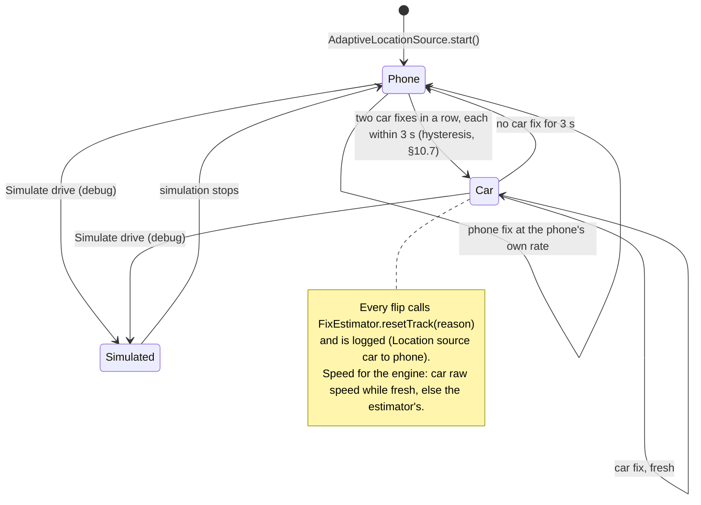

### 10.2 Rate: what the phone offers, never forced
**The phone's GPS is taken at the rate the phone offers** (owner, 2026-10-24: "we should be using the rate that the car or phone can offer not forcing it", watching a bench drive fed at a forced 10 Hz stutter: the Navigation SDK glides the car between fixes and restarts that glide on every fix, so bunched fast fixes made the car jump). The request asks for the natural GPS rate, **1 fix a second** (`AdaptiveLocationSource.GPS_HZ`), and **accepts any faster fix the phone already delivers** (`setMinUpdateIntervalMillis(0)`): it never drives the chip faster than it would run on its own, and never throws away a fix. At every speed, stopped or moving, and whether or not the car's GPS is in use. Before this (2026-10-12 to 2026-10-24) the phone was always asked for 10 Hz; that choice was for freshness after a restart (a slow rate left the car map at 0,0 until the next fix), which the 1 s interval still gives. The car's own GPS and speed stay at the fastest rate the car provides (§10.6–10.7).
- **Request**: `LocationRequest.Builder(PRIORITY_HIGH_ACCURACY, 1000 ms).setMinUpdateIntervalMillis(0).setMaxUpdateDelayMillis(0).setWaitForAccurateLocation(false)`, sent once when location starts. Fixes come in on the `adaptive-location` thread's Looper.
- **What arrives**: 1 Hz from most phone chips; more when another app or the chip itself runs faster. The rate actually delivered (a moving average of the time between fixes) is shown in the car's **More → GPS** row as "Requested 1 Hz · actual …". The request is never changed while running.
- **Speed** (`FixEstimator` in `:core`, its speed half; the heading half is §10.6a): the median of the last 3 `Location.speed` values when `hasSpeed()`; **a reported 0 is a real 0**. Displacement ÷ time is used **only when the fix carries no speed** (`!hasSpeed()`), against a reference fix at least **1 s** old, and only when the displacement exceeds max(3 m, the fix's accuracy) **on two fixes in a row** (one jitter spike can't become a speed); the displacement speed is itself the **median of its last 3 windows**, and standing still for 5 s re-anchors the reference so drift can't build up (as built, 2026-10-13); fixes with accuracy > 30 m are ignored. (Before, a reported 0 with 10 Hz jitter became distance ÷ 0.1 s: 1 m of jitter read as 22 mph while parked, which fed the engine, the panel, the report guard and the heading; found 2026-10-12.) The `Fix` records `speedSource` (gps / displacement / carRaw / simulated).
- **Power**: at the phone's own rate the GPS costs what any navigation app costs (§14); the earlier forced 10 Hz cost more, mostly when slow or parked with the car screen open.
- The old speed-dependent rate curve (`RateCurve`, `AdaptiveRateController` and the stored `gps_min_mph`/`gps_max_mph`/`gps_max_hz` values) was **deleted** on 2026-10-13 (code shrink); a backup file's old `gpsRate` block is ignored on restore. The median-of-three `SpeedSmoother` it held now lives with `FixEstimator`.

### 10.5 Lifecycle
**As built:** `AlertCoordinator.start()` (which starts `AdaptiveLocationSource`) runs from `NavSession.onCreate` to `NavSession.onDestroy`, i.e. while a car is connected, with the car session kept alive by the host (§2 "Process model", §9.3). It does nothing useful while every set has alerts turned off, until a set's alerts are turned back on.

---

### 10.6 Car speed from the head unit
Android Auto can pass the **car's own speed** to the app. The Car App Library reads it through `CarHardwareManager.carInfo.addSpeedListener` (car API level 3+, permission `com.google.android.gms.permission.CAR_SPEED`). The permission is a **runtime** one, so declaring it in the manifest isn't enough: the phone's Settings → Permissions asks for it with the others (`PermState.CAR_SPEED`, shown as "Car speed (speed panel uses the car's own speed)"). Without it the host refuses the listener: the host's log shows `SecurityException: The car app does not have the required permission: com.google.android.gms.permission.CAR_SPEED` on each car session start, nothing crashes, and the phone's GPS speed is used. (Found on the bench 2026-10-12: before this the app never asked, so car speed never worked.) The `Speed` object it returns has:
- **raw speed**: the car's measured road speed
- **display speed**: what the car's own speedometer shows, usually a few percent high
- **speedometer unit**: the car's mph/km/h setting

**Setting:** **Speed and location source** = **Car when available** (default) / **Phone only**. The same setting covers car GPS (§10.7).

**Rate:** the car's speed arrives **as fast as the host sends it** (as built: `CarInfo.addSpeedListener(executor, listener)` takes no rate parameter in the Car App Library; only the location listener has `UPDATE_RATE_FASTEST`, §10.7; owner, 2026-10-12: never a slower rate than the car offers), so the engine's speed is as fresh as the car's; the rate actually delivered is logged (`CarData firstSpeed`, the block header's Hz, §15.5) and shown in More → GPS.

**What each speed is used for** (when the car's speed is *fresh*, i.e. reported in the last 3 s):
| Use | Speed used | Why |
|---|---|---|
| Speed panel number | **Car display speed** | Matches the dashboard exactly |
| Alert engine (TIME-mode trigger distance, over-limit check) | **Car raw speed** | Accurate in tunnels, under trees and at low speed, and doesn't lag |
| Position and heading | **Car GPS** while fresh (§10.7), else the phone; the heading comes from `FixEstimator` over whichever feed is live (§10.6a) | The car's GPS is steadier than the phone's in the cabin; the estimator is reset on every handover |

The panel shows the **same fix the engine used** (`displaySpeedMps ?: speedMps`), so the dial and the engine can't silently diverge; before, the panel read the car's display speed and the engine the raw speed from different reports.

**Fallback:**
- If the car doesn't provide speed (the value status isn't SUCCESS), or nothing has arrived for 3 s, the phone's smoothed GPS speed is used, exactly as before. A car reporting raw 0 with status SUCCESS is logged (`CarData zeroFix`, §15.5) so it can't silently kill `moving`.
- The car screen's **More → GPS** row shows which source is in use, refreshed every second.

**Simulation:** during a debug **Simulate** drive the simulated speed is used, and car speed is ignored. The DHU only sends speed with `config/default_sensors.ini`.

### 10.6a Heading
`FixEstimator` (`core/location/FixEstimator.kt`, pure, tested; its heading half is referred to as `HeadingEstimator`, its speed half as `SpeedEstimator`, §10.2) turns the live feed into a heading **with an accuracy estimate**, so the direction rule (§11 step 3) and the dimming of facing-away cameras (§8.1) know how far to trust it (2026-10-12).
- **Track**: the bearing over an **adaptive chord** of clamp(speed × 2 s, 10–60 m) behind the car (10 m at a crawl, 60 m above 30 m/s), smoothed with a circular EMA. Its accuracy is `headingAccuracyDeg ≈ atan2(2 × accuracy, chord)`: 3 m fixes over a 40 m chord give about 8.5°.
- **GPS bearing**: blended with the track by inverse variance when the speed is over 3 m/s, `bearingAccuracyDegrees` ≤ 20° and the bearing is within 45° of the track. **Stale-bearing guard**: a bearing that is bit-identical for 10 or more fixes while the track has turned more than 20° is marked stale and ignored (the emulator reports 0° on every fix, found on the bench 2026-10-12; some cars repeat the last value).
- **No heading when still**: after 30 s under 1 m/s the heading is **null**. (A parked car used to keep its last heading, and 5 m of jitter could invent a new one, which consumed alert stages for cameras within range before the car ever moved.) **The chord ring is emptied whenever the speed is under 1 m/s** (as built, 2026-10-13), so a chord never spans a stop and moving off in a new direction can't read as the old one through parked jitter.
- **Right after a reset** (`resetTrack`, below) the ring is empty, so until a chord of at least 10 m exists the heading is the **GPS bearing alone** when it's trustworthy (over 3 m/s, accuracy ≤ 20°, not stale), otherwise none (as built, 2026-10-13).
- **`resetTrack(reason)`**: on a car↔phone handover (§10.7), a gap over 5 s, a jump over 200 m, and when simulation starts or stops; logged as `Location TRACK_RESET reason=` (§15.5).
- **What the engine sees** (as built, two enum sets: `FixEstimator` has its own `LocationSource`/`SpeedSource`/`HeadingSource` and the engine's `Fix` has its own, mapped by `EstimateMapper` in `AdaptiveLocationSource.kt`; the estimator's `DISPLACEMENT` is the engine's `DERIVED`): the `Fix` carries `headingSource` (track / gps / blended / none), `headingAccuracyDeg`, `speedSource`, `displaySpeedMps` (the car's dial speed when there is one), `locationSource` (car / phone / simulated) and `accuracyM`, all defaulted so `:core` callers without them still compile. Tests: `HeadingEstimatorTest`, `SpeedEstimatorTest` (§15.1).

### 10.7 Car GPS for location
The car's GPS position is read through `CarHardwareManager.carSensors.addCarHardwareLocationListener(UPDATE_RATE_FASTEST, …)` (car API 3+, uses the existing fine-location permission). It's controlled by the same setting as speed, renamed **Speed and location source**: **Car when available** (default) / **Phone only**.

- **Primary feed:** while the car's location is **fresh** (a fix in the last 3 s, with status SUCCESS), car fixes feed the alert engine, the per-fix marker redraw, the report snapshot and the free-drive camera checks. Phone fixes are ignored during that time.
- **Phone as backup:** while car GPS is fresh, phone fixes are ignored for alerts (the phone keeps reading at its own rate, §10.2). If the car stops reporting for 3 s, phone fixes take over straight away.
- **Hysteresis** (code review, 2026-10-23): once on the phone, the car takes over again only after **two car fixes in a row**, each within 3 s of the last. Before, a head unit reporting at about 0.5 Hz sat on the 2 s freshness edge and flipped car↔phone on most fixes, and every flip reset the track (no heading for a few fixes).
- **Rate:** the car's position is requested at **the fastest rate its GPS unit can provide** (`addCarHardwareLocationListener(UPDATE_RATE_FASTEST, …)`; owner, 2026-10-12), never a slower one; the car decides what it can deliver, and the delivered rate is logged (`CarData firstLocation`, the block header's Hz, §15.5). The phone is asked for 1 Hz and any faster fix is accepted (§10.2).
- **Not changed:** the **map's** car marker and turn-by-turn routing come from the Navigation SDK, which uses the phone's location services. The SDK has no way to feed it the car's GPS. On many cars, Android Auto already passes the car's GPS into the phone's location services anyway.
- **Handover reset** (2026-10-12): every car↔phone flip calls `resetTrack(reason)` (§10.6a) and is logged (`Location source car→phone (+ms since last car fix)`, §15.5). Before, the heading anchor and the speed smoother carried across the two feeds, and the follow watchdog compared the SDK's phone-based camera with our car-GPS fix (§8).
- **Clock:** the engine's and the estimator's times are the fix's `elapsedRealtimeNanos` (the time since boot, the same base for phone, car and simulated fixes), else its arrival time on that clock (code review, 2026-10-23). `Location.time` is a GNSS or car clock and was mixed with the wall clock when a feed stamped 0, which could make a gap or a stale clear look minutes long.
- **Diagnostics:** **More → GPS** shows "Location from car / phone" and "Speed from car / phone", refreshed every second.
- **Simulation:** during a debug Simulate drive, simulated positions are used and car GPS is ignored; `setSimulated(false)` is also applied when the session is destroyed or the simulated drive arrives, not only on stop. The DHU provides car location with `config/default_sensors.ini`.

## 11. Alert engine maths

Inputs per fix: position *P*, smoothed speed *v* (m/s), heading *h*, plus the route polyline if one is set.

- **Heading**: from `FixEstimator` (§10.6a): a chord track blended with the GPS bearing when it's trustworthy, with an accuracy estimate (`headingAccuracyDeg`), and **null** after 30 s under 1 m/s, so a parked car has no heading and no **new** alerts start until the speed is over 2 m/s. (The emulator's fixed 0° bearing, which made every camera on a southbound road fail the direction check on the bench, A61 Sheffield → Derby, 2026-10-12, is caught by the stale-bearing guard.)
- **Speed** *v* is the car's raw speed when fresh, otherwise the GPS speed (§10.6), in m/s, and every time-based distance is converted from it on every fix.

For each candidate *q* in the cached cells, with the set's and category's alerts on and not `hiddenByReport`:

1. **Distance**: *d* = haversine(*P*, *q*). Skip if *d* > `maxLookahead`, which is the trigger distance + 200 m, capped at 3 km.
2. **Ahead of you**: β = bearing(*P*→*q*). Keep if |angleDiff(β, *h*)| ≤ **45°** (owner's choice, 2026-10-12; was 30°, widening to 45° only within 150 m). Parallel roads are still filtered by step 4.
3. **Direction check** (**hard rule**, §1.3: never dropped or loosened; a camera with a bearing in its data is never treated as "any direction"; tests cover both facing and opposite). A camera's direction matches when its stored bearing is within **45°** of the car's current heading *h* **or** within 45° of the bearing β from the car to the camera (the road must be turning towards it); the camera must still be ahead (step 2: within 45° of the heading, or closer than 15 m) and the ONE_WAY / BOTH semantics are unchanged:
   - ANY or no bearing: passes
   - ONE_WAY: passes if |angleDiff(*q*.bearing, *h*)| ≤ 45° **or** |angleDiff(*q*.bearing, β)| ≤ 45°
   - BOTH: passes if either of those holds for *q*.bearing **or** for *q*.bearing + 180
   - An opposite-facing camera cannot pass either test. The bearing-to-camera alternative was **approved by the owner on 2026-10-12 as an amendment to the direction hard rule** (a camera just past a bend is faced only once the car has turned); the 45° tolerance itself is unchanged. **As built (2026-10-13): the β alternative applies only while the camera is properly ahead** (|angleDiff(β, *h*)| ≤ 45°), not in the "closer than 15 m" case of step 2, so a camera the car is practically on top of is judged against the heading alone.
   - **Error budget**: the 45° has to absorb the data's 22.5° compass quantisation (PGW OV2 bearings are 8-point), up to 5° of heading error (§10.6a) and a few degrees of curve, which is why nothing else may eat into it.
4. **Route matching** (only with a route): the cross-track distance from *q* to the route polyline **ahead** of you, the next 3 km of segments, found by `RoutePolyline` in `:core` (segments behind are never matched; the whole route was, 2026-10-12). **When the car itself is more than 50 m from its segment it is off the SDK's route** (the limit-change lookahead walks the same route points through `GuidanceController.routePointsAhead`, which uses its own looser 100 m off-route threshold, §8.4a) (the SDK hasn't rerouted yet, or routed a road parallel to the one being driven), and the route then says nothing about the road the car is on: the matcher returns "no route" and the engine uses its free-drive corridor until the car is back on a route (logged `Guidance carOffRoute d=` / `carOnRoute`; 2026-10-13). **The car is located once per fix, from the car's position** (`GuidanceController.locateCar`, before the engine runs), and the matcher then only measures each POI against the route ahead (bench, 2026-10-23: the matcher had located the "car" at every POI it was asked about, so the car's place on the route jumped from camera to camera and any camera over 50 m from the route made the car look off-route, sending that camera to the looser free-drive corridor; the log flipped `carOnRoute`/`carOffRoute` several times a second). **The car's own segment is chosen among segments running the car's way** (bearing within 90° of the heading; without a heading, or when no segment matches, the plain nearest one): on the bench (2026-10-13) the SDK's route from a parked car went north first, U-turned at a roundabout and came back south along the same A61, and the nearest-segment snap pinned the car to the northbound leg 10 m away, so every southbound camera was "off road" by over a kilometre and nothing alerted. If it's more than **50 m**, drop the POI, which removes cameras on parallel roads. Without a route, a **lateral offset** check is used instead: *d*·sin(angleDiff(β, *h*)) must be ≤ **max(40 m, *d*·sin 12°)** (`Config.freeDriveFarDeg`): 40 m inside 192 m, where the 2nd and passing stages live, widening with distance so a bend or heading noise doesn't reject a camera at first-stage range. (A fixed 40 m was 4.9° at the 70 mph first trigger of 469 m, so the 1st fired late or not at all on any bend.) The 12° budget: ≤ 5° of heading error, a few degrees of road curve over the lookahead, and GPS lateral noise.
   - **Free drive follows the road ahead, not a straight line** (owner, 2026-10-23: "mobile camera alerts are for road we are not on", then "its fired again"; chose "road only"). Without a route the engine's only test was the corridor around a straight line ahead (side tolerance, widening by d·sin 12°), so a camera on a nearby road roughly parallel to ours and facing our way passed it: on the bench a PGW mobile site on Sheffield Road, Chesterfield alerted (FIRST at 474 m, SECOND at 248 m) while the car drove north on a road 211 m from it, and one on Whittington Hill gave FIRST at 945 m while the car was on the A61 496 m away. Now, in free drive (and in guidance while the car is off the SDK's route), the road ahead is followed through the OpenStreetMap road pieces on the phone (`LimitLookahead.roadAhead`, the connectivity walk of §8.4a: joins within 40 m and 45°, straightest first, up to 2 km), and `RoadAheadMatcher` gives the engine a camera's cross-track distance from that road, checked against the same side tolerance as a route (50 m, 100 m for mobile sites). A camera further along than the walk reaches, or with no OSM road under the car (no limits downloaded, or a road with no posted limit), gets "no route", and the straight corridor applies as before. **Trade-off (owner's choice): a camera on a road you are about to turn onto is silent until you are on that road;** the stages already passed are then marked fired and the next one is spoken (often SECOND or PASSING). The direction rule (step 3) is unchanged and applies to all. The walk is recomputed once a second, **and at once when the heading has turned 10° or more since the last walk, and at most four times a second** (review, 2026-10-24: a heading wandering ±12° fix to fix in a crawl would otherwise re-walk 2 km of road on every 10 Hz fix) (bench, 2026-10-23: at a junction on the A57 Sheffield Parkway the walk taken just before the car turned onto the slip still led to camera 3335, 12 m off it, and gave a FIRST 1.6 s after the turn; from the slip the camera is 461 m off the road).
   - **Tracked latch** (2026-10-12): once a POI has passed ahead + direction + corridor it is marked tracked and stays valid for its stages until it is clearly behind, far outside the corridor, or its direction is off by more than 90°, so a moment of heading noise on the approach can't drop it between stages. **"Far outside the corridor" as built (2026-10-13): lateral > max(side tolerance, 2·*d*·sin 12°) in free drive (twice the entry corridor), or > the route tolerance with a route.
   - **Mobile camera sites get 100 m** for both checks (PGW mobile and pending-mobile sets, and mobile reports): a site is marked where the van parks (bridge, lay-by, verge), often 50–100 m from the carriageway's centre. Found on the bench, 2026-10-12: a PGW mobile site on the M40 south of J11, 62 m off the route and facing the right way, was dropped by the 40 m check. Fixed, red-light and average-speed cameras keep 40/50 m so parallel roads stay filtered. The direction check (step 3) applies to all, unchanged.
5. **Alert stages**: three per POI, defined in §11.1. Each fires once, when *d* ≤ that stage's trigger distance. The lead time is in **seconds** and is always converted through the **current speed**: on every fix `triggerMetres = max(floorMetres, speedMps × seconds)`, never a fixed distance. **Trigger ratchet** (owner, 2026-10-12): per POI, the trigger is `max(previous, trigger(v))` from the moment the camera comes into range, i.e. it uses the highest speed seen since then, so the distance never shrinks during an approach and braking cannot shorten the warning. (Before, the trigger shrank with the speed on every fix, which felt like wrong timing.)
6. **Missed-passing safety net**: if a POI that passed steps 2–4 suddenly goes from ahead to behind (|angleDiff(β, *h*)| > 90°) within 150 m, and its passing alert hasn't fired yet, the passing alert fires right away. This covers a GPS jump or slow fixes that skip over the 20 yd mark. When sound is on the passing alert can't be missed. **PASSING may fire below 2 m/s** (down to 0.5 m/s) once the POI was ahead-and-valid, so a crawl past a camera isn't silent (2026-10-12).
7. **Deduplication**: per POI it keeps `{firstFired, secondFired, passingFired, closestD, firedAtMs, firedAtD, lastSeenMs, firstTriggerM, secondTriggerM, tracked}`. **Stage flags are set only when an event is emitted** (2026-10-12; before, they were set before the rate limit decided not to speak, so a suppressed stage was gone for good). The state is cleared once *d* is past its lowest point by more than 100 m (you've passed it), when the POI is more than **2 km behind**, when a stage fired but there was no approach for 90 s (*d* ≥ `firedAtD` − 30 m: parked jitter had consumed the stage; **not once PASSING has fired**, so waiting at a red-light camera's stop line doesn't say PASSING again on moving off, 2026-10-13), or when the POI has been out of the candidate cache for 60 s (`prune(now)` at the end of `onFix`). Each clear writes the `PASSED` summary line (§15.5). That way the same POI re-alerts on a later pass but not twice on one approach.
   - **Events are never dropped.** The engine has no rate limit (the old 3 s window, with a never-reset "closer than the last one" rule, lost one of two cameras at a junction for good). `NavTts` serialises speech (§12.3): the newest stage per POI replaces an older one still waiting; a FIRST or SECOND that has become stale (by distance) is not spoken; **PASSING never waits more than 0.5 s behind the SDK voice and is never dropped**.
   - If one fix crosses several thresholds at once (because of high speed or a late cell load), only the closest stage is spoken. For example, crossing the 1st and 2nd together speaks the 2nd. The skipped stages are marked as fired.
8. **Average-speed zones**:
   - **With marked start and end** (sources that tag ZONE_START/ZONE_END):
     - Going past a ZONE_START POI that passes the checks starts zone mode, with the limit taken from that POI.
     - While in the zone, the overspeed check runs on each fix.
     - A ZONE_END POI ends it with a "Leaving zone" alert.
   - **PGW (all SPECS points are type 4, with no start or end)**: zones are worked out from **chains of points**.
     - **A zone is only real if it has a camera ahead.** When you pass a type-4 POI that passes the checks while you aren't in a zone, zone mode starts ("Entering average speed zone, {speed} limit") only if another type-4 POI **with the same limit** is ahead of you, facing your direction (as built: its bearing within 60° of the heading), within the gap (5 km). A lone SPECS point, or the last camera of a zone you joined part-way through, doesn't start a zone: there's nothing ahead to time you against.
     - Each later type-4 POI you pass (one that passes the direction check) keeps the zone going and updates the limit if it changes.
     - **Passing the last camera ends the zone.** When you pass a zone camera and no same-limit type-4 POI is ahead within the gap, you hear "Leaving average speed zone" there, not 5 km later.
     - The zone also **ends** when no type-4 POI that passes the direction check is ahead within **5 km**, or none has been passed for **5 km** (SPECS points are usually ≤ 2–3 km apart). Then you hear "Leaving average speed zone". Only same-limit points count as "ahead", so a nearby zone with another limit (common in cities, where SPECS 20 and SPECS 30 zones touch) can't keep a finished zone open.
     - **A jump ends the zone.** If two fixes in a row are more than 1 km apart (GPS lost in a tunnel, a bench `geo fix` jump), the zone ends with no alert: we can't know which road you're on now. Zone mode starts again at the next camera that passes the checks.
     - The 5 km gap is a setting.
     - Optional pre-processing at import: `ZoneChainer` groups type-4 points by nearest neighbour (≤ 5 km, bearing within ±30°) into `zoneId` chains and marks the ends of each chain. That improves the "entering" alert at the first camera, but the engine also works without it.
   - The zone also ends after 30 km or 30 min without an end POI.
   - **What a zone alert shows.** Zone alerts (enter, over the limit, leave) belong to the zone camera you last passed: its id, its set's icon (for PGW that's the set for the limit, e.g. "SPECS 50", so the icon itself shows the limit) and its limit. The over-the-limit text names the limit: "Average speed zone, 50 mph limit, you are over the limit" (spoken "…50 miles per hour limit…"). The banner's subtitle also gives the limit. Before this, zone alerts had no POI, so they showed the generic average-speed icon and no limit.
9. **Overspeed**: if the POI or zone has a limit and *v* > limit × (1 + `overspeedPct`). It's set with a **slider from −5% to +20% in 0.1% steps**, defaulting to **−0.1%** (so the warning triggers just below the limit, at 99.9% of it), the alert gets an "you are over the limit" suffix. In a zone, a repeat overspeed chime can play at most every 15 s. **Which limit** (2026-10-13): a zone camera is judged against the zone's limit; any other camera inside the zone (a 30 red-light camera in a 50 zone) against its own, and the zone's only when it has none. Passing a zone camera with no limit (variable) keeps the zone's limit. `overspeedPct` is **updated in place**; the engine is no longer recreated when it changes (that lost every POI's state, 2026-10-12).
10. **Trace** (`fun interface Trace` with `verdict(...)`, `stage(...)` and `cleared(...)`; an optional constructor parameter, zero cost when null; 2026-10-12): the engine reports each **change** of a POI's `Verdict` inside the lookahead (`AHEAD_OK`, `WRONG_DIRECTION` (shown dimmed, "facing away"), `OFF_ROAD`, `BEHIND`, `OUT_OF_RANGE`, `NOT_MOVING`, `NO_HEADING`: the one enum `classify()` gives the marker layer, §8.1), every stage with the distance, speed, heading, camera bearing and expected distance, and every state clear with its reason. The app writes them to `alert-debug.log` (§15.5). Only on change, never per fix. The speed-limit-ahead announcement (§8.4a) goes through the same speech path at FIRST priority.

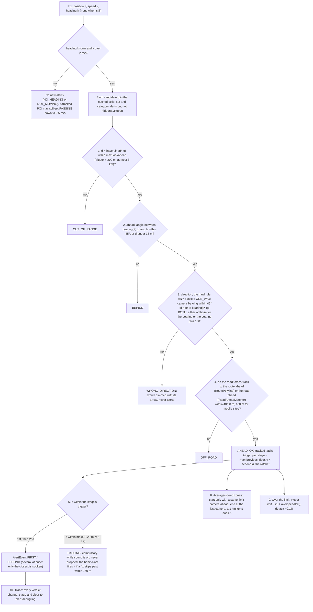

*The steps are numbered as in the text above. Verdicts are the `Verdict` enum in `core/alerts/AlertTrace.kt`, shared with the marker layer (§8.1).*

### 11.1 Alert stages
| Stage | Settings | Default | Can be turned off? |
|---|---|---|---|
| **1st alert** | Mode FIXED (distance) or TIME (seconds ahead at the current speed, with a minimum distance). In TIME mode the seconds come from the **global lead-time slider** `alertLeadSeconds` (15–60 s; owner, 2026-10-12) | **TIME: N s** at the current speed (N = 15), min 242 m (265 yd) | No. Its distance can be set, but the stage stays (turn the whole set's alerts off to remove it). |
| **2nd alert** | Turned on/off; mode FIXED or TIME; distance and minimum. In TIME mode its seconds are **N/2** | On, **TIME: N/2 s** (7.5 s) at the current speed, min 142 m (155 yd) | Yes |
| **Passing alert** | None: **1 s at the current speed, never less than 20 yd (18.29 m)** (owner, 2026-10-24: "the now alert should happen 1 second before it not after", "the alert should use time at current speed", on the Banbury bench drive at 55 mph with 1 Hz fixes, where a fixed 20 yd fell between fixes and the alert came from the behind net, after the camera; before that fixed 20 yd from 2026-10-23, and 100 yd before that). `passingTrigger = max(PASSING_METRES, speed × PASSING_LEAD_S)` on every fix from the current speed (24.6 m at 55 mph, 31 m at 70 mph; the floor below 41 mph), measured along the track | 1 s, ≥ 20 yd | **No. Compulsory whenever sound is on for the POI** (`soundOn`, §4.2). With sound off it's skipped and only the visual alerts run. A camera that is tracked stays `AHEAD_OK` until it is behind (the tracked latch, §11 step 4), so one set back from the road still gets it at 20 yd, **measured along the track** (review, 2026-10-24: the trigger is the camera's along-track distance, *d*·cos(angleDiff(β, *h*)), not the straight-line *d*, so a camera 30 m beside the carriageway, which never comes within 18 m in a straight line, is announced as the car draws level with it rather than one fix after it is behind; for a camera straight ahead the two are the same); one the car never draws level with gets it from the missed-passing safety net (step 6) as it goes behind. At speed the words "… now" end just after the camera (70 mph covers 20 yd in 0.6 s). |

- **Where it's set**: the lead time is **one global slider** in Settings → Alerts (owner, 2026-10-12): "First alert: N s ahead · second alert at N/2 s", 15–60 s, default 15, with the three worked distances for the chosen seconds (30/50/70 mph) as helper text. It overrides the per-set seconds of every set in TIME mode; `AlertCoordinator.resolve` applies it when building each set's stages, and the engine only reads the stages it's given. Per set, the editor (§13) keeps enabled, map, sound, the mode and the floor metres; its seconds fields are gone and the card says "from the Alerts slider". No schema change: the DB columns `a1_seconds`/`a2_seconds` stay but are ignored in TIME mode. The setting is in the backup (§13.4). **Per-category overrides and dismissing the passing alert: not implemented.** Distances are entered in the user's units: yards/miles in imperial, metres/km in metric. The passing distance always shows as "100 yd (91 m)".
- **Trigger distance**: FIXED `D = metres`. TIME `D = max(metres, v × seconds)` on **every fix**, with *v* the **current speed** in m/s (the car's raw speed when fresh, otherwise GPS; §10.6), never a fixed distance, so the warning time stays the same at any speed. Worked numbers at the default 15 s: 70 mph (31.3 m/s) → **469 m**, 50 mph (22.4 m/s) → **335 m**, 30 mph (13.4 m/s) → 201 m, lifted to the **242 m floor**; the second stage uses half the seconds (7.5 s → **235 m** at 70 mph, 168 m at 50 mph, floor 142 m). At 60 s: 1877 m and 938 m at 70 mph. The floors keep the 2nd outside the 100 yd passing alert and the 1st 100 m before the 2nd. **Ratchet** (§11 step 5): the distance never shrinks during an approach, since it uses the highest speed seen since the camera came into range, so braking cannot shorten the warning.
- **Existing sets**: DB v7 (`MIGRATION_6_7`) moves sets still on the old defaults (1st TIME 30 s / 457 m, 2nd FIXED 274 m) to the new ones; sets the user changed are left alone.
- **Validation** (in the editor, and again at runtime):
  - D(2nd) must be at least 142 m (155 yd), a fixed floor (`AlertEngine.SECOND_FLOOR_M`); it was 100 yd + 50 m and stays 142 m now the passing alert is at 20 yd (owner, 2026-10-23)
  - D(1st) must be at least D(2nd) + 100 m
  - In TIME mode the rule is checked at the current speed every fix. If the times shrink the gap, the 2nd distance is held to D(1st) − 100 m and the passing distance stays 18.29 m.
- **What each stage does**:

| Stage | Visual | Speech | Car `Alert` / notification |
|---|---|---|---|
| 1st | Car `Alert` with progress bar starting | 1st template | New alert, id = POI |
| 2nd | Same alert updated, progress continues | 2nd template | Replaces the 1st (same id) |
| Passing | Alert updated to "Now", ACTIVE marker pulses (§8.1) | Passing template (with chime first if the chime is on) | Replaces; dismissed 3 s after the POI is behind you |

**Output** (as built): the core `AlertEvent(poiId, kind = FIRST|SECOND|PASSING|ZONE_ENTER|ZONE_EXIT|OVERSPEED, distanceM, overspeed, priority, triggerM, staleBelowM)`; priorities PASSING 100, SECOND and OVERSPEED 50, the rest 10. The app's `AlertCoordinator` resolves the set, category, icon, display and spoken text into an `ActiveAlert` for the dispatcher (§12).

**Cost**: the 5×5 cell cache holds about 10–200 POIs in the UK. Each fix does about 200 haversine and bearing calculations, well under 0.1 ms. At 10 Hz the CPU cost is negligible.

---

## 12. Alert dispatch

`AlertDispatcher` takes `AlertEvent`s on a channel and decides where each one goes based on what's showing:

| State | Visual | Speech | Cluster |
|---|---|---|---|
| Our car screen in foreground | Alert banner on the map (§12.1) | NavTts | Trip update (if guiding) |
| Car connected, another app full screen (e.g. media) | Nav heads-up notification | NavTts | Trip update (if guiding) |
| Phone only (no car) | Phone heads-up notification | NavTts | — |

**As built:** the dispatcher has no lifecycle or connection check of its own. `NavSession` sets `AlertDispatcher.carSink` on create and clears it on destroy; `dispatch` tries the sink (the banner, which needs the map surface) and falls back to the heads-up notification when there is no sink or it returns false. The same navigation-category notification serves "another app on top" and "phone only".

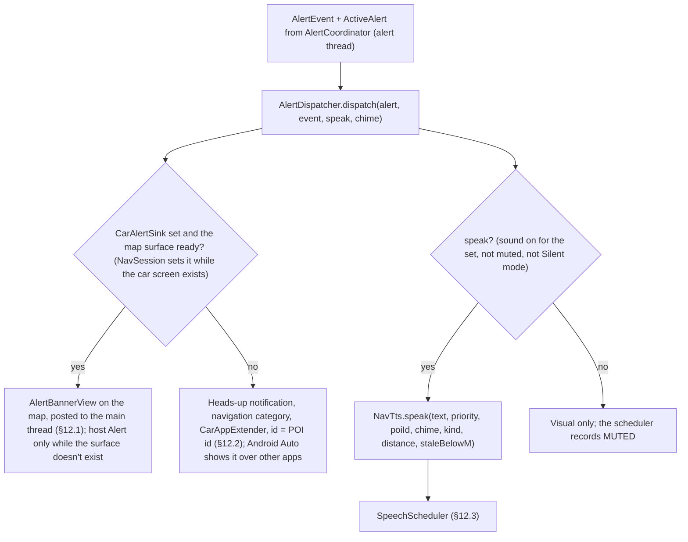

*As built there is one notification path for "car connected, another app on top" and "phone only": the same navigation-category notification.*

### 12.1 Alert banner on the map
The alert is drawn by us on the map surface, in the same `Presentation` as the speed panel (§8.4), not with Android Auto's `AppManager.showAlert`. The host places its alert card at the top beside the rail and slides it in from the side; the user wants it to **sit at the bottom**, steady.
- **Where:** bottom centre of the visible area, clear of the speed panel (bottom right). It appears and goes in place (a short fade, no slide).
- **What:** the set's icon, the alert text, a subtitle such as "140 yd · 20 mph", and a progress bar that runs for the alert's time (8 s, or 5 s when passing).
- **Updates:** the SECOND and PASSING alerts for the same POI update the banner in place.
- **Dismiss:** tap the banner (`SurfaceCallback.onClick`). There are no buttons on it: the map surface can't host them. **Mute** is in More on the action strip ("Mute alerts for 30 min").
- **Size and look** (`AlertBannerView`):
  - height **96 dp**; width up to **640 dp**, leaving **140 dp** clear on each side (`SPEED_PANEL_CLEAR_DP`, as built) for the speed panel, now one 112 dp pill (§8.4), but never narrower than half the visible width
  - placed by `MapSurface.layoutOverlays` (as built; `applyPadding` only sets the map camera's padding) from the **visible** area: centred across it, 16 px above its bottom edge, so it moves with the rail, the turn card and the split-screen media panel
  - dark card (`#202124` at 92%), 16 dp corners; the icon (the set's icon, 128 px bitmap) and the text beside it are **centred together** in the card (2026-10-12; text left-aligned to each other, the block centred); title 26 dp white, ellipsised; subtitle 20 dp grey; progress bar 4 dp along the bottom (`#8AB4F8` on a dark track)
  - **GPU drawing** (2026-10-12): the card, icon and text are drawn once per alert (text shortened once, not per frame) into a **hardware layer**, a GPU texture freed when the banner hides; the progress bar is its own view whose `scaleX` is animated on the **render thread** (`ViewPropertyAnimator`), so nothing is redrawn while it runs. (Before, the whole banner was redrawn every 100 ms.)
  - **Map frame rate** (measured on the bench): the Navigation SDK draws the map into a `GLTextureView` and keeps rendering about 57 frames/s even when parked; hiding all our overlays or leaving follow mode doesn't change it, so it's the SDK's own (e.g. its location marker), not our code.
  - fade in and out over 150 ms; never slides
- **Timing:** shown for 8 s, or 5 s for the passing alert; each new stage restarts the time. `AlertCoordinator` keeps the alert as "active" (for the markers and the diagnostics) for 12 s after the event, the banner's 8 s plus slack. The banner hides itself when the time runs out, or at once when tapped.
- **Identity:** the banner remembers the POI id it's showing. A new alert for the same POI (2nd stage, passing) updates the text in place with no fade; a different POI fades the new one in.
- **Threading:** `AlertDispatcher` calls `NavSession.showCarAlert` on the alert thread; the banner update is posted to the banner's own (main) thread. The tap hit-test in `MapSurface.onClick` compares the tap with the banner's bounds on the surface.
- **Tap delivery:** `SurfaceCallback.onClick` needs car API 5+ and a template that passes clicks to the surface. If a host doesn't deliver it, the banner still goes by itself after its time, and Mute is in More. **To confirm on the DHU** (TESTING.md A2b).
- **Fallback:** if the map surface isn't ready, the host `Alert` is used as before (`Alert.Builder(alertId = poi.id, title, 8000)`, icon, subtitle, Dismiss and Mute 30 min actions; car-app API ≥ 5).
- No template message for the alert: the banner is the only alert surface on the map (one element per job, §8; 2026-10-13). The host `Alert` fallback above is used only while the map surface doesn't exist, never alongside the banner.

### 12.2 Navigation heads-up notification (background)
- Channel `poi_alerts`, `IMPORTANCE_HIGH`, with no sound because TTS does the speaking. Vibration is off.
- Built with `NotificationCompat.Builder`:
  - `.setCategory(CATEGORY_NAVIGATION)`
  - `.setSmallIcon(...)`, `.setLargeIcon(iconBitmap)`
  - `.setContentTitle(displayText)` (*as built the distance is in the title line; no separate content text*)
  - `.setOnlyAlertOnce(false)`, `.setTimeoutAfter(10_000)`
- `.extend(CarAppExtender.Builder()`:
  - `.setImportance(IMPORTANCE_HIGH)`
  - `.setSmallIcon`, `.setLargeIcon`
  - `.setContentTitle`, `.setContentText`
  - *Designed, not built (2026-10-24; ISSUES N8):* `.setContentIntent(CarPendingIntent → open our car screen)` and `.addAction(Mute)`.
- Notification id = `20_000 + poi.id % 10_000` (as built; two POIs exactly 10,000 ids apart would share one), so SECOND and PASSING alerts update the existing notification instead of stacking.
- Android Auto shows navigation-category heads-up notifications from the active nav app the same way it shows turn notifications.

### 12.3 TTS on the navigation audio channel
- `NavTts` sets up one `TextToSpeech` engine and warms it up when the car connects or guidance starts. **Voice: the phone's default text-to-speech voice** (owner, 2026-10-23: "now we are doing the speaking you can remove the settings and use the phones default tts voice"): the engine's own default language and voice, as chosen in Android's text-to-speech settings, for the alerts **and the directions** (below), so they are always one voice. Only if the default language has no voice data does it fall back to the phone's language, then any English; what's used is logged (`Tts ready engine= lang= voice=`). There is no voice setting in the app.
  - *History:* 2026-10-13 the voice was fixed to `en-GB`; 2026-10-23 the owner heard two voices (the SDK spoke American on the en-US bench, and in UK English its recorded prompts are a male voice while the engine's default UK voice is female, measured on the bench by pitch and MFCC distance), so a Voice language setting with a voice matched per language was built and then, once we speak the directions ourselves, removed in favour of the phone's default.
- **Directions in our voice** (owner, 2026-10-23; `GuidancePrompter` in `:core`, pure and tested; `DirectionsSpeaker` in the app):
  - While guiding, the SDK's own voice is **off** (`AudioGuidanceSettings.GuidanceMode.SILENT`) and we speak its directions from the turn-by-turn feed (`NavInfo`: the current step's `fullInstructionText`, e.g. "Turn right onto Main Rd/A61", and `distanceToCurrentStepMeters`), through `NavTts`, so directions and alerts are one voice.
  - **When**, once per step, Google-style: a **prepare** prompt "In 300 yards, turn right onto Main Rd, A61" when the distance falls to clamp(speed × 30 s, 150 m, 2 km), rounded down to a spoken distance (UK units: 100, 200, 300, 500 yards, a quarter of a mile, half a mile, 1 mile, 2 miles; metric: 100, 200, 300, 500 metres, 1 kilometre, 2 kilometres); a **now** prompt, the instruction alone, at clamp(speed × 5 s, 40 m, 300 m); and on a step longer than 3 km, when it starts, "Continue for N miles" (or kilometres). A step that starts already inside a prompt's distance skips the earlier prompt; a prompt is never repeated for the same step; nothing is said while rerouting. The last step, whose instruction from the SDK is only the destination's title, is worded as Google does: "In 300 yards, your destination is on the left" / "Your destination is on the right" / "… is ahead", from the step's destination manoeuvre. On arrival "You have arrived" (with the toast, §8). Units follow the app's units (§13). "/" in road names is read as a pause (", ").
  - **Speech kind `AlertKind.GUIDANCE`** (add, don't rename), priority **80**: above a camera's 1st and 2nd stages, below its PASSING (still never dropped, §11). A newer direction replaces one still waiting; a waiting one is stale once the car is past its distance (a prepare prompt inside the now distance, a now prompt past the turn). **Mute and the alerts' Voice switch don't silence directions** (they are the alerts' controls); directions follow Android Auto's own volume like Google's did.
  - **Never left without directions**: if our TTS can't start (`NavTts` init failed, §12.3 Errors) or errors twice, the SDK's own voice is switched back on (`VOICE_ALERTS_AND_GUIDANCE`) for the rest of the route and that's logged (`Directions fallback sdkVoice reason=`).
  - Logged: `Directions say kind=prepare|now|continue step=n d= text=` to `debug-nav`, and the speech records list them as "Directions".
- Audio attributes: `USAGE_ASSISTANCE_NAVIGATION_GUIDANCE`, `CONTENT_TYPE_SPEECH`. On Android Auto this routes to the car's navigation audio stream, the same one turn prompts use.
- Focus: `AudioFocusRequest(AUDIOFOCUS_GAIN_TRANSIENT_MAY_DUCK)` is requested just before speaking and **abandoned after the last utterance** (as built: on `onDone`/`onError`/`onStop` only when nothing else is waiting, and when the queue goes idle, so back-to-back utterances keep the focus rather than flapping it). Media apps duck and don't pause.
- **Speech policy** (2026-10-12; `SpeechScheduler` in `:core`, pure with an injected clock and tested; `NavTts` drives it and is the only speech serialiser, since the engine never drops an event, §11 step 7):
  - **Ours is the only voice on the guidance channel**: the Navigation SDK's is off while we speak the directions (above), and it only comes back when our speech has failed, so the two never speak together. The detection of another guidance player and the bounded waits behind it (2 s for a stage, 0.5 s for a PASSING, a busy channel ignored after 5 s), built when the SDK spoke its own prompts, were removed on 2026-10-23 (owner: clean up what was left from when Google did the voice).
  - **Staleness by distance** (`staleBelowM`): a waiting FIRST or SECOND is not spoken once the car is already closer than the stage's distance makes sense for (it would be announcing a camera it's nearly at); PASSING is **never dropped**.
  - **Same POI**: only a **later stage** replaces an earlier one still waiting (the newest stage wins); the replaced one is recorded as `REPLACED`. SECOND/OVERSPEED jump the queue; otherwise first come, first served.
  - **Speaking watchdog**: `speaking` is cleared by `onDone`, `onError` and **`onStop(id, interrupted)`** (an interruption by the car's audio handling used to leave the flag set forever, so every later alert queued silently), and by a timeout of **3000 + 120 × characters ms, capped at 15 s** (`TTS_STUCK`). While the engine still reports `isSpeaking` the deadline is extended in 1.5 s steps up to 15 s from `onStart` rather than cutting the sentence off: numbers speak far longer than their characters ("148 yards" is "one hundred and forty-eight yards"), and on the bench the old 1500 + 70/char allowance killed every SECOND mid-sentence (2026-10-13).
  - **Errors**: a non-SUCCESS `speak()` or `onError` → **retry once**, then the chime plus the banner and a one-off toast, so an alert is never silently lost; the audio-focus request's result is recorded.
  - **Every decision is recorded** (`QUEUED / REPLACED / SPOKEN / DROPPED reason / INTERRUPTED / TTS_ERROR status / TTS_STUCK`) in a 50-entry ring shown in car More → Alerts and the phone's Diagnostics, and written to `alert-debug.log` (§15.5); `spoken`/`spokenDelayMs` are written back onto the STAGE event, so a silent alert can always be explained.
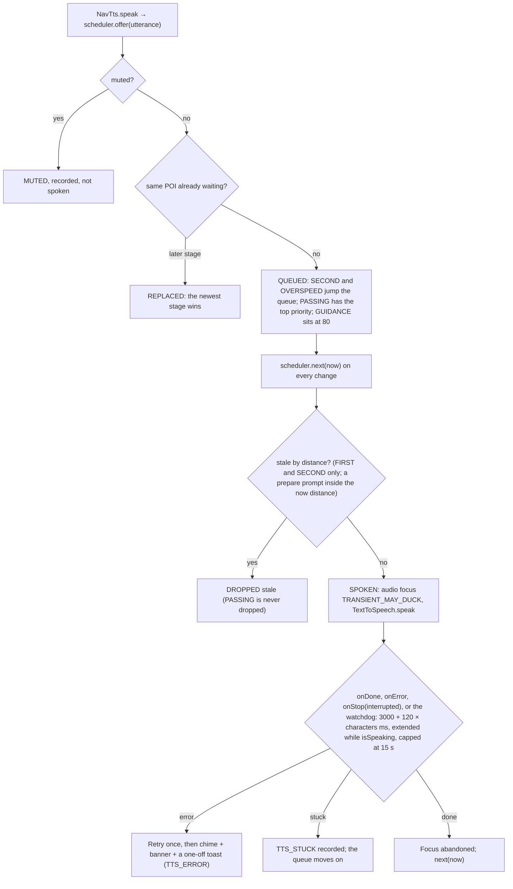

- Optional chime before speech (setting): a short earcon played through the same attributes in the same focus window.
- Mute: global and per-set mute **stop speech only**; the visual alerts, including the passing card, still show. The engine still emits PASSING while muted: the coordinator only clears `speak`, it no longer rebuilds the candidates with `soundOn=false` (2026-10-12). The compulsory rule means "always when sound is on", not "even when muted". A "Silent mode" setting turns off visuals as well.

### 12.4 Driver's screen (instrument cluster) and rail
**What the driver's screen can show** (owner request, 2026-10-12): Android Auto renders the active navigation app's `Trip` on the instrument cluster of cars that support cluster navigation: the next manoeuvre icon, its distance, the road, and the ETA/remaining distance from the destination's `TravelEstimate`. Third-party navigation apps get this turn card only; the cluster **map** is Google Maps' own and no API offers it to apps. Whether the XPENG G6 shows it at all is the car's decision, so it's **checked on the first drive after this change** (§15.4) and recorded here.
- **What we send** (`TripMapper.trip`): the current `Step` (manoeuvre, cue, road) with its estimate, the destination with the trip's estimate, and `setCurrentRoad`; the **next step is added as a second `Step`** so clusters that show two manoeuvres can; `setLoading(true)` while rerouting so the cluster shows a spinner, not a stale turn. Published on every `NavInfo` update and from whichever screen is on top (§9.3); each `updateTrip` is sampled into `debug-nav` (`Trip update step=… d=…`, every 5 s), so a blank driver's screen can be told apart from a car that ignores trips.
- **POI alerts on the cluster** (**designed, not built as of 2026-10-24**: `TripPublisher` sends the route's steps only): while guiding, `TripPublisher` would put the active POI alert into the `Trip` for 8 s as a `Step` whose **`Maneuver` icon is the camera's own icon with its limit badge** (no badge on a camera icon, §7) (the same `IconRepository` bitmap as the marker, §8.1, through `CarIcon` from a bitmap, as `TripMapper` already does for the SDK's manoeuvre bitmaps) and whose cue carries the alert text and distance ("Fixed camera · 30 mph · 0.4 mi", the road in `setRoad`), then puts the normal step back. Clusters that don't support this ignore it. Car cluster support varies by vehicle, so this is best effort.
- **The media artwork slot** (owner question, 2026-10-12): the artwork the driver's screen shows comes from the playing media app's `MediaSession` metadata (title, subtitle, album art, playback state), which Android Auto takes from whichever session is active. There's no navigation API for it, but it **could be borrowed**: our foreground service owns a `MediaSessionCompat`; for the 8 s of an alert it goes active with state `PLAYING` (no audio focus taken, so the music keeps playing), title "Fixed camera · 30 mph", subtitle "0.4 mi" and the camera icon as artwork, then `STOPPED` and released. **Unverified and risky**: Android Auto's main-screen media card would likely switch to us too and may not switch back by itself; the cluster may only accept sessions from a declared Android Auto media app; the car decides whether the media card is even visible while navigating. Open question §16 row 27: prototype on the DHU's cluster config, then the real car, before the owner decides. Until then, camera details on the driver's screen go through the `Trip` step above.

---

## 13. Phone app screens (Compose, Material 3)

The phone app has **four tabs: POIs · Cameras · Reports · Settings**. There's no separate Setup tab: the setup steps are the first sections of Settings, and the app opens on Settings while setup is unfinished (no Maps key, or the navigation terms not accepted), otherwise on POIs.

1. **Setup** (top of the Settings tab, in order). Step 0 is the **Google Maps API key**: **Create a key with my Google account** (§13.1), or a field to paste one. Either way the key is saved encrypted and the Navigation SDK and Places are re-initialised:
   1. Location (fine) → background location ("Allow all the time", with an explanation of why)
   2. Notifications
   3. Contacts (optional, for navigating to contacts' addresses)
   4. Navigation SDK Terms & Conditions dialog (`NavigationApi.showTermsAndConditionsDialog`)
   5. Android Auto setup checklist (developer mode, unknown sources: only for sideloaded developer builds; a Play install needs neither), with deep links

   **Once setup is complete** (key saved, the required permissions granted including background location, terms accepted) the four setup sections **collapse into one "Setup" row** ("✓ Maps key saved, permissions allowed, navigation terms accepted" with **Show**), so the settings proper start at the top of the tab (owner, 2026-10-13: a cleaner Settings tab). Show expands them again; they stay expanded while anything is missing.
2. **Reports**: the end-of-drive review (§8.5). Per report: type (guessed from the comment), position nudges, speed limit with its source, direction (heading ± and One way / Both), comment transcript with Play recording, then Send / Send all / Save / Discard / Browser. Send is disabled while connected to the car or moving.
3. **POI sets** (POIs tab): **only POI files you imported by hand** (source FILE). A card per set showing the name, source, count, last updated, and an on/off switch; swipe left to delete, tap to edit. Button: Import file. Camera sets never appear here.
4. **Import flow** (as built): pick file → auto-detect format (shown, can be overridden) → the CSV wizard if needed (§5.7) → progress → result report. **No set-name prompt and no icon or template step at import** (hard rule 9, §5): the name comes from the file, a zip's matching image is its icon, and icon and templates are edited afterwards in the set detail.
5. **Set detail**:
   - Default icon, and **Alerts** settings:
     - **1st alert**: mode (distance / seconds ahead), value, minimum distance, template
     - **2nd alert**: on/off switch, mode, value, minimum distance, template
     - **Passing alert (1 s, at least 20 yd)**: shown read-only as "Always on while sound is enabled", with its own template
     - **Sound** switch
     - checks from §11.1 shown inline as you type

   - *Designed, not built (2026-10-24):* a category list with per-category icon and template overrides, a map preview of 50 sample POIs with direction arrows, and re-import / export-settings actions. Today the editor has the set's icon, stages, templates and sound; delete is a swipe on the list; re-import is importing the file again (matched by name, §5).
6. **Icon picker**: grid of built-in icons and user icons, plus "Add from file".
7. **Template editor**:
   - text field with placeholder chips
   - live preview against a sample POI (display and spoken versions)
   - **Test speak**, which uses the real NavTts so the audio route can be checked
8. **PGW account** (Cameras tab): username and password, "Test login", auto-sync switch, last sync status, **Sync now**, and a terms-of-use risk note.
   - **Camera sets**: every camera set lives here, not on the POIs tab: the PGW sets (source PGW and PGW_PENDING) and **My reports** (REPORT).
   - They're **batched by camera type**, taken from the set name before " · ": e.g. the OV2 download's "PGW fixed cameras · 20 mph", "· 30 mph"… form one **PGW fixed cameras** group. Groups are ordered by source (PGW, then PGW_PENDING, then REPORT) and by name within a source, so the PGW groups are alphabetical and pending mobile sites come last, then My reports. Sets inside a group are sorted by the number after "· " (20, 30 … 70 mph), then by name for those without one.
   - Each group shows its total cameras and number of sets, a **group switch** (turns every set in the group on or off; on while any set in it is on) and an expand arrow. Expanded, it lists the sets as on the POIs tab: switch, tap to edit, swipe left to delete.
   - A summary line above the groups gives the total, e.g. "19,826 cameras in 33 sets".
9. **Settings** (one scrolling page of cards, in this order; **every control has at most one short line of help** on the phone, the full explanation lives in docs/SETTINGS.md; owner, 2026-10-13):
   - **Car screen**: units (mph/km/h and miles/km), speed panel show/hide, **Satellite map in the car**.
   - Alerts: voice on/off (the alerts only; directions are always spoken, §12.3), chime on/off, overspeed %, the **alert lead-time slider** ("First alert: N s ahead · second alert at N/2 s", 15–60 s, with the worked distances at 30/50/70 mph; §11.1), **Announce speed limit changes ahead** (on; §8.4a). (Default stage modes and floors for new sets: designed, not built; new sets get the §11.1 defaults.)
   - Over-limit warning: −5% to +20% slider, default −0.1%.
   - Speed and location source: car when available / phone only (§10.6).
   - Routing: **Avoid tolls** (on), **Energy-efficient routes (EV)** (off) (§8.3a).
   - **Speed limits (OpenStreetMap)** (§8.4a): show switch, **Download on Wi-Fi only**, Download/Update with progress and Cancel, the data's date, roads and size, Delete, and the attribution.
   - Backup: save / restore the settings file (§13.4).
   - Bench testing (debug builds): simulated-drive speed.
   - There's no GPS card: the rate is what the phone offers (§10.2).
10. **Places** (*designed, not built on the phone as of 2026-10-24*: recents and favourites are managed on the car screen, §8.2; the Google Maps import and the Data Portability sync are on the planned list, README):
   - Favourites and recents, each with its source. Delete by swiping, with undo.
   - **Import from Google Maps**: Takeout zip, or Timeline.json, with a months-back setting.
   - **Google account sync** (Data Portability API): connect/disconnect, last sync, Sync now.
   - "Hidden places" list (tombstones), where entries can be restored.
   - "Manage in Google My Activity" link.
   - **Contacts**: permission status; "Clear contact location cache".
11. **Diagnostics** (Settings → Diagnostics, between Backup and About, **folded behind Show/Hide**: collapsed, the card is one line, "Two debug logs always on · drive recording on/off"; owner, 2026-10-13; §15.5; 2026-10-12): for each of the two debug logs a status line (size, oldest entry), **Show last 200 lines** (monospace, scrollable), **Save** (`CreateDocument("text/plain")`, `autonavalerts-<name>-YYYY-MM-DD.log`), **Share** (via `FileProvider`, `${applicationId}.diag`) and **Clear**; **Engine now** (shows and records `AlertCoordinator.snapshot()`); the speech record ring (§12.3); the **Drive recording** switch and its Save. About shows the build stamp (§1.3).
12. **Connecting to a car** (Settings, between Diagnostics and About, **folded behind Show/Hide** like Diagnostics; owner, 2026-10-23: "place information of getting it working on the settings under connecting for debug to a real head unit"). Collapsed, it is one line, "Getting AutoNavAlerts on the car screen, and debugging on a head unit". Open, it is plain numbered steps in two parts, the only card allowed more than one line of help, since it is a manual, not a control:
    - **On a car** (any make; XPENG G6 and MG4 for the owner). **Testers (since 2026-10-24):** install from Google Play through the internal-testing opt-in link (§13.3 "Google Play"); nothing to turn on in Android Auto. **Developers (the sideload path):** the app installed with the Play Store recorded as its installer (`adb install -r -i com.android.vending app-release.apk`), Android Auto developer mode (tap Version about 10 times), ⋮ → Developer settings → **Unknown sources** on. **The phone's Customise Launcher list is not a check** (2026-10-24, owner's phone, Android Auto 18.0.664204): a sideloaded Car App Library app is not kept there. It appeared once, during the first head-unit session after a reinstall, and was gone after a reboot, while a head unit connected after the reboot still opened the app at once with no reinstall; a reinstall plus an Android Auto restart without a session did not list it. Google documents that Unknown sources does not cover Car App Library apps and that the Play internal test track is the way to test in real cars (§1.3 Distribution, §16 row 10); until the app is on Play, the sideload is a developer path and the list stays empty of it. Then the app opened once on the phone (key, permissions, terms), then connect (a data cable for a wired car; Bluetooth and Wi-Fi on for wireless) and open the car's app grid. **If it's missing**: Android Auto only picks up a sideloaded app that was installed or updated during a car session, so disconnect and reconnect once; if it's still missing, force stop Android Auto and reconnect; failing that, connect the phone once to a head unit on a computer (below), then reconnect the car. Stop the head unit server before driving.
    - **Debugging on a head unit** (the Desktop Head Unit on a computer with the Android SDK, `extras;google;auto`): Android Auto ⋮ → **Start head unit server** (again after every phone restart), USB debugging on, `adb forward tcp:5277 tcp:5277`, run `desktop-head-unit`; the logs are in Diagnostics above; ⋮ → Stop head unit server when done.
    Buttons: **Open Android Auto settings** (the same deep link as the setup card).

### 13.1 Creating the Maps API key with the phone's Google account
The **Create a key with my Google account** button (Settings tab, Google Maps API key section) makes the user's own key in their own Google Cloud account, with no Cloud Console visit (except to add billing the first time).

**Sign-in**: Google Identity Services `AuthorizationClient.authorize()` with the scope `https://www.googleapis.com/auth/cloud-platform`. Android shows its own account picker and consent screen for the Google accounts on the phone. Only a short-lived **access token** is used; it's kept in memory for this one run and never stored. No password or refresh token is kept.

**Steps** (Google Cloud REST APIs over OkHttp, each shown as a progress line):
1. **Project**: reuse the user's project labelled `autonavalerts=maps-key` (Resource Manager v3 `projects:search`), or create `autonavalerts-<6 random chars>` ("AutoNavAlerts") with that label, and wait for the operation.
2. **Billing**: Maps Platform needs a billing account on the project. If the project already has billing, carry on. Otherwise list the user's **open** billing accounts (Cloud Billing API): one → link it; several → the user picks one; **none → stop** with "Add a billing account in Google Cloud, then press Try again" and a button that opens `console.cloud.google.com/billing/create`. **Billing accounts can't be created through the API**, because they need a payment method.
3. **Enable APIs** (Service Usage `services:batchEnable`, then wait): the **Navigation SDK**, **Maps SDK for Android** (`maps-android-backend.googleapis.com`) and **Places API (New)** (`places.googleapis.com`). The Navigation SDK is `navigationsdk.googleapis.com` (checked with `gcloud services list --available` on 2026-10-12); if that name ever stops working, the app searches the project's available services for the title "Navigation SDK".
4. **Key** (API Keys API v2): reuse a key in the project named "AutoNavAlerts · <package> · <first 11 characters of the SHA-1>" (e.g. "AutoNavAlerts · uk.damiendye.autonav · 6C:48:A1:E5"), skipping deleted keys, or create one, restricted to:
   - **Android app**: package `uk.damiendye.autonav` and the SHA-1 of the certificate **this installed APK** is signed with (read from `PackageManager`), so a debug build and a release build each get a key that works for them
   - **APIs**: only the three services above
   
   Then read the key string (`keys/…/keyString`).
5. Save it like a pasted key (Keystore-encrypted, §1.4), re-initialise the Navigation SDK and Places, and show "✓ Key created in project <id>".

**The calls**, in order (all with `Authorization: Bearer <token>`):

| Step | Method and URL | Notes |
|---|---|---|
| Find project | `GET cloudresourcemanager.googleapis.com/v3/projects:search?query=labels.autonavalerts:maps-key` | first ACTIVE match |
| Create project | `POST …/v3/projects` `{projectId, displayName: "AutoNavAlerts", labels}` | long-running; then `GET …/v3/projects/<id>` |
| Billing on? | `GET cloudbilling.googleapis.com/v1/projects/<id>/billingInfo` | `billingEnabled` |
| Billing accounts | `GET …/v1/billingAccounts` | only `open: true` ones count |
| Link billing | `PUT …/v1/projects/<id>/billingInfo` `{billingAccountName}` | |
| Navigation SDK name | `GET serviceusage.googleapis.com/v1/projects/<number>/services/navigationsdk.googleapis.com` | if that fails, page through `…/services?pageSize=200` for the title "Navigation SDK" |
| Enable APIs | `POST …/v1/projects/<number>/services:batchEnable` `{serviceIds: [3]}` | long-running |
| Find key | `GET apikeys.googleapis.com/v2/projects/<number>/locations/global/keys` | match on the display name |
| Create key | `POST …/v2/projects/<number>/locations/global/keys` `{displayName, restrictions}` | long-running; the result's `response.name` is the key |
| Key string | `GET …/v2/<key name>/keyString` | |

**Long-running operations** are polled every 2 s, up to 60 times (about 2 minutes); an operation that finishes with an `error` stops the run with its message. **Error messages** come from Google's JSON error; if its `details` carry a help link (e.g. "enable this API", "accept the terms"), that link becomes the error's **Open** button.

Before starting, a dialog says what will be made in the user's Google Cloud account (one project, three APIs, one restricted key, linked to their billing account) and that Google may charge for Maps use beyond its free allowance. Each step is safe to run again, so **Try again** after an error carries on from where it stopped.

**Sign-in flow:** `Identity.getAuthorizationClient(activity).authorize(request)`, with the request built `setOptOutIncludingGrantedScopes(true)`: the scope is asked for **on its own**. By default Google Identity Services adds every scope the account has already granted this app ("incremental auth"), and once the Data Portability scopes of §8.2 had been granted that merge was refused with "Access blocked: Authorisation error · Incremental auth is not allowed for the requested scopes · Error 400: invalid_request" (bench emulator, 2026-10-23, owner: "I want you to proper fix getting this google token"). The token then covers `cloud-platform` only, which is all `MapsKeyCreator` uses. If Google needs the user (account picker, consent), the result has a `PendingIntent`, launched with `StartIntentSenderForResult`; the token is then read with `getAuthorizationResultFromIntent`. If the user already granted the scope, the token comes back straight away with no screens.

**Errors**: the app's sign-in isn't registered (status `DEVELOPER_ERROR` (10), or a message containing `UNREGISTERED_ON_API_CONSOLE`, seen as status 8: no OAuth client for this package and SHA-1). The app says so, opens the guided set-up (§13.2), and **disables the Create button** for the rest of the visit instead of offering **Try again**: before this, every press showed the account picker again and failed the same way (the "it asks for the account multiple times" report). Other errors: the user cancelled sign-in; no billing account; billing is closed; an API needs Terms of Service accepted or access approved (shown with a button that opens that API's page in the Console for the project); network errors. Each one is shown in plain words, and pasting a key by hand is always still possible.

**One-time maintainer set-up** (in the Google Cloud project that owns the app's OAuth client, not the user's):
- an **OAuth client of type Android** for package `uk.damiendye.autonav` and the **shared signing key's SHA-1** (§13.3), so every build from every PC works with one client
- the **OAuth consent screen** with the `cloud-platform` scope. Until Google verifies the app, it stays in **Testing**, and only the Google accounts added as test users (up to 100) can sign in. Google treats this scope as sensitive, so it has to be verified before the app is shared widely (§16).
- **Cloud Resource Manager**, **Cloud Billing**, **Service Usage** and **API Keys** APIs enabled in that project, because API calls made with the app's OAuth token are counted against it

### 13.2 Guided key set-up in the browser (no registration needed)
Google only gives an access token to an app that's registered with an OAuth client, and there's no API to create that registration, so §13.1 only works once the maintainer has registered the app. The guided set-up works for **every** user without it: the user does the steps in Google Cloud themselves, in their browser and signed in to their own account, and the app does everything else it can.

Shown under **Create a key with my Google account** as **Set it up yourself in Google Cloud (step by step)**, collapsed, and opened by itself when §13.1 reports that sign-in isn't registered. Each step has an **Open** button that opens the page in the browser. The Console applies each page to the project it last had open, so the steps run in order:
1. **Create a project**: `console.cloud.google.com/projectcreate` (suggested name "AutoNavAlerts"). The Console switches to it.
2. **Link billing**: `console.cloud.google.com/billing/linkedaccount` (add a billing account first if there's none).
3. **Turn on the APIs**: one button each for the **Navigation SDK** (`apis/library/navigationsdk.googleapis.com`), **Maps SDK for Android** (`apis/library/maps-android-backend.googleapis.com`) and **Places API (New)** (`apis/library/places.googleapis.com`).
4. **Create the key**: `apis/credentials` → Create credentials → API key. Restrict it to **Android apps** with this app's package and SHA-1 (each with a **Copy** button; the SHA-1 is read from the installed APK), and to the three APIs.
5. **Copy the key** in the Console and press **Paste key from clipboard** in the app. The app checks it looks like a Google API key (`AIza` + 35 characters), saves it encrypted and re-initialises the Navigation SDK and Places (§1.4).

### 13.3 One signing key for every build, and the one-time registration
**Application ID `uk.damiendye.autonav`** (owner, 2026-10-24: "use uk.damiendye.autonav as id", for the Google Play listing). Only Gradle's `applicationId` changed; the Kotlin namespace and packages stay `io.autonav.alerts`, and the code never hard-codes the ID (`BuildConfig.APPLICATION_ID`, `context.packageName`, FileProvider authority `${applicationId}.diag`). Consequences: Android treats it as a **new app** (the `io.autonav.alerts` install on a phone stays beside it with its own data; move settings with Backup → Restore, §13.4, then uninstall the old one); the **Android OAuth client** for sign-in and every **Maps key's Android restriction** are per package, so the maintainer registers a second Android client for `uk.damiendye.autonav` + the shared SHA-1 (**done 2026-10-24** in the Maps project, next to the `io.autonav.alerts` one; Google says it can take "five minutes to a few hours" to take effect) and users' keys made by §13.1 are created afresh for the new package (the button does this by itself; a pasted key needs the new package added in Cloud Console). The debug bench action string `io.autonav.alerts.BENCH` is unchanged (it is an intent action, not the ID).

**Why**: Google matches the app's sign-in to its package name **and signing SHA-1**. Each PC's own debug key has a different SHA-1, so without a shared key every PC (and the release build) would need its own registration.

**The key**:
- One PKCS12 key, alias `autonavalerts`, RSA 4096, valid 30 years. SHA-1 **`6C:48:A1:E5:4D:22:D5:0E:D5:C5:6E:E4:86:9E:E5:FF:AC:9D:2C:0F`**.
- The Google Play developer account's details (owner account, account ID, Console links) are likewise private: `play-console.md` in that same private folder, never this repo (owner, 2026-10-24).
- It's kept in the **private** GitHub repo `damo2929/autonavalerts-signing`, cloned to `~/.config/autonavalerts` on each PC (`autonavalerts-signing.jks` + `signing.properties` with the passwords; `storeFile` is relative to that file). **Never in this public repo**: anyone holding it can sign apps that Google treats as AutoNavAlerts.
- `app/build.gradle.kts` signs **debug and release** builds with it when `~/.config/autonavalerts/signing.properties` (or the file named by `AUTONAV_SIGNING`) exists, and otherwise falls back to the PC's own debug key. `signing.properties` holds `storeFile` (relative to the properties file, so the folder works wherever it's cloned), `storePassword`, `keyAlias` and `keyPassword`; Gradle loads it into a `signingConfigs.create("shared")`. The passwords are never in `local.properties` (which now holds only `sdk.dir`).
- **A new PC:** `git clone git@github.com:damo2929/autonavalerts-signing.git ~/.config/autonavalerts`, then build as normal. **Check** a build is signed with it: `apksigner verify --print-certs app/build/outputs/apk/debug/app-debug.apk` must show SHA-1 `6c48a1e5…9d2c0f`. A different SHA-1 means the folder wasn't found and the PC's own debug key was used, so Google sign-in (§13.1) and the restricted Maps keys won't accept that build.
- Changing an installed app's signing key needs an uninstall first (Android refuses the update), which clears its data: the Maps key, the navigation-terms record, the PGW login, the camera database and reports. On the bench that means re-entering the Maps key and PGW login after the switch.
- **Maps keys and the signing key:** a key restricted to Android apps lists package + SHA-1 pairs. A key made by §13.1 lists the SHA-1 of the build that made it. The maintainer's own key (project `damien-maps-b17139`, see CHECKPOINT.md) lists both the shared SHA-1 and the old laptop debug SHA-1, so it worked across the switch. Remove the old one once no installed build uses it.

**Google Play** (owner, 2026-10-24; set up that evening):
- The app exists in the owner's personal Play developer account as **AutoNavAlerts**, free, package `uk.damiendye.autonav`. The account's details (owner account, account ID, Console links, tester addresses) are in `play-console.md` in the private signing folder, never here.
- **Play App Signing is enrolled with the shared key as the app signing key** (the key exported and encrypted with Google's PEPK tool, uploaded through Change key → "Export and upload a key from Java keystore"; the tool, Google's encryption public key and the encrypted output live in the private folder, gitignored). Google had generated its own key when the app was created; it was replaced before any release, with no installs. The upload key is the same shared key, so `:app:bundleRelease` signs the bundle and the Console accepts it. **Never let Google generate or rotate the key:** a different SHA-1 breaks every user's Maps key and the OAuth client.
- **Automatic protection (Play's installer check) stays off** (owner: "turn protection off"): a Play-protected build refuses to run when sideloaded, which would end the developer path and make the shipped build differ from the tested one.
- **Every Play upload increments `versionCode`** in `app/build.gradle.kts`; the Console refuses a version code it has already seen. `versionName` is stamped with `-PversionName=` as before.
- **The release bundle carries native debug symbols** (`ndk { debugSymbolLevel = "SYMBOL_TABLE" }` on the release build type, NDK `29.0.14206865` pinned by `ndkVersion`; the symbols are the Navigation SDK's `.so` symbol tables). Without them the Console warns on every upload and native crashes in Android vitals are unsymbolicated (owner, 2026-10-24: "we should comply with the warning").
- **Internal testing track:** one email list, "AutoNavAlerts testers", up to 100 Google accounts; a tester must be on it before the opt-in link works. The link is public and lives in docs/INSTALLATION.md. Releases are live within minutes, with no Play review. Until the store listing is finished and reviewed, Play shows the app under a temporary name (`uk.damiendye.autonav (unreviewed)`) to testers.
- **Not needed for internal testing, needed before any closed, open or production release:** the App content declarations (privacy policy, ads, data safety, target audience, content rating, advertising ID, government/financial/health, location permissions, foreground service permissions) and the store listing. There is no Android Auto / car-app declaration in the Console for this app; the Car App Library category needs none at this stage.
- **Still the owner's to check (ISSUES N5):** that a Play-installed build is kept in Android Auto's Customise Launcher across a reboot on the phone, which is what the sideload never managed (§16 row 10).

**One-time registration by the maintainer** (Google Cloud, done once for the app, never by users):
1. A Cloud project for the app: **`autonavalerts-app-6c5c7b`** ("AutoNavAlerts app", created 2026-10-12 with `gcloud`), with Cloud Resource Manager, Cloud Billing, Service Usage and API Keys enabled. It has no billing and needs none.
2. **Console only** (no API for personal accounts): the OAuth consent screen (External, Testing, the `cloud-platform` scope, test users), then an **Android OAuth client** for `uk.damiendye.autonav` + the SHA-1 above. **Done 2026-10-12**, but in the maintainer's Maps project **`damien-maps-b17139`** rather than the project in step 1 (it can be moved later): Google Auth Platform in Testing, External, scopes `cloud-platform` and `dataportability.maps.aliased_places`, the maintainer's account as the only test user so far, and the Android client "AutoNavAlerts Android (shared signing key)". **The same five APIs (step 1's four plus Data Portability) had to be enabled in that project too:** Google counts calls made with the app's sign-in against the project that owns the OAuth client, so the first run on a phone failed with "Cloud Resource Manager API has not been used in project 893733140226" until they were. Verified on a phone the same day: the button signed in and created the user's key with nothing else to do.
3. Beyond 100 users: Google's verification of the `cloud-platform` scope (needs a privacy policy page; can take weeks).

After that, users never set anything up: they press **Create a key with my Google account** (§13.1). The only thing they may still meet is adding a billing account, if they've never had one.

---

### 13.4 Settings backup file
**Goal**: one tap saves everything you set up by hand into a single JSON file you keep yourself, so a new phone or a reinstall (which wipes the app's data, §13.3) doesn't mean finding your Maps key and PGW login again.

**Where**: Settings tab → **Backup** card → **Save settings backup…** (and **Restore from backup…**, below). Android's file picker (`ActivityResultContracts.CreateDocument("application/json")`) opens with the name `autonavalerts-settings-YYYY-MM-DD.json`, so the user chooses where it goes (Downloads, Drive, a USB stick). The app never uploads it anywhere and keeps no copy. A toast says "Settings backup saved" or why it failed.

**Plain text, with a warning**: the file holds the **Maps API key and the PocketGPSWorld username and password in plain text** (the user asked for a readable JSON file). The card says so before the button: "The file includes your Maps API key and PocketGPSWorld password in plain text. Keep it somewhere private." Inside the app the secrets stay encrypted (`SecretBox`); they're only decrypted to write this file.

**What's in it** (`SettingsBackup.toJson`, format 1):
```json
{
  "app": "AutoNavAlerts", "format": 1,
  "createdAt": "2026-10-12T13:40:00Z", "appVersion": "0.1.0", "package": "uk.damiendye.autonav",
  "settings": {
    "units": "IMPERIAL", "voiceOn": true, "chimeOn": true, "overspeedPct": -0.001,
    "speedSource": "CAR_WHEN_AVAILABLE", "speedPanelOn": true, "satelliteMap": false,
    "osmLimitsOn": true, "osmWifiOnly": true, "avoidTolls": true, "evEfficientRoutes": false,
    "pgwAutoSync": true, "pgwWifiOnly": false, "pgwDownload": "TOMTOM_OV2"
  },
  "secrets": { "mapsApiKey": "AIza…", "pgwUsername": "…", "pgwPassword": "…" },
  "navTermsAcceptedAt": "2026-10-12T09:12:44Z",
  "poiSets": [
    { "name": "PGW fixed cameras · 30 mph", "source": "PGW", "enabled": true, "showOnMap": true,
      "alertsEnabled": true, "soundEnabled": true, "icon": "user:pgw_gatso_30", "minZoom": 11.0,
      "templates": { "first": "{category} ahead, {speed} limit", "second": "{category}, {distance}", "passing": "{category} now" },
      "firstAlert": { "enabled": true, "mode": "TIME", "metres": 457, "seconds": 30 },
      "secondAlert": { "enabled": true, "mode": "FIXED", "metres": 274, "seconds": null } }
  ]
}
```
- `secrets` leaves out anything not set (no empty strings). `navTermsAcceptedAt` is null if the terms were never accepted in the app.
- `poiSets` holds each **active** set's own settings (show, alerts, sound, icon, templates, alert stages, zoom), keyed by **name**, because set ids change when PGW data is downloaded again. It doesn't hold the POIs.
- **Not included**: the camera data and imported POI files (PGW data is never copied out of the app; imports come from your own files), camera reports and their recordings, recents/home/work/favourites, the PGW session cookies and sync state, "mute until", and the debug simulator speed.

**Restore**: Backup card → **Restore from backup…**.
1. Android's file picker opens (`OpenDocument`, types `application/json`, `text/plain` and `application/octet-stream`, because some file stores label `.json` files as one of those).
2. The file is read and checked: it must be JSON with `"app": "AutoNavAlerts"` and a `format` this version knows (1). Otherwise nothing changes and the card says why ("This isn't an AutoNavAlerts settings backup", "This backup was made by a newer version of the app").
3. A **confirm dialog** shows what the file holds before anything is changed: when it was made and by which version, "Maps API key: included / not included", "PocketGPSWorld login: included (user name) / not included", "Camera set settings: N sets, M of them match sets on this phone". Buttons: **Restore** and **Cancel**.
4. On **Restore**:
   - **Settings**: each value in `settings` replaces the current one. A missing or unreadable value (unknown enum name, out-of-range number) keeps the current value, so a hand-edited or older file still restores what it can. Over-limit is clamped to −5%…+20% as usual.
   - **Maps key**: saved if the file has one, and the Navigation SDK is told the key changed (`NavigatorHolder.keyChanged`, §1.4). A key in the file never removes the current one if the file has none.
   - **PGW login**: saved if the file has one (this clears the PGW session cookies, so the next download logs in afresh).
   - **Camera set settings**: matched to this phone's active sets **by name**. A match takes the file's show/alerts/sound switches, templates, alert stages and zoom, and its icon **if that icon exists on this phone** (a PGW icon comes back with the camera download; until then the set keeps its current icon). Sets in the file with no match are skipped.
   - **Navigation terms are not restored**: Google's terms have to be accepted in the app on each install (§13), so `navTermsAcceptedAt` is information only.
   - Mute-until, the debug simulator speed, PGW sync state and all data (cameras, imports, reports, places) are untouched.
5. A summary: "Restored settings, Maps key, PGW login and 31 camera sets. 2 sets weren't found: download the cameras first, then restore again." Restoring twice is safe; it just applies the same values again.

**Order on a new phone**: install → **Restore from backup** (key and PGW login come back) → accept the navigation terms → Cameras → download → **Restore from backup** again so the PGW sets get their alert settings.

## 14. Power budget

| Consumer | Strategy | Expected impact |
|---|---|---|
| GPS (alerts) | Always 10 Hz (§10.2), or what the chip actually delivers | Main extra cost compared with Google Maps, mostly at motorway speeds |
| GPS (map) | Navigation SDK's own feed; no duplicate request from us | Same as Google Maps |
| CPU (alerts) | Event-driven; in-memory 5×5 cell cache; no Room per fix | Negligible |
| Map drawing | Navigation SDK; POI markers redrawn on **every GPS fix** (up to 10 Hz, §8.1) as a diff, ≤ 200, existing markers changed rather than re-created, unchanged markers left alone | Small to moderate at 10 Hz; measured on its own in the power test |
| Network | Places only on search; PGW: a daily conditional GET of the feed (usually a 304) plus about 220 KB per release (about weekly), on any network | Negligible |
| TTS | Engine stays warm while connected; focus only while speaking | Negligible |
| Startup | R8 code shrinking (release builds; the Navigation SDK and Maps classes are kept whole by `app/proguard-rules.pro`, because the SDK creates some of its own classes by reflection and a shrunk SDK crashed on a phone the moment the key was saved, 2026-10-12), Baseline Profile, Room DB opened in the background | Faster cold start |
| Wakeups | No timers or polling; WorkManager only for sync | — |

**How it's measured**:
1. A 30-minute simulated drive on the DHU, using the Navigation SDK Simulator with a fixed route that mixes town (≤ 30 mph) and motorway (≥ 50 mph) driving.
2. Battery Historian (`adb bugreport`) and Android Studio Energy Profiler, comparing (a) our app with alerts on, (b) our app with alerts off, and (c) Google Maps on the same route.
3. Town and motorway segments are reported separately to show what the 10 Hz mode costs.

**Target**: (a) within 10% of (c) overall.

---

## 15. Testing strategy

### 15.1 Unit tests (JVM, `src/test`)
- **Importers**: **made-up** fixture files for each format. No real PGW data, because of the licence (§5.2). They cover:
  - iGO: the copyright row at the end skipped; empty DirType/Direction → ANY; Direction 360 → 0; empty Speed → null; the pMobile file going into its own set; unknown type → "Type N"
  - valid input
  - CRLF line endings, BOM and Windows-1252
  - comment lines, bad rows, and the 20% failure rule
  - OV2 skipper blocks
  - KML heading in each of its possible places
  - CSV profiles with each direction-type preset
- **Grid**: cell maths at the equator, 52°N, the antimeridian and near the poles. The viewport cell list, and the 400-cell cap.
- **Template renderer**: every placeholder; the rules for dropping missing pieces; spoken vs display units; the order overrides apply in.
- **FixEstimator** (`:core`, 2026-10-12): **HeadingEstimatorTest** (adaptive chord, circular EMA, GPS-bearing blending by inverse variance, the stale-bearing guard, heading null after 30 s under 1 m/s, `resetTrack` on gap/jump/handover) and **SpeedEstimatorTest** (median of 3; displacement speed only without `hasSpeed()`, reference ≥ 1 s old, jitter below max(3 m, accuracy) ignored; a reported 0 stays 0).
- **SpeedSmoother** (median of three, used by `FixEstimator`): `SpeedSmootherTest`.
- **PoiAlertEngine**, with synthetic tracks built by a track generator:
  - straight approach at 30 and 70 mph (trigger distance in TIME and FIXED modes)
  - passing the POI and then coming back on a second pass (dedup clears)
  - stages: 1st, 2nd and passing fire in order at their distances in FIXED and TIME modes. With the 2nd turned off, 1st → passing. With sound off, no passing alert. With sound on, the passing alert always fires, even when the 3 s rate limit is active.
  - a missed passing: a GPS jump from 120 m ahead to 30 m behind still fires PASSING once
  - several thresholds crossed in one fix → only the closest stage is spoken
  - validation: a 2nd distance below 142 m is rejected; TIME mode shrinking the gap holds the 2nd distance down
  - opposite direction against ONE_WAY (no alert), BOTH (alert), ANY (alert)
  - a parallel road 60 m away with a route (dropped) and without a route (lateral offset check)
  - a bend within 150 m (the wider 45° check)
  - an average-speed zone start → overspeed → end, and the 30 km timeout
  - heading lost below 2 m/s
  - **Added 2026-10-12**, with a noisy-track builder (straight or arc, gaussian σ, speed profile, chord-derived heading and accuracy): defaults at 70 and 30 mph; the 1st on schedule with σ = 2.5 m; compass-quantised bearings (a 45° camera alerts on a 60° road, not at 95°; BOTH ±180); gentle bend R = 800 m with all three stages, sharp bend R = 250 m late but never missed; `camera_30DegBend_directionPassesViaBearingToCamera` and `oppositeCameraStillRejectedOnABend` (the direction **hard-rule regression**, §11 step 3); facing-away needs confidence and hysteresis; an opposite camera dimmed and silent with a good heading; no stage lost with two cameras 150 m apart; parked jitter doesn't consume stages; stale fired state expires; the tracked latch holds through a heading blip; passing while crawling; braking doesn't delay the 1st (ratchet); muted still emits passing; heading clears after a stationary hold; route-ahead-only; `traceReportsWhyACameraWasSuppressed` over the wrong-way and parallel-road tracks; `leadSliderScalesStages` (15 s → 469/235 m at 70 mph; 60 s → 1877/938 m; floors hold at 20 mph) and `secondIsHalfOfFirst`.
- **AlertEngineReplayTest** over `core/src/test/resources/drives/*.jsonl` (FIX records exported from the debug log, synthetic POIs: no PGW data in the repo) and **DriveReplayTest** (env-gated by `DRIVE_CSV`/`DRIVE_POIS`, §15.5).
- **SpeechSchedulerTest** (`:core`): interruption, later-stage replacement only, locale failure with one retry, distance staleness, directions (GUIDANCE: replaced by a newer one, before camera stages but after PASSING, kept by mute, stale by distance), PASSING never dropped, the watchdog timeout.
- **FollowWatchdogTest**: no action while guiding, on the preview or without an SDK fix; refollow on the 1st miss; rebuild on the 3rd miss ≥ 5 s apart; reset within 500 m; a 4 km free-drive jump recovers.
- **EcoReaskPolicyTest**: grace, once a minute, fastest selected → skip, not guiding → skip, only after the SDK's reroute. **GuidanceStateTest**: stop resets everything; abandoning the preview while guiding is a no-op; the Recents insert survives the preview screen popping.
- **LimitLookaheadTest** (synthetic index): straight 50→30 at 400 m; a curve of 6 pieces; a junction where straight on keeps 50 and the side road is 30 → only the continuation is reported; route-based lookahead across a turn.
- **EventLog** / **DriveLog**: 15 s batching and the block header, the bounded buffer's dropped marker, rotation at the cap, CSV parsing.
- **PoiMarkerLayer diff** (fake map): the first fix adds N markers; a fix with no change makes no map calls; one POI's emphasis changing makes exactly one `setIcon`/`setZIndex`; leaving the viewport removes the marker and returns it to the pool; a burst of fixes faster than the redraws only draws the latest.
- **Google Maps importers**: fixture files covering:
  - MyActivity.json: searched-for, directions and viewed entries, plus URLs with and without coordinates
  - Saved Places.json (GeoJSON)
  - Timeline.json visit segments
  - share links: a short link (mocked redirect), `@lat,lon`, `!3d!4d` and `place_id`
- **PlaceRepository**: duplicate merging by placeId and by distance with a similar name; HOME/FAV winning over RECENT; tombstones blocking a re-import; the 200 limit; undo after delete.
- **ContactsSource**: a fake contacts provider (several addresses, custom labels, no address); name matching in search; the geocode cache hit, miss and 90-day expiry; choosing between several matches.
- **SpeedPanel**: unit conversion, rounding and steadying; the normal/amber/red thresholds; the fallback to a POI limit with its icon; "no limit" showing speed only.
- **PgwUpdateFeed**: a fixture of the real feed → releases in order; "version 24.101:07 Oct 26" → (24, 101, 2026-10-07); a list in mixed order still finds the newest; a missing date is accepted.
- **CameraReportRepository**: one-tap capture saves the position, heading and limit with its source; undo removes the report, its marker and its audio; type guessed from the comment ("van" → Mobile, "not there" → Camera gone); review edits update or remove the My reports marker; "not there" hides the related camera; DrivingState blocks Send while connected or moving.
- **TurnByTurnMapper**: sample NavInfo → expected RoutingInfo.

### 15.2 Instrumented tests (`src/androidTest`)
- Room: staging import, atomic swap keeping the user's customisations, cleanup of leftover staging sets at startup, cascade delete.
- **Automatic update end to end** (MockWebServer): feed shows new version → PgwSyncWorker runs with **no user action**; expired cookie → logs in once and continues; wrong password → AUTH_FAILED + one notification, old data kept; logged in but no package → SUBSCRIPTION_REQUIRED; Release.txt version ≠ feed version → warning but import goes ahead; during guidance → staging done, swap held until guidance ends.
- PgwFeedCheckWorker against **MockWebServer**: 304 → nothing queued; 200 with the same version → nothing queued; 200 with a newer version → PgwSyncWorker queued exactly once; an unparseable title → hash fallback; feed down → the 14-day safety net still queues a sync.
- PgwReportSubmitter against **MockWebServer**: form fields picked out → POST body mapped correctly for each report type; logged-out → login and retry; captcha page → FAILED with the browser fallback offered.
- PgwClient against **MockWebServer**: login success, wrong password, changed layout, captcha page, and download streaming.
- NavTts audio focus: a fake media player holding focus gets `AUDIOFOCUS_LOSS_TRANSIENT_CAN_DUCK`, not a full `LOSS`, and focus is abandoned after `onDone`.
- Notification: the built notification has CATEGORY_NAVIGATION and a CarAppExtender with the expected fields.

### 15.3 DHU end-to-end checklist

> The full procedure is in [TESTING.md](TESTING.md). **Bench simulation:** while the debug **Simulate** drive is running, `AdaptiveLocationSource` ignores the phone's real GPS and takes positions from the Navigation SDK's `RoadSnappedLocationProvider` (the simulated car). So alerts and the speed panel can be tested at a desk. Free-drive tests need a moving phone GPS: `tools/drive.py` (a road route from OSRM played through the emulator's GPS, with speed), the emulator's route playback, or a mock-location app.
Setup: phone with Android Auto developer mode → "Start head unit server"; `adb forward tcp:5277 tcp:5277`; `desktop-head-unit` (with `--config` set to a split-screen 1920×720 profile and a portrait profile).

1. Launch the app on the DHU: the map appears and the T&Cs were already accepted on the phone.
2. Start media (Spotify or the DHU's media sample). **Check**: split screen with the media card, and the car marker is not under the card.
3. Import a fixture POI set with known POIs along a test route.
4. Search for a destination → results → preview with 2 or more alternatives → Go. **Check**: turn card, lanes, ETA, and the rail shows the next turn when media is full screen.
5. Run the Simulator along the route (`simulateLocationsAlongExistingRoute`). **Check** at each POI:
   - the marker is shown
   - `showAlert` fires while our app is in the foreground
   - the nav heads-up fires while media is full screen
   - TTS ducks the music, which resumes at full volume afterwards
   - a direction and a camera stage due together: the direction first, then the stage (a PASSING before both)
6. **Check**: a ONE_WAY POI facing the other way does not alert, and a POI on a parallel road does not alert.
7. Average-speed zone: enter, overspeed, leave.
8. **Check**: markers update on every fix. The ACTIVE marker is emphasised during its alert, POIs ahead turn full colour, and passed POIs fade. The diagnostics overlay shows the time per redraw and how many markers changed.
9. The diagnostics overlay shows the requested Hz moving through 1 → 10 as simulated speed passes 10 → 50 mph.
10. Contacts: search for a contact by name, pick their Home address, check the route preview. The speed panel shows the simulated speed, Google's limit in both free-drive and guidance, and turns amber/red when the simulator goes over the limit.
11. Recents: import a Takeout fixture → the Google-sourced recents appear in Search and Recents. Delete one from the car screen → it's gone, and Undo brings it back. Delete it again, then re-import → it doesn't come back. Share a place from Google Maps on the phone → it appears at the top of the recents.
12. `adb shell am start -a android.intent.action.VIEW -d "geo:0,0?q=Leeds"` while connected → route preview opens.
13. Report: while the simulator is driving, tap Report → Mobile camera → 30. Check the Undo alert, that the report's position matches where Report was tapped, and that a "My reports" marker appears and alerts on a second pass. Use the Report action on a camera alert → Not there → that camera's alerts stop. After disconnecting, the phone notification lists the drafts.
14. Stop navigation from the system UI → the foreground service stops if no car session is connected.
15. **Park → preview → Go → drive off** (`drive.py --hold 90`): sit still 90 s, open the preview for 15 s, Go, move. **Check**: the route stays; `debug-nav` shows `watchdog skip (preview)` then `skip (guiding)` and `eco re-ask skip (grace)`; no `Guidance stop` other than from the strip. EV re-ask off-route: `skip` within 60 s, then `Ask … RouteStatus OK`, and the route never clears.
16. **Host stop**: the X on the host's travel-estimate card, or starting a route in Google Maps on the DHU → `hostStopNavigation`, `stop caller=HOST`, the card gone, the strip back to Recents. **Preview Back** → `preview abandoned`, no route drawn, no travel-estimate card. **Arrival** → the X clears everything. Route → Go → X → Search's empty state and Recents list the destination.
17. **Car GPS 1 km from phone GPS** (`bench.sh dhu "location …"`): no refollow or rebuild; `Location source` handover lines only, with `TRACK_RESET`.
18. **Scenarios** (`tools/scenario.sh`): `parked-then-go` (60 s parked with noise → preview → `--ez go true` → drive; pass: no `Guidance stop` for 5 min); `bend-camera` (90° bend, camera 80 m past the apex, 30 and 50 mph, noise 5 m; pass: one `enter`, three stages, ≤ 1 verdict change); `wrong-way` (a ONE_WAY camera reversed → no alert, dimmed with its arrow; BOTH → alerts); `crawl` (3 and 6 mph past a camera: PASSING fires); `handover` (car dropout 5 s every 60 s → `source car→phone` within 2 s and back). `drive.py` gains `--noise`, `--speed-noise`, `--dropout`, `--rate-jitter`, `--stop-at … --for`, `--crawl-mph`, `--car-speed/--car-location` (feeds the DHU's sensors in lockstep), `--record` and `--replay`. DHU screenshots show the arrows and the dimmed camera.
19. **Logs**: both files grow in 15 s blocks (Settings → Diagnostics), one `App start` per process, Save/Share/Clear work, the `run-as` pull, `--ez engine true`, a drive CSV records and replays, `am kill` keeps the lines flushed so far. Limit lookahead on the A61 with OSM limits: `limitAhead` 300–400 m before each change and the grey limit-change marker on the road in the screenshot.

### 15.4 Real-world
- **Protocol for every real-car drive** (V0–V3, TESTING.md): **V0** Drive recording on, Clear both logs, phone on the dash; **V1** say the time aloud at each anomaly; **V2** afterwards Save both logs and the recording and `adb pull` them (kept out of the repo); **V3** build the POI CSV for the cameras passed and run the replay (`DriveReplayTest`).
- **First real-car drive (XPENG G6, wireless Android Auto, 2026-10-12)**: the route cleared on drive-off, the SDK's on-map controls were dead, alert timing was unclear, markers vanished on approach, some alerts were silent and Recents stayed empty (§16 rows 22–25). **Acceptance for the re-test**, read from the logs on a route with ≥ 10 cameras including ≥ 3 ONE_WAY passed both ways and a gentle bend:
  - **Route**: a 10-minute guided drive from parked shows no `Guidance stop` other than the `caller=HOST` from the X on the host's travel-estimate card at the end; the SDK's dead controls are gone and that X works; `Places remember` on Go and Recents lists the destination.
  - **Alerts**: every enforced-direction camera on our road gets FIRST ≥ 0.9 × (N s × speed, floor 242 m), SECOND ≥ 0.9 × (N/2 s × speed, floor 142 m) and PASSING ≤ 19 m (20 yd), all spoken (banner-only when muted) with no `spoken=false` except under mute; |d − expectedD| ≤ v × 0.5 s + 10 m for ≥ 90% of FIRST/SECOND; PASSING waited ≤ 0.5 s; stage → speech ≤ 1.5 s; two cameras < 200 m apart: four stage events all spoken within 8 s; the `PASSED` summaries confirm all three stages per camera; the replay reproduces the distances.
  - **Direction** (and the meaning of DIRECTION, §5.2): every ONE_WAY camera passed against its bearing gives zero STAGE events and is drawn dimmed with its arrow; no camera drawn AHEAD within 300 m is then dimmed without a STAGE unless its bearing mismatch is over 45°.
  - **Heading and speed**: heading accuracy ≤ 6° above 30 mph for ≥ 95% of FIX samples; no heading-source flapping faster than 10 s; `TRACK_RESET` only at handovers and gaps; parked ≥ 2 min and at every stop > 30 s the engine speed is < 0.5 m/s with no STAGE or `NOT_MOVING` suppress for cameras later passed; no `late=true` STAGE on a straight approach; engine vs dial speed within 5%.
  - **Limit lookahead**: `limitChanged` follows each `limitAhead` within the predicted distance ± 60 m for ≥ 80% of changes (OSM data errors logged, not counted).
  - **Driver's screen**: with guidance running, the cluster shows the next manoeuvre and ETA, and keeps updating while Search or More is open on the main screen; `Trip update` lines in `debug-nav` throughout (§12.4). If the G6 shows nothing, note it in §16 row 26.
- A battery comparison drive (§14).

### 15.5 Diagnostics: the two debug logs, the drive recorder and the replay
**Why** (owner, 2026-10-12): the owner's OPPO/ColorOS phone keeps no app `Log.i` lines, so the first real-car drive left no evidence of why the route cleared or why some alerts were silent. The app now records its own activity to files, **always on** (the drive that produced the bugs had nothing to switch on), kept tiny by rate rules and a size cap rather than a toggle.

**Two files** (`EventLog`, `@Singleton`, `files/diag/`): **`debug-nav.log`** (route, map, navigation and the location feeds) and **`alert-debug.log`** (alerts and what was done at each camera). Each has a 1 MB cap with one rotation (`*.1.log`), and `diag/` is excluded from Android backup (`backup_rules.xml`, `data_extraction_rules.xml`).

**15-second batches**: `record(channel, tag, msg)` appends to an in-memory buffer; one `HandlerThread("diag")` writes each buffer to its file **once every 15 s** as one block headed `--- 18:04:00–18:04:15 fixes=147 src=car/phone hz=9.8 ---` (a fix accumulator — counts, min/max, sources, rate — feeds the header rather than lines), plus a **forced flush** on car-session destroy, `NavCarAppService.onDestroy`, `MainActivity.onStop`, `App.onTrimMemory` and export. A hard kill loses at most the last 15 s, and the headers make gaps visible. The buffer is bounded: the oldest lines go, replaced by one `…dropped N` marker. Helpers: `sample(key, intervalMs)` (the location feed every 5 s) and `onChange(key, value)` (only when a source, heading source, panel limit source or verdict changes). Never a line per 10 Hz fix, nothing in marker redraws or `onGetTemplate`. Lines are mirrored to `Log.i("AutoNav")` for the emulator bench. `App start build=<GIT_COMMIT> model= android= pid=` goes to both files on `App.onCreate`, so a second `App start` between a session's create and destroy means the process died. `Report` taps while driving land in the log as timestamps to refer back to.

**What each subsystem writes**:

| Tag | File | Lines |
|---|---|---|
| `Session` | nav | `create api= host=`, `destroy`, `hostStopNavigation` |
| `Guidance` | nav | `setDestination title lat lon placeId ev= tolls=`, `routeStatus=<OK\|…> ms= points=`, `start simulate=`, `stop caller=<HOST\|ARRIVED\|KEY_CHANGED\|SESSION_DESTROY>`, `rerouting`, `routeChanged points=`, `ecoReask status=`, `preview abandoned`, `arrived`, `Places remember "<title>"` |
| `Trip` | nav | `navigationStarted` / `navigationEnded` |
| `Map` | nav | `ready`, `surface w×h`, `visible Rect`, `tap x,y hit=<…>`, `followOff`, `recenter`, `refollow d=`, `rebuild d=`, `watchdog skip (reason)` |
| `Search` | nav | `textChanged/submitted/voice len=`, `Places textSearch n= ms= status=`, `NavigateIntent` |
| `Location` | nav | `request hz`, `source car↔phone (+ms since last car fix)`, `heading src= hdg=`, `speed src=`, a 5 s `fix` sample (lat lon acc spd hdg src hz gpsBrg track), `gap ms=`, `accuracy>50m`, `TRACK_RESET reason=` |
| `CarData` | nav | `listening`, `unavailable`, `firstSpeed`, `firstLocation`, `locationStatus`, `zeroFix` |
| `Panel` | nav | `limit n src=` |
| `Bench` | nav | each bench command |
| `Alerts` | alert | `cache n= cell=`, `mute …`, `quiet poi=`, `limitAhead new= d= via=`, `limitChanged a→b` |
| engine `Trace` | alert | `enter` / `leave`; `suppressed reason=direction\|offRoad\|notAhead\|notMoving\|noHeading\|muted\|quiet d= offAxis= hdg= camBrg= dir= lateral= allowed=`; `stage KIND poi= set= d= spd= hdg= brg= expectedD= late= overspeed= spoken= spokenDelayMs=`; `stateClear reason=`; `dim`/`undim` with bearingDiff and headingAcc; `zone enter/exit/overspeed` |
| `Dispatch` | alert | `shown via=car\|notification\|none` |
| `Tts` | alert | `queued`, `start waited= queue=`, `done dur=`, `replaced`, `dropped reason=`, `interrupted`, `error status=`, `stuck`, `focus=` |
| `PASSED` | alert | one line per camera when its state clears (below) |

**The trace hook** (§11 step 10): `fun interface Trace` with `verdict(...)`, `stage(...)` and `cleared(...)`, an optional `AlertEngine` constructor parameter, zero cost when null, called only on a verdict change inside the lookahead. `Verdict` is the one enum the marker layer uses (§8.1).

**The passage summary**: when a camera's state clears (passed, stale, behind) one line answers "what was done as we passed it": `PASSED poi=<id> set="…" dir=ONE_WAY camBrg=90 ourHdg=92±5 approach: enter d=512 → FIRST d=466 spoken(+0.8 s) → SECOND d=218 spoken → PASSING d=88 spoken`, or `… NOT ALERTED reason=direction(70°) dimmed at d=240`.

**Engine snapshot**: `AlertCoordinator.snapshot()` (Settings → Diagnostics → **Engine now**, and the debug bench's `--ez engine true`) shows and records the last fix, the stats, the cache, the route state, the mutes, the 5 nearest POIs (distance, bearing-to, off-axis, camera bearing, verdict) and the TTS queue and speaking state. Debug bench extras: `--ez diag true` (the last 100 lines of each file to logcat), `--ez go true` (Go on the preview).

**Drive recorder** (`DriveRecorder`, setting `driveRecordingOn`, default off, not in the backup): every `Location` reaching `AdaptiveLocationSource` (including phone fixes dropped while car GPS is fresh, `used=0`), car fixes and car speed reports → `files/diag/drive-YYYYMMDD-HHMM.csv` with the columns `t_ms,kind,src,used,lat,lon,acc_m,spd_mps,brg_deg,has_brg,alt_m,fix_t_ms,eng_spd_mps,eng_hdg_deg,hdg_src,car_raw_mps,car_disp_mps`; the newest 3 files kept, 50 MB cap, flushed every second on the diag thread (about 1–8 MB an hour).

**Replay**: `DriveLog` in `:core` parses the CSV; `DriveReplayTest` (env-gated by `DRIVE_CSV` and `DRIVE_POIS`, like `PGW_IGO_FILE`, with the env passed through in `core/build.gradle.kts`) runs `FixEstimator` and the engine over it, prints the verdict and stage timeline and must reproduce the drive's stages; `tools/drive.py --replay drive.csv [--speed]` plays the positions and speeds through the emulator (bearing and accuracy can't be injected there; the JVM replay covers those).

**Getting the files**: Settings → Diagnostics (view, Save, Share, Clear; §13); on debug builds `adb shell run-as uk.damiendye.autonav cat files/diag/debug-nav.log`; on release builds Save to Downloads, then `adb pull`.

**Privacy**: sampled positions (one in 5 s), destination titles and POI ids, on the device only; nothing leaves the phone unless the user exports it. Logs and recordings are never part of the settings backup (§13.4). Documented for users in docs/SETTINGS.md (Diagnostics).

---

## 16. Open questions and risks

| # | Item | Risk / question | Plan |
|---|---|---|---|
| 1 | Navigation SDK access | Access needs approval from Google; billed per trip | Apply early. Phases 1–2 can use the free Navigation SDK trial/dev quota if granted. |
| 2 | Navigation SDK + custom TTS | SDK voice and ours sharing the guidance stream | **Resolved 2026-10-23**: the SDK's voice is off and we speak the directions ourselves (§12.3), so only one voice uses the stream. |
| 3 | Our POI alerts in the turn card | Android Auto has no "custom alert" field in RoutingInfo | Use car `Alert` + nav heads-up; cluster through the trip cue (best effort). |
| 4 | ~~PGW DIRECTION meaning~~ **Resolved** | PGW's form labels it "Heading / 'Direction of Travel'" | Used as direction of travel (§5.2) |
| 4a | PGW data licence | Mostly covered: each user signs in with their own subscription and gets their own watermarked copy, with no redistribution (§6.4). Remaining doubt: the "incorporated in any application" clause | Low priority for personal use; email PGW before sharing the app with others |
| 5 | iGO TYPE codes (mostly resolved) | Real file has 1, 3, 4, 5, 11; 11 is a best guess (RedSpeed); SPECS start/end not marked | Confirm 11 using package 288 once; SPECS zones worked out from chains of points (§11 step 8); unknown codes become "Type N". |
| 6 | PGW automation | Terms of use; site changes; captcha | Everything in `PgwConfig`; manual import fallback; switch to turn it off. |
| 7 | ~~10 Hz GPS on phones~~ **Resolved 2026-10-24** | Many chips cap below 10 Hz | The phone is asked at its natural 1 Hz and any faster fix it offers is accepted; nothing is forced (§10.2, owner). The actual rate shows in More → GPS. |
| 8 | Background location | Android 14+ foreground-service rules; OEM battery killers | `foregroundServiceType=location`, started while the car UI is visible; onboarding asks to ignore battery optimisation. |
| 9 | Default nav app selection | Android Auto UI for choosing the default varies by version | Document the steps; handle `ACTION_NAVIGATE` either way. |
| 10 | Sideload restrictions | Android Auto may hide unknown-source apps without developer mode | **2026-10-24:** Google's testing guide says Unknown sources "doesn't apply to apps built using the Android for Cars App Library": they must come from Google Play (internal test track or internal app sharing, no review). On the owner's CPH2791 (Android Auto 18.0.664204) the sideloaded app (installed with `-i com.android.vending`) runs on a head unit, before and after a reboot, but is not kept in Customise Launcher: listed once during the first head-unit session after a reinstall, gone after a reboot, not re-added by a later session or by a reinstall plus an Android Auto restart. **Decision put to the owner (then ISSUES D5):** move distribution to a Play internal testing track with Play App Signing on the shared key (same SHA-1, so the Maps keys and the OAuth client stay valid and the sideloaded install updates in place). The release bundle (`:app:bundleRelease`) is built and ready. **Resolved 2026-10-24 22:10:** the internal testing track is live with release 1 (§1.3 Distribution, §13.3 "Google Play"); the Customise Launcher check on a Play-installed build is still to do (ISSUES N5). |
| 11 | Car-app API level on older head units | `Alert` needs API ≥ 5 | Fall back to the nav heads-up notification on lower levels. |
| 12 | Places API cost | Autocomplete is billed per session | Use session tokens, a 300 ms debounce, and a minimum of 3 characters. |
| 13 | Google Maps recents | No live API; Takeout and Timeline are manual; Data Portability needs an OAuth client, test-user setup and the EEA/UK | Our own recents and Maps shares are always current; imports fill in the history; Data Portability sync is optional (§8.2) |
| 14 | Deleting in Google Maps | No write API | Tombstones locally; link out to My Activity |
| 15 | People-finder privacy and consent | Tracking vulnerable people is sensitive; misuse is possible | Only entities you explicitly choose; the HA user's own permissions apply; nothing stored or logged beyond the live session; consent notice (§17.6) |
| 16 | Stale or poor location from the target | Phone off, no signal, battery saver, coarse fixes | Freshness and accuracy shown at all times; a request-location-update push; the "last known" state is made clear (§17.4) |
| 17 | HA reachable from the car | Home internet down or no remote access set up | Cloud/remote URL first, then a local URL as fallback; clear error on the car screen |
| 18 | Speed limit on Auto | SDK speedometer may not show on `NavigationViewForAuto` or in free-drive; the limit number may not be exposed | Check in phase 2; fall back to our own `SpeedPanel` (§8.4) |
| 19 | Submitting reports to PGW | Fields now known (§8.5); still open: the camera-ID lookup endpoint, the success text, and whether automated sending is allowed; it may change, have a captcha, or terms may not allow automated sending | Fields go in `PgwConfig` in phase 1; review-first by default; "Open in browser" fallback (§8.5) |
| 20 | Electroverse data access | No public API; the web map's private GraphQL is behind bot protection | Don't use it. Ask Octopus for partner or API access; use Places + Open Charge Map, plus a hand-off to the Electroverse app, in the meantime (§18) |
| 20a | Creating the Maps key from the app (§13.1) | Needs an OAuth client set up once by the maintainer; the `cloud-platform` scope is sensitive, so the app is limited to 100 test users until Google verifies it; billing accounts can't be created by API; the API may need its terms accepted in the Console | Pasting a key by hand always works; billing and terms errors open the right Console page; the service name is confirmed and also looked up at run time if it changes |
| 20b | Android Auto on the emulator | Recent emulator images ship only a stub of Android Auto (`1.2.x-stub`, no head-unit server), and Play says the real one "isn't compatible". Without it the DHU has nothing to connect to. | Copy Android Auto from a real phone (`adb pull` its split APKs, `install-multiple` on the emulator; the emulator translates ARM code). Works with 17.9 on the API 36 image (2026-10-12). Never from third-party APK sites. TESTING.md §3. |
| 20c | Driving the DHU from scripts | The DHU console has no tap command, and GNOME blocks desktop screenshots | `bench.sh` uses a touch + rotary profile so `dpad` commands work, and the DHU's own `screenshot` command; restarting the DHU reopens the last nav app |
| 21 | Live incident reporting on Android Auto (crashes, congestion, police, roadworks…) | Google Maps has it, but the Navigation SDK doesn't offer it to apps on Android Auto: "real-time disruptions are not available on Android Auto". As of SDK 8.0.0 the APIs exist on `NavigationView` only, and Google fixed the panel "appearing in Android Auto projections" in Apr 2025. Open request: googlemaps/flutter-navigation-sdk#726. | **Watched.** `IncidentReporting.kt` looks the APIs up by reflection on `NavigationViewForAuto` (`supportedBySdk/availableNow/showPanel`); its dead `enableButton` call, a `setReportIncidentButtonEnabled` that doesn't exist in SDK 8.0.0, was **removed 2026-10-12**. If a future SDK adds the APIs, Google's report button appears on the car map, plus "Report to Google Maps" in More, with no code change. A **quarterly GitHub Actions workflow** (`.github/workflows/nav-sdk-feature-watch.yml`, 1 Jan/Apr/Jul/Oct) runs `tools/check-nav-sdk-features.sh --latest` and opens an issue when Android Auto gains the APIs. It can also be run by hand from the Actions tab, or locally. |
| 22 | **Route cleared on drive-off** (first real-car drive, XPENG G6, wireless Android Auto, 2026-10-12) | A route set while parked (Search → Go) cleared within seconds of moving; EV routing on, Google Maps not navigating, no log survived. Candidates: **A** the EV re-ask on the first off-route after drive-off, racing the SDK's reroute from a headingless origin with the `RouteStatus` ignored (prime suspect); **B** the follow watchdog rebuilding `NavigationViewForAuto` while the preview's route overview held the camera far away, or comparing the SDK's phone-based camera with our car-GPS fix; **C** a host `onStopNavigation`, handled silently | Guards shipped together, each "do less, and say so": the re-ask policy (§8.3a), the watchdog free-drive-only against the SDK's own position (§8), the host stop logged and toasted (§9.3), `stopGuidance(reason)`. **Resolved when the next drive's `debug-nav` shows which fired** (`Guidance stop caller=`, `Trip navigationEnded`, `App start`, `Session`, `Location source` in the preceding 30 s), or that none did. **Bench, 2026-10-13: candidate C fired.** 2 min 35 s into a guided drive (emulator + DHU, nothing else navigating, no `Trip navigationEnded` from us beforehand) the host called `onStopNavigation`: our log `Session hostStopNavigation guiding=true` → `Guidance stop caller=HOST`; the host's own log `GH.GhNavFocusManager: Focus abandoned … GRANTED→RELEASING` then `RouteInfoService: Stopping Navigation`, 2 s after `GH.MsgNotifParser: No semantic reply action found for io.autonav.alerts … skipped=5` (the host parsing our notifications as messages). Cause not yet known; next run captures the host's `GH.GhNavFocusManager`/`RouteInfoService`/`MsgNotifParser` lines to a file for the 30 s before any stop. Alerts carried on in free drive after it. |
| 23 | SDK-drawn controls dead on Android Auto (2026-10-12) | `NavigationViewForAuto` draws its own ETA card (with an X), header, recenter, speedometer and trip bar, but no touch reaches the SDK view through a `SurfaceCallback`, so they're dead and overlap ours | **Resolved by disabling** all of them on the inner `NavigationView` that `NavigationViewForAuto` wraps (§8 step 6, 2026-10-13); `NavigationViewForAuto` itself has no setters. The host's own travel-estimate card (drawn from our `Trip`, bottom-left) stays and its X is the one cancel on the car screen (owner, 2026-10-13; our strip stop was removed). Bench: no SDK card, header, recenter, speedometer or trip bar during guidance; the host's card and its X there (TESTING.md §6.2, U1). |
| 24 | Some alerts not spoken (mixed: some spoke, some didn't, in no order; 2026-10-12) | Four independent silent paths, none logged: a `speaking` flag stuck after an interruption (`onStop` not handled, no timeout); a waiting stage replaced by the next one for the same POI, so only the last spoke, possibly after the camera; silent drops on a non-SUCCESS `speak()`/`onError`; the engine's rate limit setting the fired flag before deciding not to speak | The speech policy of §12.3 (onStop, watchdog, distance staleness, PASSING never dropped, retry then chime, every decision recorded), events never dropped (§11 step 7), `SpeechSchedulerTest`. Resolved when every STAGE has `spoken=true` except under mute. |
| 25 | OPPO/ColorOS drops the app's `Log.i` | The owner's phone keeps no app logcat, so a real drive leaves nothing to read | Evidence comes from the files: the two 15 s-batched logs and the drive recorder (§15.5), always on |
| 26 | Nav updates on the driver's screen (owner, 2026-10-12) | The cluster only shows a third-party app's `Trip` turn card, never a map, and only on cars that support cluster navigation; our trip feed was tied to the home screen, so it stalled while Search or More was open | Publish from the session on every update with the next step and loading state (§9.3, §12.4); check on the XPENG G6 and record the result here |
| 27 | Camera alerts in the cluster's media card (owner, 2026-10-12) | The media card is fed by the active `MediaSession`; a transient session of ours with `PLAYING` state and the camera as artwork might put the alert there (§12.4). Unknowns: whether the cluster takes a session from a non-media app, whether Android Auto's media card then sticks on us and drops the music app, whether the G6 shows the media card while navigating | Prototype behind a debug switch: DHU with the instrument-cluster config, then one real drive; owner decides on the result. Never on by default until the music app is shown to come back by itself |
| 28 | Fork test by drawing direction (review, 2026-10-24) | `LimitIndex.joinFrom` counts another branch as a fork only when it is walked the same way round as the chosen one (§8.4a), which is what the 2026-10-23 replay chose to keep dual carriageways out; but a two-way road's drawing direction is arbitrary, so a two-way branch drawn towards the node is missed and the walk can announce that branch's limit. Fix: a oneway flag in the limit file (data rebuild), then exclude by oneway-ness and make the fork test purely geometric. Owner's call. |

---

## 17. Home Assistant integration: people finder

> **Purpose**: to quickly find and drive to a person who may need help, such as a child who hasn't come home, or a relative living with dementia who has wandered off. The app shows where Home Assistant says they are and gives turn-by-turn directions that keep updating as they move.

### 17.1 Data source
- Home Assistant `person.<name>` entities. Their `latitude`, `longitude`, `gps_accuracy`, `source` and `last_updated` come from the device trackers linked to the person: the HA Companion app, Life360, Google/Apple Find-My-type trackers or GPS tags.
- Raw `device_tracker.<id>` entities are also supported. That covers dedicated GPS trackers with no `person` set up, such as dementia wearables that report into HA.
- Extra details, when available:
  - battery level (`sensor.<device>_battery_level`, linked through the device registry)
  - the HA zone they're in (`state`: home / not_home / zone name)
  - speed and course, if the tracker reports them
- **Several HA servers** are supported (your own plus a relative's), each with its own token. "Other Home Assistant accounts" in the request means people on any server you've added.

### 17.2 Connection and authentication
- **v1: long-lived access token.** You create it in HA (Profile → Security), ideally for a dedicated HA user with access only to what's needed, and paste it into the phone app. It's stored with the same Keystore encryption as PGW credentials (§6.1).
- **Later: HA OAuth login** (an authorisation code flow with a `client_id` URL page we host), so no token has to be pasted. This is deferred because it needs a hosted client page.
- URLs: an external URL (Nabu Casa `*.ui.nabu.casa`, or your own HTTPS domain), plus an optional internal URL used when on home Wi-Fi. Self-signed certificates are allowed only through a "trust this certificate" fingerprint pin.
- `HaClient`:
  - **REST**: `GET /api/states/<entity>` for the first load. `POST /api/services/notify/mobile_app_<device>` for location requests (§17.4).
  - **WebSocket** `/api/websocket`: `auth`, then `subscribe_entities` filtered to the chosen entity ids, which gives pushed updates with no polling. It reconnects with backoff (1 s → 60 s) and pings every 30 s.
  - The WebSocket is open **only while the People screen is showing or you're navigating to a person**. Otherwise it's closed, which keeps it off the battery budget.

### 17.3 Car UI
- **People screen** (`PlaceListNavigationTemplate`):
  - one row per tracked person: name or photo icon, distance, zone / "Not home", **"updated N min ago"**, ±accuracy, battery %
  - live markers on the map, which move as updates come in
  - shown in order of distance
  - rows whose location is more than 15 min old get a "Last known" label; more than 60 min old, a red "Location may be out of date" label
- Tapping a row opens **PersonDetailScreen** (`MapWithContentTemplate`), with these actions:
  - **Find**: navigate, following the person as they move
  - **Request update**: a push to their device (§17.4)
  - **Navigate to last known**: a normal, fixed destination
- During Find, the NavigatingScreen's destination row shows "→ Mum · updated 40 s ago". A moving person-marker sits on the route, and the heading shows if their tracker reports course.
- Voice prompts during Find (on the guidance channel, §12.3):
  - "Mum has moved, updating route", when a re-route happens
  - "Mum is 200 yards ahead", within 200 yd
  - "Mum's location is out of date", when the location goes stale
- Arrival: once within the person's GPS accuracy plus 25 m, the Arrival screen says "You're near Mum. Last reported 1 min ago, accurate to ±10 m". It stays on the screen with a "Keep following" option, because they may still be moving.

### 17.4 Navigating to a moving target (`LiveTargetController`)
- When you start Find, `Navigator.setDestinations` is called with the person's current position.
- **Re-route** when:
  - a new update has moved the target more than **max(150 m, accuracy)** from the current destination, **and** it's been at least **30 s** since the last re-route
  - or, more urgently: the target moved more than 500 m (no wait)
- A re-route keeps the current guidance without a preview: `setDestinations` and `startGuidance` are called again. Their location jitter doesn't cause re-routes, because of the accuracy threshold.
- **Freshness**: on start and then every 2 min while in Find, if `last_updated` is more than 2 min old **and** the tracker is a HA Companion device, the app sends `notify.mobile_app_<device>` with `message: "request_location_update"`. That's the Companion app's documented command for asking the phone to report its location now. It's rate-limited to once every 2 min per device, because iOS limits background updates too.
  - If that device supports it (Android Companion), an optional setting can also send `command_high_accuracy_mode` (turn on) while you're finding them, and turn it off again when Find ends.
  - Both need a HA user allowed to call notify services, and the options are off by default.
- **Accuracy**: if the reported accuracy is more than 200 m, the route still goes to the reported point, and the car screen shows "approximate location (±N m)".
- **Ending Find**: you stop, you arrive and then dismiss, or the person goes stale for more than 60 min. In the stale case the app asks whether to keep going to the last known location. Ending Find closes the WebSocket and stops the location-update requests.

### 17.5 Phone app
- **Home Assistant** screen:
  - add a server (name, external/internal URL, token, **Test connection**)
  - pick the people/trackers to show from that server's `person.*` / `device_tracker.*` entities (unticked by default)
  - per person: display name, icon or photo (the HA `entity_picture` by default), and which device to send location requests to
  - switches: location requests, high-accuracy mode
- The phone app also gets a simple **"Find…"** entry that sends the person to the car, the same way as "Send to car" (§9.1).

### 17.6 Privacy, safety and consent
- Only the entities you **explicitly choose** are read. The HA user and token you set up limit what can be read, and HA's own permissions apply.
- Locations are **kept in memory only** for the live session. They aren't written to Room, logs or crash reports; diagnostics show only "update received" and how old it is. No location data leaves the phone except in the requests to your own HA server.
- First-time use shows a consent notice: the people being located should be aware and consent, or a carer or guardian should decide this for them. The app is a help to families and **not a replacement for emergency services**. The People screen shows "In an emergency call 999/112".
- People-finder use isn't kept in recents unless you choose to save the place.

### 17.7 Tests
- Unit tests:
  - HA state JSON → `TrackedPerson` parsing, including a missing GPS fix, a zone-only state and the `device_tracker` source
  - freshness labels
  - `LiveTargetController` re-route rules (small jitter → no re-route; 200 m move after 30 s → re-route; 600 m move → immediate re-route; accuracy threshold)
  - request-update rate limiting
- Instrumented: `HaClient` against a MockWebServer WebSocket (auth OK, auth invalid, subscribe and updates, disconnect then reconnect with backoff).
- DHU: a scripted fake HA server moves a "person" along a path. Check the People list, Find, the re-route announcements, the stale warning and arrival while still moving.

---

## 18. EV chargers (Octopus Electroverse and others)

> **Goal**: find EV chargers near you, along the route or near the destination, filtered for your car, see whether they're free, then navigate to one, all from the car screen.

### 18.1 Electroverse: what was found (2026-10-11)
- **There's no public developer API.** Octopus Electroverse **licenses** its network and data to partners (OEM navigation, fleets, apps), now including Chargetrip routing. Access is a commercial or partner agreement.
- The electroverse.com web map uses a **private GraphQL proxy** (`/api/proxy/graphql`) behind a **bot-protection challenge script**. **We will not use it**: it's an internal, protected endpoint, and calling it from the app would mean getting around their protection and breaking their terms.
- **What we can do legitimately**:
  1. **Ask Octopus for partner or developer access**, for personal or non-commercial use of the Electroverse API. If they grant it, `ElectroverseProvider` is turned on (§18.3), with their API key and their terms.
  2. **Hand off to the Electroverse app** to start and pay for a charge. Our app navigates to the charger, and a **"Charge with Electroverse"** action opens the Electroverse app on the phone. It uses a deep link if Octopus documents one; otherwise it just launches the app, with the charger's name and address on the clipboard. This needs no API.
  3. Use **other legal charger data** for finding chargers in the meantime (§18.2).

### 18.2 Charger data providers
One `ChargerProvider` interface lets sources be added or turned off. Results are merged and duplicates removed (same site within 40 m with a similar name/operator, keeping the richest record).

| Provider | Data | Access | Notes |
|---|---|---|---|
| **Google Places API (New)** (default) | Nearby/Text Search with `includedTypes=["electric_vehicle_charging_station"]`. `evChargeOptions`: connector count, and per connector type the max kW, count, and (for some networks) **live available / out of service counts** with an update time | Our existing Maps Platform key | `evChargeOptions` is billed at the **Enterprise + Atmosphere** SKU, so requests use a narrow field mask, a 5-min cache and debouncing |
| **Open Charge Map** | Free, community data: sites, connectors, kW, operator, access notes | Free API key (registered by the user) | Open-data licence: **attribution shown** in the app ("Data © Open Charge Map contributors"). No live status. |
| **Electroverse** (turned off until access is granted) | Their network, compatibility with the Electroverse card, pricing and live status | **Partner or API agreement with Octopus** | Implemented only against official docs; the stub returns nothing until it's set up |

- **Vehicle profile** (phone app): connector types (CCS2, Type 2, CHAdeMO), max DC kW, and optional battery size. It filters and ranks the results, for example hiding CHAdeMO-only sites from a CCS2 car.
- **Ranking**: available now > compatible > faster (≥ 50 kW first when you ask for rapid) > closer. Along a route, it's ranked by **detour time** (via the Navigation SDK's route ETA) rather than straight-line distance.

### 18.3 Car UI
- **Action**: "Chargers" sits in the **More** menu and in Search's empty state. Typing or saying "charger", "EV charger" or "rapid charger" in Search shows charger results above places.
- **ChargersScreen** (`PlaceListNavigationTemplate`):
  - **Tabs**: Nearby · Along route (only while navigating) · Near destination.
  - **Rows**: name/operator, distance or detour ("+4 min"), fastest compatible kW, "3 of 6 available" (with how old the status is), and the connector icons.
  - **Map**: pins coloured by speed, matching the Electroverse colours: slow ≤ 7 kW, fast 8–49, rapid 50–149, ultra-rapid 150+.
  - **Filter chips** (a small `GridTemplate`): Rapid only · Available now · All connectors.
- **ChargerDetailScreen** (`MapWithContentTemplate`): connectors with kW and status, operator, and opening and access notes. Actions:
  - **Navigate**: normal guidance to the site's entrance coordinates.
  - **Add as stop**: a waypoint before the destination, using `Navigator.setDestinations` with several waypoints.
  - **Charge with Electroverse**: the hand-off from §18.1.
- **Low-battery suggestion**: not in v1. Android Auto doesn't give a projection app the car's battery level, so it would need the car's own API or a manual entry.
- **Chargers as a map layer** (optional switch in POI layers): live charger pins inside the viewport, refreshed when the map stops moving, at most 50, at zoom ≥ 12. Unlike imported POIs, these aren't stored in Room. They're kept in an in-memory cache for 5 min.

### 18.4 Phone app
- **EV** settings: the vehicle profile, provider switches, the Open Charge Map API key, and an Electroverse access-key field (hidden until it's turned on). There's also "Request Electroverse API access", which opens Octopus's partner contact page.

### 18.5 Tests
- **Unit**: Places `evChargeOptions` JSON → `Charger` (fixtures based on the documented shape); Open Charge Map JSON → `Charger`; duplicate merging between providers; filtering by vehicle profile; ranking (available, compatible, kW, detour); speed-band colours.
- **Instrumented**: both providers against MockWebServer, including the Places field mask and cache.
- **DHU**: search "rapid charger" → list → detail → Navigate / Add as stop; "Charge with Electroverse" hands off to the app (if it's installed).

---

## Appendix A — Build phases (after approval)
1. Skeleton, toolchain and manifest; install the DHU. (The iGO format was already checked against PGW v24.101 on 2026-10-11, §5.2; type 11 still to confirm using package 288.)
2. Car map (AutoMapRenderer, padding, gestures).
3. Search → preview → guidance → trip publishing.
4. Replacing Google Maps: intents, foreground service, audio coexistence.
5. POI data model, importers, CSV wizard, PGW sync.
6. POI overlay and the layers screen.
7. Adaptive location, the alert engine and dispatch.
8. Phone app screens.
9. Home Assistant people finder (§17).
10. EV chargers (§18): Places + Open Charge Map providers, car screens, Electroverse hand-off; Electroverse API once access is granted.
11. Power measurement and tuning; real drive.


## Appendix B — Implementation status (first test build, 2026-10-11)

**In the test APK** (`app/build/outputs/apk/debug/app-debug.apk`):
- **Car**:
  - Navigation SDK map on the car surface, with padding from the visible/stable areas, pan/zoom/recenter, traffic and follow mode.
  - Search (Places autocomplete + text search, recents in the empty state), route preview with ETA and traffic, and guidance.
  - Turn-by-turn feed → `RoutingInfo`, `TravelEstimate` and `Trip` (cluster and rail), stop and arrival.
  - Debug **Simulate** button and DHU auto-drive.
- **POIs**:
  - Room model with staging and atomic swap.
  - Importers for iGO TXT (checked against PGW v24.101), KML, GPX, OV2 and CSV (column mapping), with zip support.
  - Per-set icon (built-in or from a file), three templates with a live preview and Test speak, and 1st/2nd stage settings with validation.
  - PGW sets get type-based icons and SPECS zone points.
- **Alerts**:
  - 10 Hz GPS (adaptive 1–10 Hz until 2026-10-12), the 5×5 cell cache, and the full `AlertEngine`: 3 stages including the compulsory passing alert (20 yd since 2026-10-23), direction and parallel-road checks, missed-passing safety net, average-speed chains, overspeed.
  - The alert banner at the bottom of the car map (§12.1; Android Auto's `Alert` card with Dismiss/Mute only before the map exists), a navigation heads-up notification when the app is in the background, and TTS on the guidance channel with ducking and queueing behind SDK voice.
- **Car speed and GPS** (§10.6–10.7): the speed panel uses the car's display speed, and the alert engine uses its raw speed. Car GPS is the primary position feed for alerts, with the phone (still at 10 Hz) as the backup. Both fall back to the phone and can be switched off in Settings.
- **Map extras**: markers redrawn as a diff on every fix (ACTIVE/AHEAD/OTHER), and the speed panel, which shows Google's limit worked out from `SpeedingListener` while speeding, or a camera limit.
- **PGW**:
  - Encrypted login, the daily RSS conditional GET, an automatic download on a new release, a held swap during guidance, notifications, Sync now / Force re-download.
  - Report menu (type → speed → Undo), "My reports" set (mobiles expire after 24 h), "Not there" hide, and phone review with Send / Discard / Open in browser.
- **Phone**: four tabs (§13): POIs (manually imported files), Cameras (PGW and report sets, grouped by type), Reports, and Settings, which starts with setup (Maps key, created automatically or by the guided steps; permissions including car speed; Navigation terms; Android Auto help) followed by units, voice, chime, overspeed %, speed panel and GPS curve.

**Updated 2026-10-12** (session 2, tested on the emulator + DHU with Android Auto copied from a phone):
- No built-in or fallback Maps key (§1.4); every Navigation SDK call waits for the user's key, on the phone and the car.
- Car map fixes: `FrameLayout` host for the map and overlays, map created only after the key is applied, and the follow watchdog (§8).
- Alerts on the car moved to our own banner at the bottom of the map (§12.1). Seen working on the DHU; tap-to-dismiss not yet confirmed.
- Heading: the GPS bearing is only used when it agrees with the track within 60° (§11). Found on the bench: the emulator's bearing is always 0, so nothing alerted on roads not heading north.
- Real average-speed zones: start only with a same-limit camera ahead, end at the last camera, ignore a different-limit zone, end on a 1 km jump; zone alerts carry the zone camera's set icon and limit (§11 step 8). Unit-tested; bench run still to do.
- A fresh report's own marker doesn't alert until you're 300 m away (§8.5).
- Satellite / Map toggle at the top right of the car map, with zoom in, zoom out and recenter in a column under it as our own views; also More → Satellite map and a phone setting (§8). Placement seen on the DHU; taps not yet confirmed.
- `tools/drive.py --limits`: follows OSM speed limits, under / at / over in turn (TESTING.md §3).
- Contacts' addresses in car Search, with a contacts-only search, geocode cache (DB v4) and an optional permission button (§8.3). Built; not yet run on the emulator.
- Settings backup and restore: a plain-text JSON file with the settings, Maps key, PGW login and each set's settings; restore checks it, previews it and asks first (§13.4). Built; not yet run on the emulator.
- Bench: `tools/bench.sh car` keeps the DHU running with a touch + rotary profile, `bench.sh dhu screenshot|dpad …` drives it, and `tools/drive.py` plays a road route through the emulator's GPS (TESTING.md §3).
- **Tests**: 83 JVM unit tests in `:core` (all pass), plus the optional real-file check against a local PGW download.

**Updated 2026-10-12** (session 3):
- OpenStreetMap speed limits for the whole UK from Geofabrik (§8.4a): the roads layers of England, Scotland, Wales and (kept to its border) the Ireland file, range-requested; Wi-Fi only by default with a switch for mobile data; DB v6 drops the earlier Overpass tables. Bench: the whole UK in 1–3 minutes, 29 MB; the grey-dot limit seen on the car panel.
- RAM and CPU pass: disk-backed speed-limit download and compact tile index (§8.4a); alert fixes conflated and the cache-reload race fixed (§4.3); cheaper marker redraws with cached marker images (§8.1); lazy zip reading and streamed imports (§5.2).
- Map buttons anchored to the right edge from the start (§8); the phone's GPS rate card removed.
- **Tests**: 98 JVM unit tests in `:core` (all pass).

**2026-10-12, first real-car drive** (XPENG G6, wireless Android Auto): the route cleared on drive-off, the SDK's on-map controls were dead, some alerts were silent, markers vanished on approach and Recents stayed empty: see §16 rows 22–25 and the diagnostics in §15.5, with the amended §8, §8.1, §8.3, §8.3a, §8.4a, §9.3, §10.2, §10.6a, §11, §11.1, §12.3 and §13. Designed; to be built in that order, diagnostics first, then re-tested against §15.4.

**2026-10-24, distribution:** the app is on Google Play's internal testing track (release 2, `0.0.2-2026-10-24`, version code 2, Play App Signing on the shared key, native debug symbols in the bundle; §1.3 Distribution, §13.3 "Google Play"). The first Play install on the owner's phone and the Customise Launcher check after a reboot are still to do (ISSUES N5).

**Not yet built** (later phases):
- Home Assistant people finder (§17), Google Maps history imports and the share receiver (§8.2), EV chargers (§18).
- Phone "Send to car" share target, a foreground service for background free-drive, and per-category overrides in the UI.
- Saved CSV profiles, the RadarDroid/Nokia importers, `ZoneChainer` pre-processing, PGW camera-ID lookup and the region picker.
- Instrumented tests, a Baseline Profile and power measurement.
